# portfolio-modern

現代化的個人檔案系統，以結構化方式組織與呈現個人介紹、學經歷、旅程、專案經驗與技能，並提供英文、簡體中文、繁體中文內容 API。

A modern personal profile system that organizes profile information, education and work experience, journeys, projects, and skills through structured data and serves content in English, Simplified Chinese, and Traditional Chinese.

本專案以 **輕量化開發與部署** 為目標：依實際功能引入依賴，控制常駐服務與資源使用，維持清楚、容易理解的模組結構。

The project aims for **lightweight development and deployment**: add dependencies as features require them, control resource usage and persistent services, and keep the module structure clear.

**後端公開讀取 API 與 React 前端功能已實作。** `backend/` 放置後端程式；`frontend/` 使用 React Router Framework Mode、React 與 TypeScript，已重構既有 `portfolio-web`，細節見[前端 README](frontend/README.md)。

**Public read APIs and the React frontend are implemented.** `backend/` contains backend code. `frontend/` uses React Router Framework Mode, React, and TypeScript for the completed feature migration of `portfolio-web`; see the [frontend README](frontend/README.md).

閱讀入口 / Reading guide：[網站圖解 / Website tour](#網站圖解--website-tour)、[專案架構 / Architecture](#專案架構--project-architecture)、[本機安裝 / Local setup](#從乾淨-checkout-安裝--install-from-a-fresh-checkout)、[正式部署 / Production deployment](#前後端正式部署--production-deployment)。

## 網站圖解 / Website Tour

以下以實際網站截圖與功能局部裁切介紹操作方式。圖片集中在 [`docs/images/`](docs/images/README.md)，點擊可查看原始尺寸。畫面中的個人介紹、日期、經歷、專案與技能由 API 提供，會隨作品集資料更新。

The tour uses real website screenshots and focused crops. Images live in [`docs/images/`](docs/images/README.md) and link to their original size. Profile content, dates, experience, projects and skills come from the API and may change as portfolio data is updated.

### 1. 首頁與區段導覽 / Overview and Section Navigation

[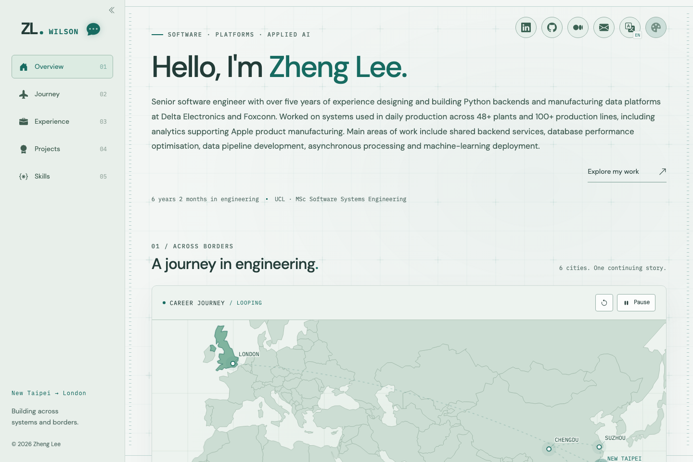](docs/images/overview-desktop.png)

左側導覽連到 Overview、Journey、Experience、Projects、Skills 五個區段，隨捲動標示目前位置，也可收合以增加閱讀空間。首頁呈現個人介紹、累積年資與目前學習方向；右上角保留社群、Email 與 Gear fill 選單。主題與語言已移入選單，帳號及管理項目依登入狀態與權限顯示，登入／登出已整合至齒輪；主題與語言列保留 UI 框架，網站／帳號／角色管理可開啟列表。

The left rail links to five sections, follows the current scroll position, and can collapse to give content more room. The overview presents the profile, engineering tenure and current study direction. Social links and email remain at the upper right beside a Gear fill menu. Theme and language have moved into that menu; account and management entries follow session permissions. Sign in and sign out use the gear menu. Website/account/role management opens administrative lists; the theme and language rows retain their UI framework.

### 2. 旅程地圖 / Interactive Journey

[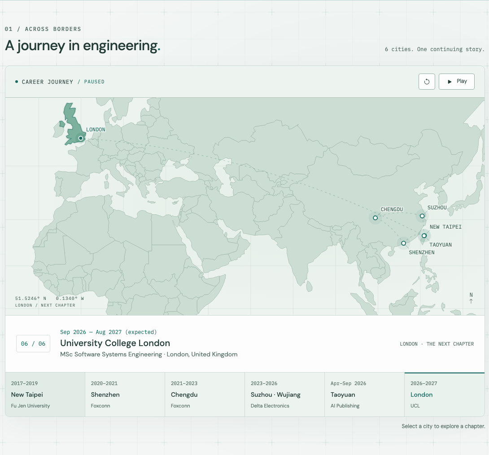](docs/images/journey-map.png)

地圖把學習與工作的城市串成旅程。播放時，飛機沿路徑前進並依序切換章節；可暫停、重播，或直接選擇下方城市。點擊／聚焦地圖上的城市可查看地點介紹，下方摘要同步呈現組織、期間與角色。

The map connects education and work locations. Playback moves a plane along the route and advances through chapters. Visitors can pause, restart or select a destination from the strip. Clicking or focusing a map marker opens its introduction; the summary follows the selected organization, period and role.

### 3. 學經歷 / Education and Work Experience

[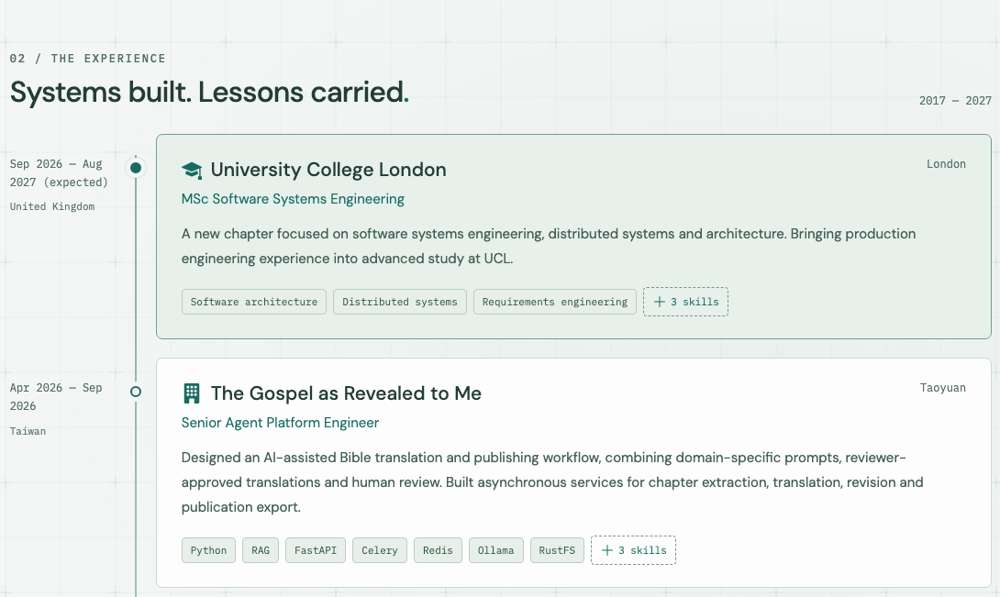](docs/images/experience-cards.png)

左側日期與節點提供時間順序，右側卡片呈現學校／公司、角色、地點、內容與相關技能。上圖裁切出最近兩筆經歷；頁面可繼續往下閱讀。技能標籤共用展開元件，較長清單以「＋N skills」保留入口。

Dates and nodes establish the chronology, while cards show the organization, role, location, description and related skills. This crop focuses on two recent entries; more remain below. Long skill lists use the shared disclosure component and retain a “+N skills” control.

### 4. 專案時間軸與詳情 / Project Timeline and Detail

[](docs/images/project-timeline.png)

專案按開始月份分組，預設突出第一個月份的節點；桌面滑鼠移到其他卡片時，該月份以較大的光暈與 heartbeat 回饋選擇。卡片顯示期間、摘要及技能；有詳細內容時，右上角箭頭會開啟對話框。更多專案透過區段下方的展開入口讀取。

Projects are grouped by their starting month. The first month is emphasized by default; hovering another card on desktop moves the larger halo and heartbeat feedback to its month. Cards show periods, summaries and skills; a corner arrow opens available detail. The section disclosure loads additional projects.

[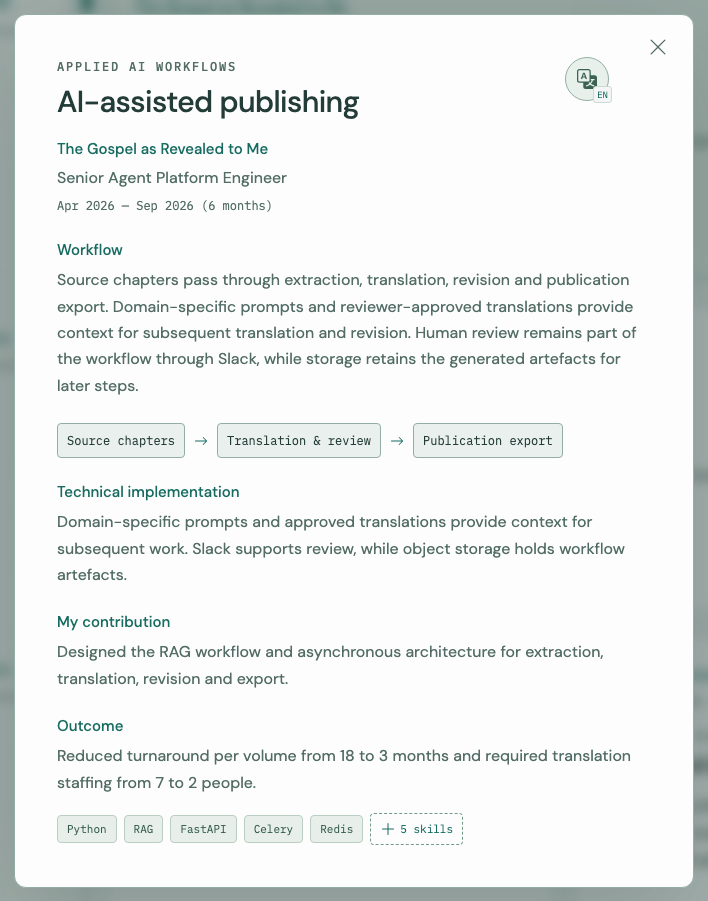](docs/images/project-detail.png)

詳情對話框把工作流程、技術實作、個人貢獻與成果分段呈現，流程步驟以箭頭串接；內容可在框內捲動。關閉或按 Escape 後回到原專案入口，對話框內也保留語言切換。

The scrollable dialog separates workflow, implementation, contribution and outcomes, with connected workflow steps. Closing it or pressing Escape restores the project trigger. A language control remains available inside the dialog.

### 5. 技能分類與展開 / Skills and Disclosure

[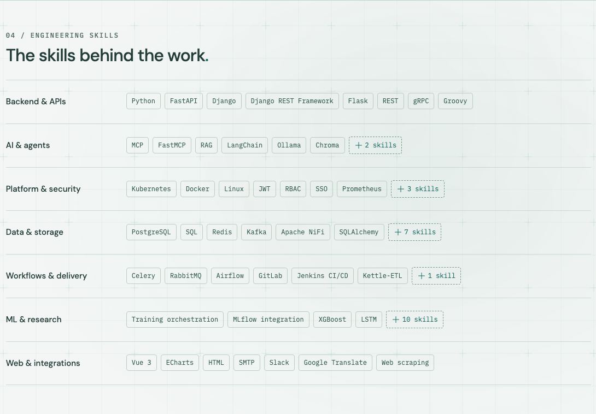](docs/images/skills-toolkit.png)

技能區進入視窗時呈現首批分類；更多分類由展開按鈕讀取。每列依可用寬度安排標籤；需要收合時，以約 75% 的預覽寬度保留「＋N skills」的空間。分類與分類內技能分別使用頁碼 API，畫面仍維持一份連續的技能清單。

The first category page appears when the skills section approaches the viewport; a disclosure control loads further categories. Tags adapt to the available width, with roughly 75% of the row reserved for previews and space for “+N skills.” Category and owner-skill pagination remain separate while the UI presents one continuous toolkit.

### 6. 主題、背景與進場 / Appearance and Entrance

| 淺色 Mist / Light Mist                                                                                                                               | 深色 Mint / Dark Mint                                                                                                                             |
| ---------------------------------------------------------------------------------------------------------------------------------------------------- | ------------------------------------------------------------------------------------------------------------------------------------------------- |
| [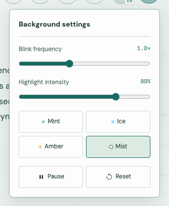](docs/images/appearance-light.png) | [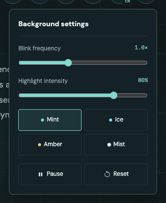](docs/images/appearance-dark.png) |

設定包含 Mint、Ice、Amber、Mist 四種色票，以及背景閃爍頻率、亮度、暫停與重設。主題切換沿用同一份全域外觀狀態；滑鼠光暈與背景訊號也跟隨設定。

The menu provides Mint, Ice, Amber and Mist palettes, background frequency, intensity, pause and reset. Global appearance state also controls the pointer halo and background signals.

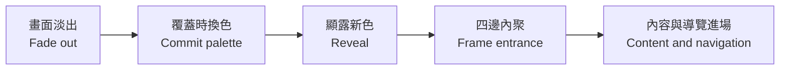

換色採 400ms 覆蓋、400ms 顯露，再重播原有 1400ms 進場序列。四邊先收進，內容與左側導覽依原本節奏淡入；手機則播放固定 header 的進場。連續選色合併到最後一次，保留資料、焦點與捲動位置。啟用 Reduced Motion 時直接套色。

A 400ms cover and 400ms reveal precede the shared 1400ms entrance. The frame settles first, followed by content and the rail; mobile uses its fixed header. Rapid choices coalesce, preserving data, focus and scroll. Reduced Motion applies the palette immediately.

### 7. 三語與聯絡介紹 / Languages and Contact

[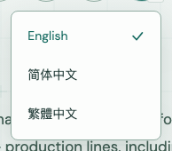](docs/images/language-menu.png)

語言選單提供英文、簡體中文與繁體中文，切換 UI 及 API 內容，並更新對應 URL。語言更新成功前保留原內容；失敗時仍可繼續閱讀。

The menu switches both UI copy and API content across English, Simplified Chinese and Traditional Chinese, updating the locale URL. Existing content stays visible until the new language is ready and remains usable if preparation fails.

[](docs/images/contact-introduction.png)

品牌旁的 chat 圖示開啟聯絡介紹，使用像素包邊、吉祥物與 Email 入口。首次進場可自動介紹，完整閒置約 3 秒後淡出；滑鼠停在框內或以鍵盤閱讀時延後關閉。這是履歷聯絡入口，沒有即時聊天室服務。

The brand's chat icon opens an introduction with a stepped frame, mascot and email action. Startup may offer it automatically, then fade after about three idle seconds. Hover or keyboard engagement extends reading time. It is a CV contact entry, with no real-time chat service.

### 8. 平板與手機 / Tablet and Mobile

[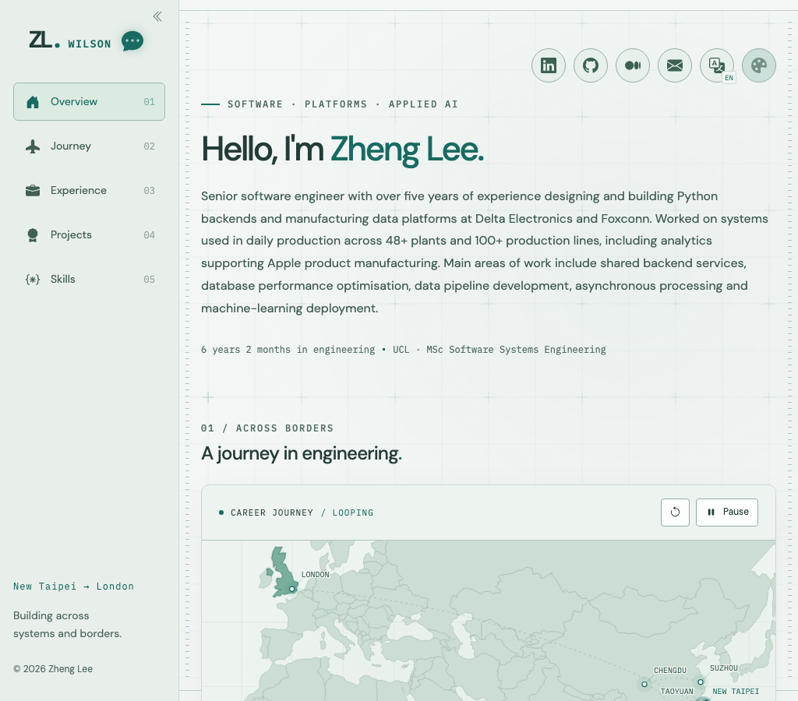](docs/images/overview-tablet.png)

平板保留側邊導覽，內容與工具列依寬度重新配置；760px（含）以下改用手機固定 header 與抽屜導覽。下面以 390px 畫面示範首頁與選單展開狀態。

Tablet keeps the rail while content and controls adapt to the width. At 760px and below, a fixed mobile header and navigation drawer replace it. The 390px screenshots below show the overview and open drawer.

| 手機首頁 / Mobile Overview                                                                                                                                                                                    | 手機導覽 / Navigation Drawer                                                                                                                                                     |
| ------------------------------------------------------------------------------------------------------------------------------------------------------------------------------------------------------------- | -------------------------------------------------------------------------------------------------------------------------------------------------------------------------------- |
| [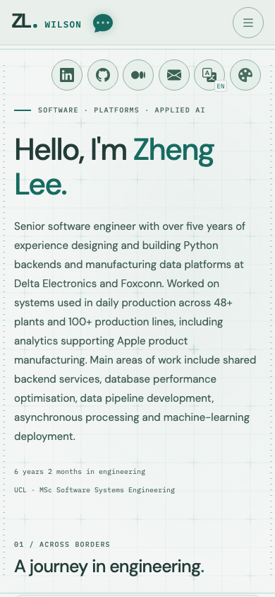](docs/images/overview-mobile.png) | [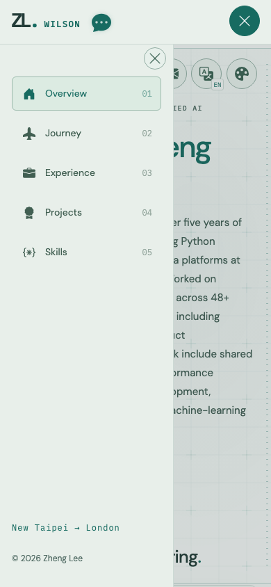](docs/images/navigation-mobile.png) |

完整元件介面、資料防呆、共用模組與 RWD 規格見[前端 README](frontend/README.md)，環境與啟動方式見下方[安裝步驟](#從乾淨-checkout-安裝--install-from-a-fresh-checkout)。

See the [frontend README](frontend/README.md) for component contracts, fault handling, shared modules and responsive specifications, and the [installation guide](#從乾淨-checkout-安裝--install-from-a-fresh-checkout) below for setup.

### 9. 登入介面與草地牛 / Account Forms and Cow Workspace

| 登入 / Sign In                                                                                                                                                                                                                  | 註冊 / Registration                                                                                                                                                                                                                     |
| ------------------------------------------------------------------------------------------------------------------------------------------------------------------------------------------------------------------------------- | --------------------------------------------------------------------------------------------------------------------------------------------------------------------------------------------------------------------------------------- |
| [](docs/images/auth-login-desktop.png) | [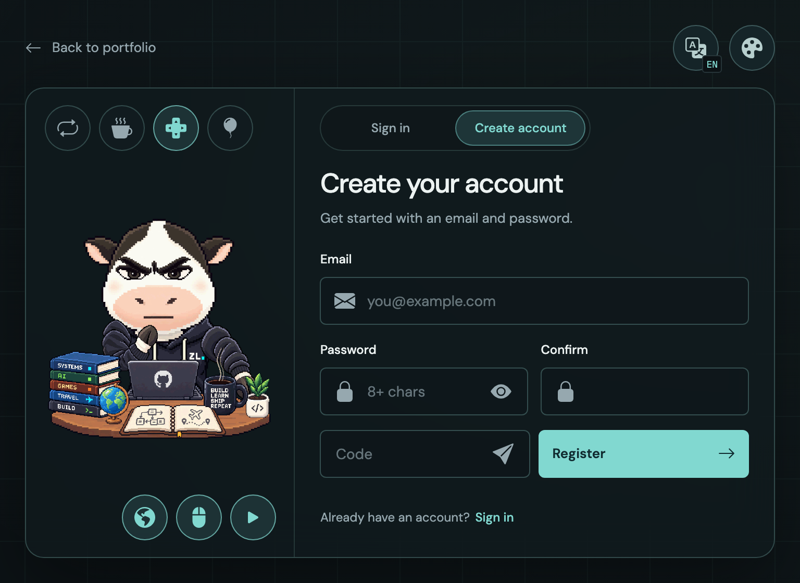](docs/images/auth-register-desktop.png) |

右上角齒輪選單的 Sign in 進入目前語系的 `?view=login`：導覽收合、作品集淡出，左右邊框對撞再展開登入框。介面提供信箱與密碼登入、註冊及忘記密碼；註冊包含驗證碼欄位與發送入口，密碼使用圖示切換顯示。各模式共用相同框體尺寸，手機與窄平板將牛場景放到表單上方；語言、主題、返回作品集及瀏覽器上一頁／下一頁保持可用。

The door icon opens `?view=login` on the current locale route. Navigation retracts, the portfolio fades, and the side rails collide before revealing the account card. Email/password sign-in, registration and password recovery share one card size. Registration includes a verification-code field and send action; an icon toggles password visibility. Narrow layouts place the cow above the form. Language, appearance, portfolio return and browser history remain available.

登入／註冊切換列支援點擊、鍵盤及滑鼠／觸控水平拖曳，放開後依中點吸附；未跨中點或取消時保留目前表單內容。切換採動態島式收合與展開：舊內容縮小、模糊並淡出，新內容短距離滑入、展開及輕微回彈。卡片上下各留 16px，牛控制鈕與切換列均為 44px 高，上下邊緣對齊。註冊的確認欄精簡為 Confirm，密碼不一致時以紅色 Mismatch 提醒。

The sign-in/registration switch supports clicks, keyboard activation and horizontal mouse/touch dragging, snapping at the midpoint on release. Short or cancelled drags retain the current form values. Dynamic Island-style switching shrinks, blurs and fades the old content, then brings the new content a short distance into view with expansion and a gentle rebound. The card has equal 16px top/bottom insets; 44px cow controls align with the switch edges. Registration uses a concise Confirm label and a red Mismatch warning for differing passwords.

[](docs/images/auth-cow-workspace.png)

草地牛沿用分層 SVG 與 2.5D 視差，預設以「思考 → 敲代碼 → 看你 → 敲代碼」循環，每個表情停留三秒。場景按鈕可選表情、暫停地球、停止滑鼠跟動、暫停草葉，以及以單一按鈕切換播放／暫停；按鈕共用三語像素提示氣泡。滑鼠在整個頁面依輸入區中心控制視差，動態遵守減少動態效果、全域暫停與可見性設定。原本準備素材的獨立預覽頁已移除，向量原稿與重建、比對工具保留；詳見[牛場景文件](frontend/src/shared/ui/cow-workspace/README.md)。

The layered SVG cow uses 2.5D parallax and cycles through thinking, typing, watching and typing, holding each expression for three seconds. Controls select expressions, pause globe rotation, disable mouse tracking, pause leaves and toggle playback with one button. They share localized pixel tooltips. Tracking covers the page around the input region, and motion respects accessibility, global pause and visibility preferences. The preparation preview page has been removed; vector sources and rebuild/parity tools remain in the [cow workspace guide](frontend/src/shared/ui/cow-workspace/README.md).

登入收到 `INVALID_CREDENTIALS` 時，牛暫時換成 Access denied 頁面共用的憤怒眼神、注視瞳孔與舉牌姿勢，保留原桌面及托腮動作。修改信箱或密碼後恢復原牛，沿用所選表情、動態偏好及同一場景時鐘；僅聚焦欄位不會恢復。網路與服務錯誤維持原本提示，不觸發拒絕表情。

An `INVALID_CREDENTIALS` sign-in response temporarily shows the shared Access denied cow with angry eyes, tracking pupils and a raised sign, retaining the desk and chin rub. Editing email or password restores the original cow with the selected expression, motion preferences and scene clock intact; focusing a field alone keeps the denied pose. Network and service failures retain their existing feedback without changing the cow.

[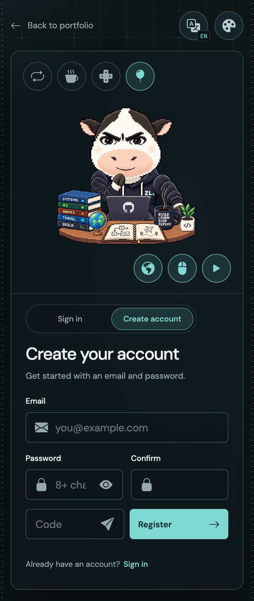](docs/images/auth-mobile.png)

390px 手機版將牛場景、控制列及表單改為上下排列，目前保留全部八個場景按鈕，包含新增草葉開關；短視窗可捲動整張卡片，水平拖曳切換不影響垂直捲動。

At 390px, the cow, controls and form stack vertically with all eight scene buttons, including the leaf toggle. Short viewports scroll the whole card, and horizontal switching preserves vertical touch scrolling.

登入、登出、註冊、email 查重與驗證碼流程已串接 Auth API；登入狀態由伺服器 SESSION 保存，登出時清除。SMTP 目前保留發送框架，以測試碼 `123` 完成 Redis 驗證流程，驗證碼有效 5 分鐘。實際寄信與密碼復原功能仍待後續實作。

Sign-in, sign-out, registration, email availability and verification codes use the Auth APIs. Server sessions retain account identity and are cleared on sign-out. SMTP currently provides a delivery stub with test code `123`, verified through Redis with a five-minute expiry. Actual email delivery and password recovery remain pending.

## 目前進度 / Current status

- 六支公開 Portfolio API 支援預設首頁及各帳號作品集。只有 Site API 以 `user` 查找公開帳號，回傳 `site_id`；其餘內容 API 使用 `site_id`，未帶入時讀取已發布的 default 作品集。資料與快取依 `site_id` 隔離，每個帳號最多一個作品集，草稿不可公開或設為首頁。
- 登入、登出、註冊、SESSION 與成功登入紀錄已接上 PostgreSQL／Redis；角色包含 CRUD 及 `is_manage_roles`、`is_manage_users`、`is_manage_sites`。
- 公開頁面採動態 SSR，保留 `/`、`/en`、`/zh-Hans`、`/zh-Hant`，支援 `/:locale/:user` 與 `/:locale?site_id=1`。區塊、後續分頁與地圖等資源按需載入。
- Dashboard、內容編輯介面與 CRUD／發布 API 留在後續階段；目前只有可重用的權限及發布交易 module。

Public APIs, per-site ownership/cache isolation, account sessions and login records are implemented. The Site API resolves a public `user` and returns `site_id`; content APIs use that ID or the published default when it is omitted. Dynamic SSR serves default and individual portfolio URLs with bounded initial content and demand loading. Dashboard and content editing remain a later phase; shared authorization and publication transactions are ready for those views.

## 技術選擇 / Technology choices

| 項目 / Tool                                          | 用途                                                                     | Purpose                                                                                    |
| ---------------------------------------------------- | ------------------------------------------------------------------------ | ------------------------------------------------------------------------------------------ |
| Python                                               | 目前宣告支援 Python 3.13 以上                                            | Currently declares Python 3.13 or later                                                    |
| uv                                                   | Python 專案、依賴、虛擬環境與鎖定檔管理                                  | Python project, dependency, environment, and lockfile management                           |
| FastAPI                                              | API 框架                                                                 | API framework                                                                              |
| Uvicorn                                              | ASGI 伺服器，採用 `uvicorn[standard]`                                    | ASGI server with the `standard` extras                                                     |
| Pydantic                                             | 請求與回應資料驗證                                                       | Request and response validation                                                            |
| pydantic-settings                                    | 環境設定讀取與驗證                                                       | Environment configuration loading and validation                                           |
| SQLAlchemy                                           | ORM 與資料庫操作，包含 asyncio 額外依賴                                  | ORM and database operations with asyncio extras                                            |
| Alembic                                              | 資料庫結構版本管理                                                       | Database schema migrations                                                                 |
| redis、fastapi-cache2                                | Redis client 與 WEB cache；GET API 可透過 `is_caching=true` 使用回應快取 | Redis clients and WEB cache; GET APIs can opt into response caching with `is_caching=true` |
| fastapi-utils                                        | CBV 路由寫法                                                             | Class-based view routing                                                                   |
| python-socketio                                      | Socket.IO ASGI 組裝                                                      | Socket.IO ASGI assembly                                                                    |
| HTTPX                                                | HTTP client 設定，執行依賴                                               | HTTP client configuration; runtime dependency                                              |
| Black                                                | Python 排版，開發依賴                                                    | Python formatter; development dependency                                                   |
| Docker                                               | 按需啟動外部服務、容器驗證或部署                                         | On-demand external services, container validation, or deployment                           |
| React Router Framework Mode、React、TypeScript、Vite | 已初始化的前端路由、畫面與建置                                           | Initialized frontend routing, UI, and build tools                                          |
| Bootstrap、React-Bootstrap、Bootstrap Icons          | 樣式、React 元件與 SVG 圖示                                              | Styles, React components, and SVG icons                                                    |

具體依賴宣告見 [backend/pyproject.toml](backend/pyproject.toml)，解析後版本以 `backend/uv.lock` 為準；前端依賴見 [frontend/package.json](frontend/package.json) 與 `frontend/package-lock.json`。

Dependency declarations are in [backend/pyproject.toml](backend/pyproject.toml); resolved versions are recorded in `backend/uv.lock`. Frontend dependencies are recorded in [frontend/package.json](frontend/package.json) and `frontend/package-lock.json`.

目前的 `ConnectionManager` 支援單一非同步 SQLite 或 PostgreSQL engine，並提供每次操作新建的 `AsyncSession`。`asyncpg` 與 `aiosqlite` 都是正式依賴。`SYSTEM/models/` 定義 ORM 模型，Alembic 使用其 metadata；安裝 Python 用戶端套件不代表已安裝或啟動資料庫、Redis 服務。

`ConnectionManager` supports one async SQLite or PostgreSQL engine and returns a fresh `AsyncSession` for each operation. Both `asyncpg` and `aiosqlite` are runtime dependencies. `SYSTEM/models/` defines the ORM models whose metadata Alembic uses. Installing Python clients does not install or start database or Redis services.

## 輕量化原則 / Lightweight development principles

- 日常在 macOS 以 uv 虛擬環境直接開發 FastAPI，Docker 按需啟動。
- WEB cache 由 Redis 提供；讀取 API 透過 `is_caching` 選擇是否使用短時間回應快取。
- 初期採單一後端服務，避免預先拆分微服務或引入多套排程、訊息佇列系統。
- 目前啟動入口維持單一 worker；依實測負載調整資料庫連線池與快取上限，多 worker 擴充須先改造啟動入口。
- 開發工具與正式執行依賴分開管理。
- 共用能力按實際重用需求抽取，避免為簡單功能建立過多抽象層。

- Develop FastAPI directly on macOS in a uv virtual environment; start Docker only when needed.
- Redis provides WEB cache; read APIs use `is_caching` to opt into short-lived response caching.
- Start with one backend service, without prematurely introducing microservices, multiple schedulers, or message queues.
- Keep the current entry point on one worker; tune connection pools and cache limits using measured workloads. Multiple workers require an entry-point change first.
- Manage development tools separately from runtime dependencies.
- Extract shared functionality when reuse is justified; keep simple features free of unnecessary abstraction.

## 專案架構 / Project architecture

以下顯示目前主要的程式模組與前端模組。後端實作細節見[後端 README](backend/README.md)，前端的目錄、責任與開發規範見[前端 README](frontend/README.md)。

The tree shows current backend modules and frontend modules. See the [backend README](backend/README.md) for implementation details and the [frontend README](frontend/README.md) for the layout, responsibilities, and development standards.

```text
portfolio-modern/
├── README.md
├── docs/images/                  # Website screenshots and focused feature crops
├── frontend/
│   ├── README.md                 # Frontend architecture and development guide
│   ├── src/
│   │   ├── root.tsx / routes.ts   # Document shell and route declarations
│   │   ├── app/                  # Providers and shared QueryClient assembly
│   │   ├── routes/               # URL entry, dynamic SSR loaders and SEO
│   │   ├── pages/               # Portfolio, management and access-denied composition
│   │   ├── features/            # Site, journey, experiences, projects, skills,
│   │   │                        # appearance, language, online visitors, auth, account menu and management
│   │   ├── shared/              # Reusable API infrastructure, UI and utilities
│   │   ├── i18n/                # Locale setup, dictionaries and copy helpers
│   │   ├── styles/              # Design tokens and global styles
│   │   └── assets/              # Imported fonts, map and illustrations
│   ├── public/                  # Unprocessed favicon and license files
│   ├── scripts/                 # Accepted builds, artifact checks and preview
│   ├── deploy/                  # Generic Nginx configuration example
│   ├── .env.example             # Public environment template
│   ├── package.json / package-lock.json
│   └── react-router.config.ts / vite.config.ts / tsconfig.json
└── backend/
    ├── APPs/
    │   ├── Portfolio/            # Six public content GET APIs
    │   │   ├── views_portfolio.py
    │   │   ├── module/
    │   │   └── schema/
    │   └── Sys/                  # Online-count diagnostic API
    ├── COMMON/
    │   ├── decorator/
    │   ├── schema/               # Shared help, parsers, responses
    │   └── tools/storage/        # Redis and SQLAlchemy helpers
    ├── SYSTEM/
    │   ├── config.yaml           # Published development defaults; replace production secrets
    │   ├── settings.py
    │   ├── lifespan.py
    │   ├── database/             # Async DB and Redis connection manager
    │   ├── models/               # Portfolio, auth, Alembic migrations
    │   ├── middleware/
    │   ├── static/               # Local Swagger/ReDoc assets
    │   └── tools/                # Router, docs, Socket.IO assembly
    ├── manage_fastapi.py
    ├── alembic.ini
    ├── pyproject.toml
    └── uv.lock
```

- `APPs`：按 Portfolio 與 Sys 模組組織 API。`views` 定義 CBV 路由，`schema` 解析參數及驗證回應，`module` 執行業務查詢。
- `COMMON`：跨模組共用的裝飾器、例外、資料格式與工具。
- `SYSTEM`：系統設定、路由定義、生命週期、資料庫基礎設施與 middleware。
- `SYSTEM/models`：作品集與帳號的 ORM 模型，以及 Alembic migration；資料表需手動遷移。
- `manage_fastapi.py`：目前的 FastAPI、文件與 Socket.IO 組裝及啟動入口。

- `APPs`: Portfolio and Sys APIs. `views` declares CBV routes, `schema` parses parameters and validates responses, and `module` runs business queries.
- `COMMON`: Decorators, exceptions, schemas, and utilities shared across modules.
- `SYSTEM`: Configuration, route definitions, lifecycle management, database infrastructure, and middleware.
- `SYSTEM/models`: Portfolio and account ORM models and Alembic migrations; apply migrations manually.
- `manage_fastapi.py`: The current FastAPI, docs, and Socket.IO assembly and startup entry point.

`backend/SYSTEM/config.yaml` 提供可提交的開發預設配置；`backend/SYSTEM/settings.py` 負責整理設定。正式環境須使用私有配置替換 `SECURITY.secret_key` 與服務連線值，實際機密不回寫公開儲存庫。前端共用模組的介面與範例見[共用模組 SPEC](frontend/src/shared/README.md)，後端啟動與各工具規格見[後端 README](backend/README.md)。

`backend/SYSTEM/config.yaml` contains published development defaults, organized by `backend/SYSTEM/settings.py`. Production replaces the signing key and connection values through a private configuration file without committing secrets. See the [shared module specification](frontend/src/shared/README.md) for frontend interfaces and examples, and the [backend README](backend/README.md) for startup and backend tools.

### 前端分層與目錄責任 / Frontend Layers and Responsibilities

`feature` 就是一個前端功能模組，例如專案、技能或外觀設定。同一功能的 API、驗證、狀態與 UI 放在一起；跨功能共用的能力才抽到 `shared/`。這讓功能修改集中在自己的模組，也保留與後端業務模組相近的閱讀方式。

A feature is a frontend module such as projects, skills or appearance. Keep its requests, validation, state and UI together; extract capabilities into `shared/` when they serve multiple features. A feature change stays close to its own business logic, following a structure familiar from backend modules.

| 目錄 / Directory                | 責任與使用方式 / Responsibility and Usage                                                                                                                                                                             |
| ------------------------------- | --------------------------------------------------------------------------------------------------------------------------------------------------------------------------------------------------------------------- |
| `src/root.tsx`、`src/routes.ts` | 全站文件、CSS 入口與路由宣告。 / Document shell, stylesheet entry and route declarations.                                                                                                                             |
| `src/app/`                      | 組裝 QueryClient 與外觀等 providers，提供全站狀態入口。 / Assemble the QueryClient and application providers.                                                                                                         |
| `src/routes/`                   | 解析 URL 語言／user、動態 SSR loader 與 metadata；交給 page 呈現。 / Handle locale/user URLs, dynamic SSR loaders and metadata, then render a page.                                                                   |
| `src/pages/portfolio/`          | 組合五個區段、導覽、背景與進場動畫，協調切語言、主題及聯絡面板。 / Compose sections, navigation, background and entrance; coordinate page interactions.                                                               |
| `src/features/`                 | 擁有功能專用 API、schema、model、hooks、components 與公開匯出。 / Own feature-specific requests, schemas, models, hooks, components and exports.                                                                      |
| `src/shared/`                   | 共用 HTTP、防呆、分頁、對話框焦點、標籤、狀態提示及工具；介面見[共用 SPEC](frontend/src/shared/README.md)。 / Reuse HTTP, validation, pagination, focus, tags, status UI and utilities through documented interfaces. |
| `src/i18n/`                     | 三語 UI 字典、語系設定與格式化文案；個人介紹等業務內容由 API 提供。 / Store UI dictionaries and locale helpers; profile content comes from the API.                                                                   |
| `src/styles/`、`src/assets/`    | 統一設計 token／全域 CSS，以及由 bundler 處理的字型、地圖與插圖。 / Own design tokens, global CSS and bundled visual assets.                                                                                          |
| `public/`                       | 直接複製進產物的 favicon 與授權檔；元件樣式放元件旁的 CSS Module。 / Copy static public files; keep component CSS Modules beside their components.                                                                    |
| `scripts/`、`deploy/`           | 建置工具與部署範例。 / Maintain build tooling and deployment examples.                                                                                                                                                |

功能模組的典型結構如下；只建立實際使用到的層，外觀或語言這類沒有 API 的模組不必建立空 `api/`。`schemas/` 是前端回應驗證與型別，`model/` 放純資料轉換與業務規則，`hooks/` 管理 React 狀態、副作用與查詢。

Create only the layers a feature uses. Appearance and language do not need empty API directories. Schemas validate responses and define types; models contain pure transformations and rules; hooks manage React state, effects and queries.

```text
features/<feature>/
├── api/          # Feature endpoints; reuse shared HTTP and pagination
├── schemas/      # Response validation and inferred types
├── model/        # Pure transformations and feature rules
├── hooks/        # Queries, state and lifecycle orchestration
├── components/   # Feature UI and colocated CSS Modules
└── index.ts      # Public feature exports
```

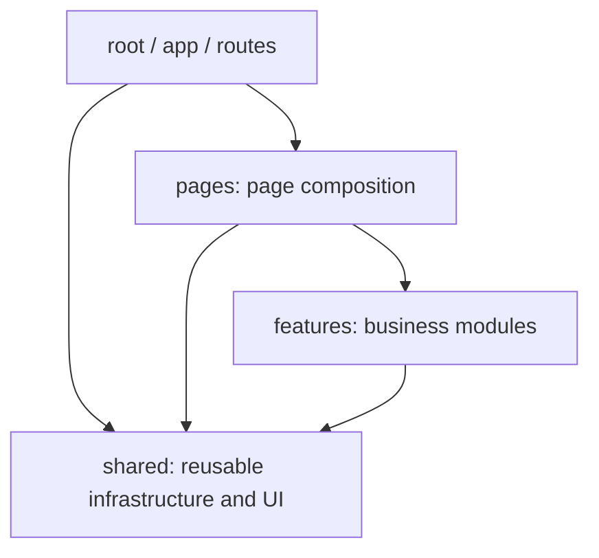

API 不全部塞進共用資料夾：`features/projects/api/` 擁有專案端點，`shared/api/` 處理 HTTP、timeout、取消、錯誤與共用分頁機制。feature 透過 `index.ts` 提供對外介面；多功能協作交給 page，`shared` 不反向依賴 feature。新增方法或元件前先查現有共用介面；可重用的能力集中維護，函式／hooks／CSS 註解說明目的、契約與生命週期，元件及 page 的中英文 SPEC 更新於[前端 README](frontend/README.md)。

Feature API directories own endpoint semantics; `shared/api/` handles transport, timeouts, cancellation, errors and pagination infrastructure. Export feature interfaces through `index.ts`, coordinate features at page level, and keep shared code independent of features. Check existing interfaces before adding helpers. Document function, hook and CSS responsibilities, and update component/page specifications in the frontend guide in both languages.

前端共用 hydration、帳號／登出回饋、拒絕轉址、背景、牛控制與載入指示器已有單一實作；管理頁拆分版面、表格 controller 與欄位／URL 模型。ESLint 自動納入實際 feature 目錄，阻擋反向依賴、自我匯入與循環，帳號選單只透過 auth 輕量公開入口取得身份／權限。`npm run check:docs` 檢查共用 README 是否列出公開契約，三語 key 與組合文案在維護時檢查；詳見[架構整合說明](frontend/README.md#架構檢查與整合--architecture-review-and-consolidation)。

Hydration, account feedback, denied routing, backgrounds, cow controls and loading indicators have shared implementations. Management layout, interaction and URL/column models are separated. ESLint discovers features and rejects reverse dependencies, self imports and cycles; the account menu uses only auth's lightweight public contracts. Shared documentation is checked automatically; review locale contracts when updating translations; see the [architecture review](frontend/README.md#架構檢查與整合--architecture-review-and-consolidation).

## API 範圍 / API scope

後端已提供以下六支公開讀取 API，另有系統診斷及網站／帳號／角色三支管理列表 API：

The backend exposes six public read APIs, a system diagnostic API, and management lists for sites, accounts, and roles:

| 路徑 / Endpoint                        | 內容                                                      | Content                                                                  |
| -------------------------------------- | --------------------------------------------------------- | ------------------------------------------------------------------------ |
| `GET /portfolio/site`                  | 品牌、個人介紹、社群與聯絡入口                            | Brand, profile, social links, and contact entry                          |
| `GET /portfolio/journey`               | 完整旅程與地圖資料                                        | Complete journey and map data                                            |
| `GET /portfolio/experiences`           | 學經歷與技能，每頁 6 筆                                   | Education/work experience and skills, six per page                       |
| `GET /portfolio/projects`              | 專案、完整詳情與技能，每頁 6 筆                           | Projects with full details and skills, six per page                      |
| `GET /portfolio/skill-categories`      | 技能分類頁碼分頁；每類包含最多 6 個技能的內層 skills 分頁 | Numbered categories with nested skill preview pages                      |
| `GET /portfolio/skills`                | 指定分類下的技能頁碼分頁                                  | Numbered skills in one category                                          |
| `GET /system/heartbeat`                | 依近期心跳估算目前在線人數                                | Estimated online count from recent heartbeats                            |
| `GET /management/roles`                | 角色列表、關聯帳號數、搜尋、篩選與多欄位排序              | Paginated roles with account counts, search, filters and ordered sorting |
| `GET /management/users`                | 一人一列的帳號、角色狀態與成功登入統計                    | One account per row with role state and successful-login statistics      |
| `GET /management/sites`                | 一人一列的網站設定及目前管理語言內容                      | One person per row with portfolio settings and selected-language content |
| `PATCH /management/sites/{account_id}` | 部分更新既有網站與指定語言內容，包含原子 Default 切換     | Partial platform updates with atomic default-homepage replacement        |

Portfolio API 以 `locale=en` 為預設，另支援 `zh-Hans`、`zh-Hant`；六支 GET 均可透過 `is_caching=true` 啟用短時間回應快取。三支管理列表沿用 `{items,total,pages,page,size}`，Platform／User 每人一列，Role 每角色一列；每頁預設 6 筆，可調整為 1–100 筆。Platform 搜尋和內容使用目前管理語言；管理讀取、預覽及 Platform PATCH 已套用共用權限 dependency。Platform PATCH 排除 PK／FK 與登入身分，表格 Active／Default 已即時保存，完整細節 Save 尚未串接；其他管理寫入、Portfolio 寫入與上傳功能尚未實作。參數與回應格式見[後端 README](backend/README.md)。

Portfolio APIs default to `locale=en` and also support `zh-Hans` and `zh-Hant`. All six GETs can opt into short-lived response caching with `is_caching=true`. Management lists share the numbered envelope, with one person per Platform/User row and one role per Role row; the default size of 6 is adjustable from 1 to 100. Platform search and content use the current management language. Management reads, previews and Platform PATCH use the shared permission dependency. Platform PATCH preserves keys and login identity; table Active/Default switches save immediately; full-detail Save is not wired yet. Other management writes, Portfolio writes and uploads remain unimplemented. See the [backend README](backend/README.md) for parameters and response shapes.

## 從乾淨 checkout 安裝 / Install from a Fresh Checkout

先安裝 Git、[uv](https://docs.astral.sh/uv/getting-started/installation/)、[Node.js 24](https://nodejs.org/en/download) 與 Redis。Python 基線為 3.13（`.python-version`），前端基線為 Node.js 24.21.0／npm 11.19.0（`frontend/.node-version`、`packageManager`）；Python 套件與 npm 套件分別由鎖定檔重建。SQLite driver 隨 Python 依賴安裝，使用預設 SQLite 不需要另啟資料庫服務；Redis 則須獨立啟動。

Install Git, uv, Node.js 24 and Redis first. The repository pins Python 3.13 and the frontend baseline of Node.js 24.21.0/npm 11.19.0. Lockfiles reproduce package dependencies. The default SQLite backend needs no separate database service, while Redis must run independently.

```bash
git clone https://github.com/zhenglee315/portfolio-modern.git
cd portfolio-modern
```

接著依序完成後端服務與資料初始化，再在另一個終端機啟動前端。完整後端說明見[後端安裝步驟](backend/README.md)，前端環境與部署說明見[前端安裝步驟](frontend/README.md#開發與驗證--development-and-verification)。

Initialize backend services and data first, then run the frontend in a separate terminal. The linked guides explain configuration, data import and deployment in detail.

## 後端本機開發 / Local backend development

在專案根目錄執行：

Run from the repository root:

```bash
cd backend
uv python install 3.13
uv sync --locked
```

`uv sync --locked` 依既有鎖定檔建立 `.venv` 與依賴，預設包含開發依賴；若 manifest 與 lock 不一致會停止，避免安裝時默默改版。

`uv sync --locked` creates `.venv` from the committed lockfile, including development dependencies, and fails if the manifest and lock disagree.

新增正式依賴與開發依賴的方式：

To add runtime or development dependencies, replace the placeholders below with package names:

```bash
uv add <package-name>
uv add --dev <development-tool-name>
```

以上 `<package-name>` 與 `<development-tool-name>` 為佔位符，執行前請替換為實際套件名稱。

在 VS Code 選擇 `backend/.venv/bin/python` 作為 Python interpreter；終端機也可手動啟用環境：

Select `backend/.venv/bin/python` as the Python interpreter in VS Code. You can also activate the environment manually in a terminal:

```bash
# 於 backend 目錄執行 / Run inside backend
source .venv/bin/activate
python -c "import sys; print(sys.executable)"
```

不手動啟用環境時，可使用 `uv run` 執行專案指令。例如檢查 Python 排版：

Use `uv run` to execute project commands without manually activating the environment. For example, check Python formatting:

```bash
uv run black --check --skip-string-normalization .
```

多用戶版本請將 `SYSTEM/config.yaml` 設為 PostgreSQL 並先建立資料庫；底層 SQLite 支援保留供工具及隔離測試。API 使用 8080，本機 Redis 使用 6379。先依 [Redis 安裝文件](https://redis.io/docs/latest/operate/oss_and_stack/install/install-stack/homebrew/)啟動 Redis；macOS 已安裝 Homebrew 時可執行：

Configure PostgreSQL and create the database before running multi-user migrations. SQLite remains supported by the storage tools and isolated tests. The local API uses 8080 and Redis uses 6379. Start Redis first; on macOS with Homebrew:

```bash
brew install redis
brew services start redis
redis-cli ping
# Expected: PONG
```

在 `backend/` 執行 migration，再啟動 API：

Apply migrations from `backend/`, then start the API:

```bash
# Run inside backend/
uv run --locked alembic upgrade head
uv run --locked manage_fastapi.py
```

新資料庫沒有作品集內容，後端可先以空資料啟動。SSR 請求需要已發布且有對應語言的 Site 內容；建置不讀取作品集。請建立自己的作品集內容。文件位於 `http://127.0.0.1:8080/swagger`。目前 `uv run backend` 是 uv 範例，不是 API 啟動入口。

A new database has no portfolio content; empty-data backend development is supported. SSR requests need a published Site translation, while builds do not fetch portfolio data. Create your own portfolio content. API documentation is at `http://127.0.0.1:8080/swagger`. The `backend` console script remains an example; use `manage_fastapi.py` to start the API.

`SECURITY.secret_key` 是明確標示的開發佔位值，正式環境必須更換為隨機私密金鑰。設定在 Python 匯入時讀取，修改後需重啟；目前沒有自動環境變數覆寫 YAML 的機制，部署時應掛載私有 `SYSTEM/config.yaml`。詳細欄位與金鑰產生方式見後端 README。

The signing key is a development-only placeholder and must be replaced with a random private value in production. Configuration loads at Python import time, so edits require a restart. YAML currently has no automatic environment override; mount a private `SYSTEM/config.yaml` for deployment.

## 前端本機開發 / Local frontend development

使用 Node.js 24 與 npm，在專案根目錄執行：

Use Node.js 24 and npm. From the repository root:

```bash
cd frontend
npm ci
cp .env.example .env.local
npm run dev
```

首次安裝才複製 `.env.example`，保留已有 `.env.local` 的個人設定。預設 browser proxy 與 SSR server target 都是後端 8080；若更換 API 位址，同時調整兩者。開發頁面位於 `http://127.0.0.1:5173`，支援 `/`、`/en`、`/zh-Hans`、`/zh-Hant` 及 `/:locale/:user`。`npm run check` 執行型別、lint、格式、文件與建置，建置不讀取作品集資料，SSR 執行時需要可用的 API。本機測試工具集中於不提交的 `agent/` 資料夾。

Copy the environment example only on first setup; preserve existing local settings. Both default API targets point to port 8080. Development runs on port 5173 with default and user URLs. Builds do not fetch portfolio content; the SSR runtime requires an available API. Local test tooling stays in the ignored `agent/` directory.

## 前後端正式部署 / Production Deployment

公開 HTML 由 Node.js 動態 SSR 產生，Nginx 提供靜態資產並代理前後端。正式環境需要 Python 3.13／uv、Node.js 24／npm、PostgreSQL、Redis 與 Nginx；API origin 放在伺服器環境設定，不放進瀏覽器 bundle。HTTPS 憑證仍由正式伺服器的私有配置管理。

Node renders public HTML on each request. Nginx serves static assets and proxies the API and document runtime. Production needs Python/uv, Node/npm, PostgreSQL, Redis and Nginx. API origins belong to server environment settings, while TLS certificates remain in server configuration.

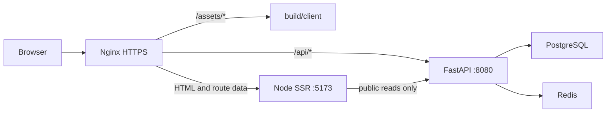

### 資料庫與後端 / Database and Backend

先依 [後端文件](backend/README.md) 配置 PostgreSQL／Redis、建立資料備份，再依序同步依賴及執行 migration。既有單一作品集會保留原 ID／內容，綁定既有帳號並成為已發布首頁。Migration 不會在應用啟動時自動執行。

Configure PostgreSQL and Redis using the backend guide, back up data, then synchronize dependencies and migrate. The existing sole portfolio retains its IDs/content and becomes the published default. Application startup never runs migrations automatically.

```bash
cd backend
uv sync --locked
uv run --locked alembic upgrade head
uv run --locked manage_fastapi.py
```

正式主機以既有 service manager 管理 FastAPI 與 Redis。程式更新後重啟後端；資料庫及私有設定放在發版替換範圍之外。

Use the host service manager for FastAPI and Redis. Restart the API after source updates and retain database/private settings across releases.

### 前端建置與 Node 服務 / Frontend Build and Runtime

```bash
cd frontend
npm ci
npm run check
API_SERVER_TARGET=http://127.0.0.1:8080 API_PROXY_TARGET=http://127.0.0.1:8080 PORT=5173 npm start
```

發布 `build/client` 給 Nginx，`build/server`、`scripts/preview.mjs` 及 Node 執行依賴則供私有 Node 服務使用。`npm start` 與 `npm run preview` 都啟動同一 SSR runtime，預設 5173；本機開發用 `npm run dev`。它們不能同時占用相同 port。正式 Node 服務須由 systemd 等服務管理器維持。

Publish `build/client` to Nginx and retain the server build, runtime script and Node dependencies for the private SSR service. Start and preview use the same runtime on port 5173; development uses `npm run dev`. Run one frontend service per port and supervise production Node with systemd or an equivalent service manager.

Nginx 使用 [部署範例](frontend/deploy/nginx.conf.example)，替換部署主機的 root／upstream。`/api/` 移除 prefix 後交給 FastAPI；HTML 與 route data 交給 Node 並使用 `no-store`，hashed assets 使用 immutable cache，未知資產與用戶保留實際 404。作品集發布狀態及預設首頁變更會在新請求生效，內容更新無需重建前端。

Adapt the Nginx example's root/upstreams. It forwards stripped API paths to FastAPI, renders HTML/data through Node with no-store, and caches hashed assets immutably. Missing assets/users retain real 404s. New requests reflect publication/default changes without rebuilding the frontend.

### 驗證與發布 / Verification and Release

前端執行 `npm run check`，確認型別、lint、格式、文件與正式建置。測試工具與報告只保留於不提交的 `agent/`。正式驗收確認預設／個人三語網址、登入登出、跨作品集隔離、草稿不可見、HTTP 狀態及手機的按需載入。

Run frontend checks for types, lint, formatting, documentation and production builds. Keep local test tooling and reports in the ignored `agent/` directory. Release acceptance covers default/individual locales, account sessions, isolation, draft visibility, real HTTP statuses and mobile demand loading.
