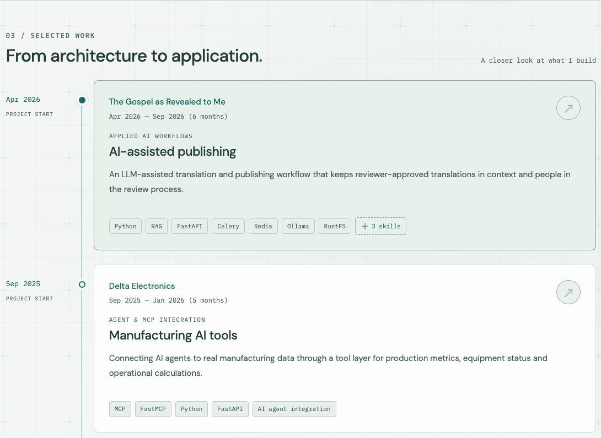
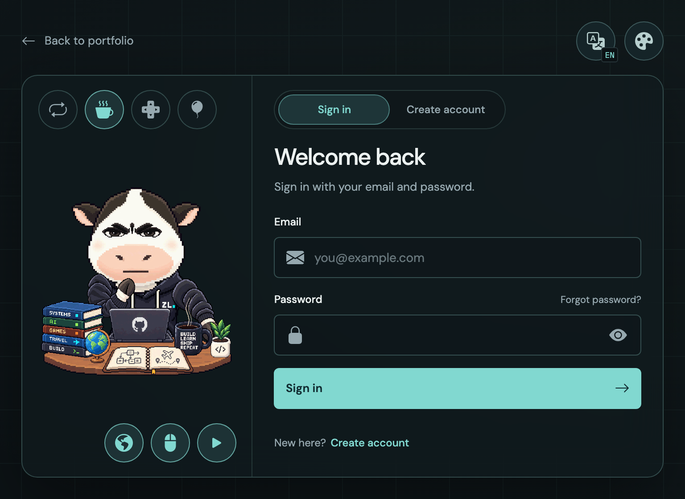

# 前端架構總覽 / Frontend Architecture

本目錄以 React 重構既有 `portfolio-web`，沿用其版型、三語內容與互動規則，並串接本專案的 FastAPI。前端負責呈現、互動與資料取得；後端負責業務資料、驗證、權限與儲存。整體產品方向見[專案 README](../README.md)，API 現況見[後端 README](../backend/README.md)。

This directory implements the React migration of `portfolio-web`, preserving its design, three languages, and interaction rules while integrating with the existing FastAPI backend. The frontend owns presentation, interaction, and data fetching; the backend owns business data, validation, authorization, and persistence.

**目前狀態：React 功能遷移與登入介面已實作。** 十一個 feature 涵蓋公開內容、三語切換、經歷／專案／雙層技能分頁、專案詳情、旅程地圖與播放、四主題設定、聯絡氣泡、在線人數及登入介面。公開內容串接六支 GET API，在線人數於瀏覽器另讀取 heartbeat；登入與註冊已串接後端 SESSION API；註冊暫用驗證碼 123，SMTP 寄信與密碼重設仍待接入。公開首頁與個人網址由 Node 動態 SSR，先解析已發布的 Site，再載入有界首批內容；後續資料與互動按需取得。元件與頁面規格集中在本文件，程式使用英文用途／介面／生命週期註解，樣式責任以 CSS 註解說明。

**Status: React feature migration and account interface implemented.** Nine features cover public content, locale transactions, numbered collections, project detail, journey mapping/playback, appearance preferences, contact introduction, online visitors and account forms. Public content uses six GET endpoints, while the browser separately reads heartbeat. Sign-in and registration use the backend session API. Registration temporarily uses code 123 while SMTP delivery and password reset await integration. The default homepage and owner URLs use dynamic Node SSR, resolving a published Site before reading bounded initial content. Subsequent data and interactions load on demand. Component/page specifications live here; English comments describe code interfaces, lifecycle and style responsibility.

## 網站畫面導覽 / Visual Website Tour

網站的[完整截圖圖解](../README.md#網站圖解--website-tour)位於專案 README，涵蓋首頁、旅程地圖、學經歷、專案時間軸／詳情、技能、主題、語言、聯絡、登入／註冊、草地牛與平板／手機版型。所有正式文件圖片集中在 [`../docs/images/`](../docs/images/README.md)，兩份 README 共用圖片，維持單一來源。

The project README contains the [complete screenshot tour](../README.md#網站圖解--website-tour), covering the overview, map, experience, project timeline/detail, skills, appearance, language, contact, sign-in/registration, the cow workspace, tablet and mobile layouts. Both guides share the documentation assets in [`../docs/images/`](../docs/images/README.md).

[](../README.md#4-專案時間軸與詳情--project-timeline-and-detail)

本文件以下保留架構、安裝與元件規格；圖解介紹操作與畫面，規格說明介面、資料契約及生命週期。

The sections below retain architecture, setup and component specifications. The tour explains the visible experience; the specifications define interfaces, data contracts and lifecycle.

## 工程原則 / Engineering Principles

- **正規化 / Normalization：** 資料契約、設定與設計變數有明確來源；API 資料、UI 狀態與衍生結果分責管理，減少重複定義與同步負擔。
- **模組化 / Modularity：** 先按功能分組，再依責任拆分；每個模組定義公開介面、相依項目與生命週期。
- **標準化 / Standardization：** 統一型別、命名、格式、錯誤處理、測試與建置流程，透過工具檢查可自動驗證的規則。
- **重用性 / Reusability：** 撰寫元件、Hook、函式或 class 前，分析業務相依、狀態、副作用與實際使用情境，再決定共用範圍。
- **輕量化 / Lightweight development：** 依功能需求引入依賴與抽象層；開發工具與正式依賴分開管理，簡單功能保持簡單。

These principles apply to responsibility and behavior as well as directory layout. Reusable abstractions should share meaning and change together, with dependencies and side effects made explicit.

## 技術基線 / Technology Baseline

下列工具已安裝；實際套件版本以 [package.json](package.json) 與 `package-lock.json` 為準。Node.js 以 `.node-version` 記錄版本，`engines` 限定 Node.js 24；npm 版本記錄於 `packageManager`，依賴採精確版本與鎖定檔。

The tools below are installed. The manifest and lockfile record exact dependencies; `.node-version`, `engines`, and `packageManager` document the runtime and package manager baseline.

| 項目 / Tool                                   | 責任 / Responsibility                                                                                                                                 |
| --------------------------------------------- | ----------------------------------------------------------------------------------------------------------------------------------------------------- |
| Node.js 24 LTS                                | 開發工具與建置執行環境 / Development and build runtime                                                                                                |
| npm                                           | 依賴、鎖定檔與專案指令管理 / Dependencies, lockfile, and project scripts                                                                              |
| React                                         | 函式元件、畫面組合與互動 / Function components, composition, and interaction                                                                          |
| TypeScript                                    | API、元件參數與函式介面；啟用 `strict` / Strictly typed API, component, and function interfaces                                                       |
| React Router Framework Mode                   | 路由、資料載入入口、metadata、路由程式碼分割與渲染策略 / Routing, data-loading entry points, metadata, route code splitting, and rendering strategies |
| Vite                                          | 透過 React Router plugin 提供開發與建置 / Development and builds through the React Router plugin                                                      |
| TanStack Query                                | API 資料快取、載入、重試與分頁 / Server data caching, loading, retries, and pagination                                                                |
| Bootstrap、React-Bootstrap                    | Bootstrap 5 樣式與由 React 管理的互動元件 / Bootstrap styles and React-managed components                                                             |
| Bootstrap Icons                               | 按需 import 個別 SVG 圖示 / Individual SVG imports                                                                                                    |
| CSS、CSS Modules                              | 全域 tokens 與逐步隔離的元件樣式 / Global tokens and scoped component styles                                                                          |
| Zod                                           | 外部資料的執行期驗證與型別推導 / Runtime validation and inferred types                                                                                |
| i18next、react-i18next                        | 固定 UI 三語字典與 React Provider / UI dictionaries and React integration                                                                             |
| ESLint、typescript-eslint、import-x、Prettier | 型別語法、Hooks、依賴邊界與一致排版 / Typed syntax, Hooks, import boundaries, and formatting                                                          |
| sirv                                          | Node SSR runtime 的靜態資產服務 / Static assets within the Node SSR runtime                                                                           |

React、Vite 與其他工具安裝為專案依賴。Node.js 與 npm 是本機準備事項；安裝 npm 套件不代表已啟動 FastAPI、資料庫或 Redis。日常可直接在本機開發，Docker 按實際服務或部署需要使用。

Install frontend tools as project dependencies. Node.js and npm are local prerequisites; installing frontend packages does not start backend services. Use Docker when service or deployment requirements call for it.

### 渲染、路由與按需載入 / Rendering, Routing, and On-Demand Loading

React Router Framework Mode 使用動態 SSR（`ssr: true`），由常駐 Node.js 服務產生 HTML；FastAPI 持續負責業務 API、公開狀態與帳號權限。建置只產生 client／server 程式與資產，不在 build 時固定任何人的作品集資料。

React Router Framework Mode uses dynamic SSR through a persistent Node.js service. FastAPI owns content, visibility and account permissions. Builds produce client/server code and assets rather than an owner's content snapshot.

| 公開網址 / Public URL                                              | 內容解析 / Resolution                                                                  |
| ------------------------------------------------------------------ | -------------------------------------------------------------------------------------- |
| `/`、`/en`、`/zh-Hans`、`/zh-Hant`                                 | 後端 `is_default=true` 且已發布的 Site / Published default Site                        |
| `/:locale?site_id=1`，例如 `/en?site_id=1`                         | Query string 指定的已發布 Site；切換語言保留 ID / Published Site selected by ID        |
| `/:locale/:user`，例如 `/en/alex`                                  | 唯一公開 `user` 所屬的已發布 Site / Published Site belonging to a unique public handle |
| 不存在、草稿、停用帳號或不合法的個人網址 / Unavailable owner route | 真正 HTTP 404，不改讀預設資料 / Actual HTTP 404 without a default fallback             |

沿用六支公開 API，以 query string 選擇作品集，沒有重複的 owner path API。只有 Site API 接受 `user`，也可改帶 `site_id`（兩者互斥）；其他五支內容 API 只接受 `site_id`。第一次 Site 查詢用 `user`（省略時解析 default）；Site response 的 `site_id` 固定後續區塊查詢，避免 default 在載入期間切換時混入另一人的內容。`ownerType`／`ownerId` 仍表示技能分類。公開網址的主人與目前登入帳號分開；SESSION 不決定訪客看哪一份作品集。

Only Site accepts the `user` query selector, with optional `site_id` as an alternative. Other content endpoints accept only `site_id`; resolve Site first and pin subsequent section reads to its returned ID. Omitting the selector resolves the published default. Skill `ownerType`/`ownerId` still identify categories. A signed-in account never overrides the public URL's owner.

前端 `/en` 顯示 default；`/en?site_id=1` 直接選擇 ID 為 1 的作品集。SSR、瀏覽器導覽、重新整理與語言切換共用相同 selector；查找失敗不改讀 default。ID 必須是正整數，與 path 中的 `user` 互斥；無效或重複的 ID 參數回 404。Canonical／分享網址及各語言連結保留所選 ID。

The frontend `/en` displays the default; `/en?site_id=1` directly selects Site 1. SSR, browser navigation, reloads and language switches share that selector. Invalid, duplicate or conflicting ID selectors return 404 without a default fallback. Canonical, sharing and language links retain the selected ID.

每次 SSR 建立獨立 QueryClient，解析 Site 後準備經歷、專案與技能分類的第 1 頁（各最多六筆），保留可讀正文與 metadata。Journey index、分類續頁、集合續頁、地圖、帳號表單、詳情與牛場景不全部一起載入。SSR snapshot 複製完成就清除 request cache；不轉交瀏覽器的 SESSION cookie，也不序列化 private auth query。HTML 與 route data 使用 `no-store`，每次請求重新確認公開狀態；hashed assets 可長期快取。未知地址回 404，無法解析公開 API 時回 503。

Each SSR request owns a QueryClient and prepares Site plus the first experience, project and category pages, with at most six records per collection. Journey data, continuation pages and heavy interactions are deferred. The request cache is cleared after dehydration. Public SSR never forwards account cookies or serializes private auth queries. Documents and route data are `no-store`; hashed assets are immutable. Missing routes return 404 and unavailable public content returns 503.

Code Splitting 分開可下載的程式；Lazy Loading 決定下載時機。`useSectionDemand` 在距 viewport 200px 或使用直接 hash 導覽時啟用區塊查詢；fragment 不送到 SSR，瀏覽器負責優先載入目標。JourneyMap 在接近時載入，在真正離開 viewport、背景頁籤、帳號畫面或停止動畫政策下暫停。未讀頁數不自動耗盡；技能分類以「顯示更多分類」逐頁讀取。穩定 section anchor 保留最小空間，避免空白載入區消失。

Code splitting separates downloads; lazy loading selects when they happen. Sections activate within 200px of the viewport or through fragment navigation. Browsers prioritize fragments because hashes are absent from SSR requests. The map pauses offscreen, in hidden tabs and while the account surface owns the screen. Continuation pages require demand; category continuation has an explicit control. Stable anchors retain minimum space before data arrives.

Query identity 包含 selector／已解析 Site、locale、resource、分類與頁尺寸。語言切換只準備目前 Site 已讀過的範圍，保留 `user`、query 與 hash；切換主人則重置個別區塊的選取／導覽狀態並取消舊請求。Browser cache 的 inactive GC 為 5 分鐘，另外限制保留的公開 identity 群組；private SESSION query 不受公開清理影響。

Query identity includes the public selector or resolved Site, locale, resource, category and page size. Locale changes stage only the current Site's loaded ranges while preserving its handle, search and fragment. Owner changes reset selection/navigation state and cancel obsolete requests. Inactive browser queries expire after five minutes, with an additional public-identity retention cap; private session state is preserved.

## 目錄分層 / Directory Layout

目錄圖只呈現主要分層，個別檔案與功能內部分工在後續章節說明。React Router 的 `appDirectory` 已設為 `src`，框架根入口與路由設定放在此處；`src/app` 則是本專案的應用組裝層。目錄依實際責任建立；測試工具集中於根目錄的 `agent/`，不提交到版本控制。[官方目錄設定](https://reactrouter.com/api/framework-conventions/react-router.config.ts#appdirectory)

This tree shows the main layers rather than every implementation file. React Router's application directory is configured as `src`; `src/app` is the project's assembly layer. Create directories as needed. Local test tooling stays in the ignored root `agent/` directory.

```text
frontend/
├── README.md                      # Architecture and development guide
├── package.json / package-lock.json
├── react-router.config.ts         # Source directory and rendering configuration
├── vite.config.ts / tsconfig.json
├── .env.example                   # Public configuration example
├── scripts/                       # Build acceptance, preview and public-output checks
├── deploy/                        # Generic Node SSR/static/API hosting example
├── public/                        # Stable public paths and asset license notices
└── src/
    ├── root.tsx                   # Root layout and providers
    ├── routes.ts                  # URL-to-route-module mapping
    ├── app/                       # Application assembly and providers
    ├── routes/                    # Route modules, loaders, metadata
    ├── pages/                     # Complete page composition
    ├── features/
    │   ├── site/
    │   ├── journey/
    │   ├── experiences/
    │   ├── projects/
    │   ├── skills/
    │   ├── online-visitors/
    │   ├── auth/
    │   ├── account-menu/
    │   ├── management/
    │   ├── appearance/
    │   └── language/
    ├── shared/
    │   ├── README.md             # Shared contracts, consumers and usage examples
    │   ├── api/                   # HTTP transport and common errors
    │   ├── schemas/               # Common record, career and numbered-page contracts
    │   ├── ui/                    # States, collection/tag disclosure, PixelBubble and PixelTooltip
    │   ├── hooks/                 # General interaction hooks
    │   └── lib/                   # General pure functions
    ├── i18n/                      # Fixed UI dictionaries and locale utilities
    ├── styles/                    # Base styles, themes, design tokens
    └── assets/                    # Imported fonts, icons, maps, images
```

各 feature 依實際責任建立 api、schemas、model、hooks、components，透過 index.ts 公開介面。沒有 API 的 appearance／language 不建立空 API 層；正式建置與公開產物檢查放 scripts，通用 hosting 範例放 deploy。

Features contain the layers they need and expose an index.ts interface. Local-only appearance/language features have no artificial API layer. Formal build/public-output tooling lives in scripts; generic hosting examples live in deploy.

### 與後端分層的對照 / Backend Layer Mapping

| 後端 / Backend | 前端 / Frontend                                             | 共同目的 / Shared purpose                                |
| -------------- | ----------------------------------------------------------- | -------------------------------------------------------- |
| `APPs`         | `features`                                                  | 依業務或功能組織 / Feature boundaries                    |
| `COMMON`       | `shared`                                                    | 跨模組能力 / Shared capabilities                         |
| `SYSTEM`       | `app`、框架入口與設定檔 / Framework entry and configuration | 系統組裝 / Application assembly                          |
| `schema`       | 功能內的 `schemas` / Feature schemas                        | 資料契約 / Data contracts                                |
| `module`       | `api`、`model`、`hooks`                                     | 請求、計算與流程分責 / Requests, calculations, and state |

## 模組責任與依賴 / Responsibilities and Dependencies

- `root.tsx`、`app`：根佈局、Provider 與全域初始化；業務計算交給功能模組。
- `routes.ts`、`routes`：URL 對應、參數、loader、metadata 與路由錯誤邊界；透過功能 API 取得資料，再交給頁面組合。
- `pages`：組合功能區塊、版面與跨功能協調；頁面專屬元件放在 `pages/<page>/components`。
- `features`：擁有該功能的 API、契約、純計算、狀態與畫面。
- `shared`：提供不依賴特定 Portfolio 功能的基礎能力。
- `i18n`：管理固定 UI 文案與語系工具；作品集業務文字由 API 提供。
- `styles`、`assets`：管理全域視覺資源；功能樣式放在對應元件旁。

The root and `app` assemble global services. Route modules handle URLs, loaders, metadata, and route errors. Pages compose features and own page-specific components. Each feature owns its data and behavior; `shared` provides business-independent capabilities. UI translations belong to `i18n`, while localized profile content comes from the API.

依賴方向：

```text
app / routes / pages → features → shared
app / routes / pages / features → i18n → shared
```

`shared` 不反向依賴功能、路由或應用組裝；功能之間由頁面協調，例如由頁面串接技能資料與專案呈現所需的 props／事件，避免 `projects` 與 `skills` 互相引用。外部使用功能的 `index.ts`，不直接引用內部實作；公開匯出保持明確，功能內部直接引用自己的檔案，避免循環依賴。`eslint.config.js` 已配置 import-x 規則，檢查 alias 與相對路徑的依賴方向、功能間引用及功能公開入口。`auth` 另公開輕量 `session.ts`、`permissions.ts` 與 `actions.ts` 入口。ESLint 從實際 `features/` 目錄自動建立規則，新功能不會漏檢，並阻擋循環及自我匯入。唯一跨 feature 例外是 `account-menu` 使用 auth 的公開身份型別及權限政策；它不能引用 auth 內部元件／schema，其他 feature 仍由頁面組合。

Keep shared code independent of features, routes, and application assembly. Pages coordinate features. ESLint discovers feature directories automatically and enforces import direction, isolation and public entries. Auth also exposes lightweight `session.ts`, `permissions.ts` and `actions.ts`. The single documented cross-feature exception lets account-menu consume auth’s public identity types and permission policy, never its internal schemas or components.

React Router Framework Mode 以 `:locale?` 與 `:locale/:user` route 管理公開 URL，另以 `:locale/management/:resource` 提供網站／帳號／角色管理列表；帳號畫面使用 URL query state，頁內章節使用 hash，並非每個 section 都是一條 route。路由 chunk 分割與元件 lazy 分割各自負責不同層級：管理頁於進入 route 後才載入、帳號表單於進入時載入、ProjectDetail 於選取專案時載入、JourneyMap 於接近 viewport 時載入、ContactBubble 於開啟時載入、牛場景於需要時載入。BackgroundSignals 有獨立 chunk 但首頁立即掛載；Bootstrap 使用官方預編譯 CSS，再依來源映射選取基礎、button、dropdown、modal、offcanvas、table、form、pagination、badge、spinner、helpers 及 utilities；三語 UI 文案仍共同載入。公開 SSR 先解析 Site，再平行準備有界首批正文；管理列表只在瀏覽器按需查詢。

React Router Framework Mode manages public locale/owner URLs plus `:locale/management/:resource` administrative lists. Account access uses query state and sections use hashes. Route splitting and component lazy loading cover management entry, account entry, selected project detail, near-viewport map, open contact bubble and the needed cow scene. Bootstrap uses official precompiled CSS with source-map selection retaining the used foundations, buttons, dropdowns, modals, offcanvas, tables, forms, pagination, badges, spinners, helpers and utilities. All three UI dictionaries remain shared upfront. Public SSR resolves Site before bounded page-one reads; management lists are requested on browser demand.

帳號入口目前是 `?view=login`，由頁面管理 history 與切換效果，沒有獨立的登入 route。直接開啟這個 URL 仍載入個人檔案 route，底層導覽、各 section 與其 query 訂閱保持掛載；`inert`／`aria-hidden` 禁止互動及隱藏無障礙內容，並不卸載元件或停止資料訂閱。現有 lazy 主要延後帳號表單、詳情與大型場景，尚未完全隔離登入入口的個人檔案載入成本。

Account access currently uses `?view=login`, with page-owned history and transitions rather than a separate login route. Opening this URL still loads the profile route; navigation, sections and query subscriptions remain mounted underneath. `inert`/`aria-hidden` prevent interaction and hide accessibility content without unmounting components or stopping subscriptions. Existing lazy boundaries defer forms, details and large scenes, but do not fully isolate account entry from profile loading.

共用方法、Hooks、元件的完整介面與引用範例見 [`src/shared/README.md`](src/shared/README.md)。共用檔案依責任直接 import，不建立把所有工具混在一起的大型匯出入口；功能模組對外仍使用自己的 `index.ts`。

See [`src/shared/README.md`](src/shared/README.md) for shared contracts, consumers and import examples. Import shared modules by responsibility; feature consumers retain each feature's public index.

### 架構檢查與整合 / Architecture Review and Consolidation

共用流程有單一實作：`shared/hooks/useHydrated` 保持 SSR 與首次 hydration 一致；`auth/actions.useAccountSession` 統一身份訂閱、登出期間暫停與成功／失敗回饋，頁面只提供成功後的動作；`useAccessDeniedRedirect` 統一警示及 replace 轉址。 `useAccountSession(onSignedOut?)` 回傳原查詢 `session`、mutation `signOut` 與 `logout()`，不另存身份；`useAccessDeniedRedirect({ denied, destination, enabled? })` 由 owner 提供已確認的拒絕狀態與目的地。管理頁分為 `ManagementPage` 版面／權限組裝、`components/ManagementTable` 查詢／互動與 `model/management-view` 欄位／URL 正規化。

`shared/ui/background-field` 擁有首頁與 Access denied 共用背景，幾何計算在 `shared/lib/background-signals`，有限進場控制器在 `shared/lib/auth-transition`。共用視覺元件接收已翻譯的 copy；牛控制列透過 `i18n/cow-copy` 注入 `CowMotionCopy`，不在 shared 寫帳號文案 key。DataTable loading 使用既有 `LoadingIndicator`，不另製一套 spinner。

各 feature 的薄 API wrapper 仍保留 endpoint 與 schema 責任，transport／分頁已由共用層處理。相似但擁有不同 scroll／動畫生命週期的 page Hook 保留各自 owner；不為少量形似程式新增通用狀態框架。QueryClient 是遠端資料唯一來源，URL 是表格操作狀態來源，React state 只保留輸入草稿及局部互動。

`npm run check:docs` 以 TypeScript AST 檢查 shared 匯出契約是否列入共用 README，並納入 `npm run check`。三語 leaf key、動態組合文案與實際互動仍須在維護時檢查。

Shared implementations now own hydration, account/session logout feedback, permission warning/replace routing, viewport backgrounds and finite entrance timing. Management composition, table interaction and URL/column metadata have separate modules. Reusable UI receives translated copy, and DataTable uses the shared loader. Domain API wrappers retain endpoint/schema ownership; independent interaction lifecycles retain their own owners. QueryClient remains the server-data source, URL state controls the table and local state holds drafts/disclosure. `check:docs` indexes shared exports against the guide; verify locale parity, literal keys and composed vocabulary when maintaining translations.

### 功能內部分工 / Feature Structure

`features` 是前端功能模組，不等於單一頁面、元件或 endpoint。一個功能可包含多個 API 與元件，也可以只有本機互動。各功能遵循同一套責任規則，**只建立實際需要的子目錄**；例如 `projects` 可能需要完整分層，`appearance` 沒有遠端資料就不需要 `api` 或 API `schemas`。

A feature groups related frontend behavior rather than representing one page, component, or endpoint. It may own several API calls or only local interactions. Apply consistent responsibilities and create only the directories each feature needs.

| 位置 / Location | 責任與邊界 / Responsibility and boundary                                                                                                                 |
| --------------- | -------------------------------------------------------------------------------------------------------------------------------------------------------- |
| `api/`          | 功能 endpoint、參數、回應解析、query keys 與查詢設定；不操作 DOM / Endpoint calls, response parsing, query keys, and query options without DOM access    |
| `schemas/`      | 外部資料契約與執行期解析；可從 schema 推導型別時，避免另寫一份相同欄位 / External contracts and runtime parsers; derive types where possible             |
| `model/`        | 功能型別、業務計算、資料轉換與 selector；保持輸入輸出明確，不發 HTTP 請求 / Feature types and pure business calculations, transformations, and selectors |
| `hooks/`        | React 資料訂閱、互動狀態與副作用生命週期；可組合 API 查詢設定與 model / React subscriptions, interaction state, and lifecycle-managed effects            |
| `components/`   | 功能畫面、props、事件與元件樣式；不重寫 transport 或契約解析 / Feature UI, props, events, and styles                                                     |
| `index.ts`      | 明確列出外部可用的元件、函式與型別；不匯出所有內部細節 / Explicit public components, functions, and types                                                |

功能檔案依具體責任命名，例如 `projects/api/projects.ts`、`projects/schemas/projects.ts`、`journey/hooks/useJourneyPlayback.ts`、`projects/components/ProjectCard.tsx`。檔案與目錄在責任增長時拆分；不為每個短函式建立一層資料夾。

Name files by responsibility and split them as complexity grows, without introducing a directory for every small function.

### API 放置與資料載入 / API Placement and Data Loading

前端 `api` 指呼叫 FastAPI 的程式。**功能請求放在 `features/<feature>/api`，HTTP 基礎能力集中在 `shared/api`。** 例如 `features/site/api/site.ts` 的 `siteQuery` 定義 `/portfolio/site` 的參數與回應解析；`shared/api/http.ts` 的 `requestJson` 處理 URL、取消請求及共用錯誤。即使多個頁面使用 Site，請求仍由 `site` 擁有，透過公開介面重用。

Frontend API modules call FastAPI. Features own endpoint semantics, while `shared/api` owns HTTP mechanics. Reuse a feature API through its public interface even when several pages need it.

路由 loader 呼叫功能 API 或公開查詢設定，不在路由檔案另寫一套 endpoint 與解析規則。request SSR 負責取得有界首批公開資料；初始化時將這批資料銜接到 Query cache，明確設定刷新時機。後續分頁、重試與瀏覽器更新由功能 Hooks 使用 Query 管理，避免同一筆資料在掛載時無意重抓，或另存一份全域 store。[Query 初始資料與刷新規則](https://tanstack.com/query/latest/docs/framework/react/guides/initial-query-data)

Route loaders reuse feature APIs or public query options. Request SSR supplies bounded initial public data; initialize Query caching from that data with an explicit freshness policy. Feature hooks manage subsequent pagination, retries, and refreshes without accidental duplicate requests or a second global copy.

典型請求與回應流程：

```text
ProjectsSection → useInfiniteQuery(projectsQuery) → numberedQuery → requestJson → FastAPI
FastAPI JSON → response parser → Query cache → selector/model → component
```

HTTP transport 處理 URL、query、取消請求與共用錯誤；資源 API 定義 endpoint、參數與回應解析；Hook 管理資料或互動生命週期；元件依資料與狀態呈現。`model` 保持純計算，以明確輸入取得結果。獨立資源可平行載入，避免因元件逐層掛載形成不必要的請求等待。

Transport owns HTTP mechanics, resource APIs own endpoint contracts, hooks own state lifecycles, and components render data. Keep model calculations pure and load independent resources concurrently where appropriate.

### 在線人數 / Online Visitors

`features/online-visitors` 擁有 `GET /system/heartbeat` 的非負整數契約、查詢與 `OnlineVisitors` 呈現元件。`PortfolioPage` 只建立一個查詢訂閱，透過 `ProfileOverview.leadingControls` 將 Person hearts 圖示與數字放在 social 列最左側，接續 API 社群連結與齒輪選單。桌面與手機共用這一個呈現實例，窄螢幕允許控制列換行；登入／登出統一由右上角齒輪選單操作。文案提供三語 aria-label 與像素提示窗，零人顯示 `0`；首次載入／不可用顯示 `—`，更新失敗保留最後有效值並標示過期。hover、可見鍵盤焦點或輕觸圖示透過共用 `useHoverTooltip` 開啟 `PixelTooltip`，顯示目前網站語言的在線人數。

The `online-visitors` feature owns the nonnegative integer contract, query and `OnlineVisitors` indicator for `GET /system/heartbeat`. PortfolioPage owns one subscription and supplies the indicator through ProfileOverview's leadingControls slot. The toolbar order is online count, API social links and the gear menu, with one responsive instance and wrapping on narrow screens. Sign in and sign out are available in the gear menu. Localized accessible labels and pixel tooltips distinguish zero, loading, unavailable and stale results. Hover, visible keyboard focus or tap opens the shared `PixelTooltip` through `useHoverTooltip`, showing the online count in the active language.

在線提示窗使用共用 `side-left` 定位，在圖示左側以縮小的像素尾巴朝右指向圖示；左側空間不足時改用共用上下定位，保持在視窗內。`PixelTooltip` 集中 `PixelBubble` 小型外殼的內距、文字、20px 尾巴與 viewport 限寬，透過 body portal 避免被側欄裁切。在線圖示與數字透過共用 `IconGroup pulse="chat"` 一起播放 heartbeat，沿用 chat 的 `icon-breathe` 與 4 秒週期；hover／鍵盤聚焦時整組高亮，Door open fill 也沿用相同高亮規則。動畫、暫停及減少動態效果由 shared 模組統一管理，feature 不另外定義 heartbeat。

The online tooltip uses shared side-left placement with a smaller right-facing pixel tail. When the left side lacks room, shared above/below placement keeps it within the viewport. `PixelTooltip` owns the compact `PixelBubble` padding, type, 20px tail and viewport-constrained width, with a body portal that avoids sidebar clipping. The online icon and count pulse together through shared `IconGroup pulse="chat"`, using the same icon-breathe and four-second cycle as chat. Hover and visible keyboard focus highlight the whole group; Door open fill uses the same highlight rules. Shared decoration policies own pause and reduced motion; the feature defines no separate heartbeat.

登入／登出入口統一放在右上角 `AccountMenu`。訪客點選登入後，由頁面開啟目前語系的 `?view=login`；登入後顯示登出並使用既有 SESSION API。首次恢復身份及登出期間只停用帳號動作，避免重複操作。桌面側欄與手機 drawer 不再顯示登入／登出；返回作品集時將焦點還原至齒輪觸發器。

Sign in and sign out share the upper-right AccountMenu. Sign in delegates to the page-owned locale-preserving `?view=login` transition; sign out uses the existing SESSION API. Only account actions are disabled during initial session restoration and pending logout. Desktop rail and mobile drawer no longer include account entries. Returning from the account form restores focus to the gear trigger.

### 全站訊息 / Global Notifications

`AppProviders` 掛載單一 `NotificationProvider`，注入三語狀態名稱、預設訊息和關閉文案。全站以 `useNotifications().notify({kind,message?,id?})` 呼叫：成功綠色、異常黃色、錯誤及 Bug 紅色。提示固定於視窗上方中央，3 秒後消失，亦可手動關閉；沒有遮罩、焦點移動或焦點圈限，文字區可點穿，僅關閉鈕接收點擊。最新訊息取代前一則；相同 ID、種類及文案不延長時間。持續掛載的 polite live region 提供讀屏回饋，計時器在替換、關閉及卸載時清理。完整介面和使用範例見[共用 UI 規格](src/shared/README.md#浮動通知--floating-notifications)。

`AppProviders` mounts one `NotificationProvider` with injected localized labels, defaults and dismissal copy. Call `useNotifications().notify({kind,message?,id?})`: success is green, warning yellow, and error/bug red. Notifications sit at the viewport's upper center for three seconds, with optional manual dismissal. They have no backdrop or focus movement/trap; text allows click-through and only the close button intercepts input. The latest message replaces its predecessor; identical ID/kind/message does not extend its timer. A persistent polite live region announces copy, and timer cleanup covers replacement, dismissal and unmount. The [shared UI guide](src/shared/README.md#浮動通知--floating-notifications) defines the contract and examples.

`NotificationEvents` 僅在瀏覽器監聽主 Query cache 的最終失敗、離線／恢復及未捕捉的程式錯誤。相同 query 失敗直到恢復前只提示一次，排除取消、重試中及手動 cache 更新；一般 GET 成功不跳提示。成功恢復與明確的語言切換完成才顯示成功。`i18n/notification-copy.ts` 統一分類，僅顯示安全文案。局部請求／分頁的重試鈕保留；`SectionBoundary` 捕捉的渲染或 chunk 錯誤會顯示 Bug 提示，並保留局部恢復功能。SSR、建置及語言預備 cache 不發布瀏覽器提示。

`NotificationEvents` listens only in the browser to terminal failures in the application Query cache, offline/recovery events and uncaught bugs. Each query failure is announced once until recovery; cancellation, intermediate retries and manual cache writes are excluded. Ordinary GET success stays quiet; real recovery and completed explicit language changes announce success. `i18n/notification-copy.ts` owns shared safe classification. Local request/pagination retry controls remain available. `SectionBoundary` announces caught render/chunk bugs while retaining local recovery. SSR, builds and isolated locale-preparation caches emit no browser notifications.

### 帳號介面 / Account Forms

[](../docs/images/auth-login-desktop.png)

上圖呈現目前桌面登入及草地牛配置；另見[註冊畫面](../docs/images/auth-register-desktop.png)、[牛場景與控制局部裁切](../docs/images/auth-cow-workspace.png)、[390px 手機註冊畫面](../docs/images/auth-mobile.png)。操作圖解見[專案 README 的登入與草地牛章節](../README.md#9-登入介面與草地牛--account-forms-and-cow-workspace)；下列規格補充介面及生命週期。

The screenshot shows the current desktop sign-in and cow layout. See also [registration](../docs/images/auth-register-desktop.png), the [cow scene/control crop](../docs/images/auth-cow-workspace.png) and the [390px mobile registration view](../docs/images/auth-mobile.png). The [project README's account and cow tour](../README.md#9-登入介面與草地牛--account-forms-and-cow-workspace) explains visible interactions; the specifications below cover interfaces and lifecycle.

`auth` feature 提供最大 720px 的半透明雙欄卡片，左側牛場景、右側登入／註冊／忘記密碼。`PortfolioPage` 在進入帳號畫面時才動態載入 `AuthPanel`，牛拆件再獨立按需載入。只有當前模式的一份表單，已移除重複的隱藏尺寸副本及 API 訊息空位。登入與註冊切換保持相同桌面外框尺寸。模式切換清空帳密、驗證碼及欄位結果，保留牛的播放、表情和跟動偏好。英文信箱標籤為 Email；密碼與確認密碼各占半列，至少 8 字元提示放在 placeholder。信箱、密碼和確認密碼於輸入框 mouseleave 或 input blur 時檢查，未互動空值不顯示錯誤；精簡錯誤或可讀屏的通過勾號顯示在標籤右側，修改時清除舊結果及原生 custom validity。

The `auth` feature presents a translucent two-column frame up to 720px, with the cow scene and account modes. `PortfolioPage` dynamically imports `AuthPanel` only when entering account access; cow parts load separately on demand. Each mode has one form, with no duplicate hidden sizing form or empty API-feedback reservation. Desktop sign-in and registration share frame dimensions. Switching modes clears credentials, code and field checks, while retaining cow preferences. The English email label is Email. Password/confirmation share a row; the eight-character hint lives in the placeholder. Input-frame mouseleave or input blur triggers label-side validation, leaving untouched empty fields quiet. Accessible success checks and concise errors clear on edits alongside stale native custom validity.

帳號卡片頂部、底部留白統一為 16px，列間距也為 16px。桌面雙欄共用三列 subgrid：上方表情圖示外框與登入／註冊切換列同為 44px 高，下方播放圖示外框與提示文字區也同為 44px 高，上下邊緣完全對齊。圖示外框與語言／主題按鈕共用尺寸；手機上下排列也保留 16px 外側留白。切換列的透明點擊區覆蓋完整 44px 高度。

The account card uses equal 16px top/bottom insets and row gaps. Desktop columns share three subgrid rows with matching 44px outer heights for expression buttons/account switch and playback buttons/footer area. Icon frames share the language/theme button size. Mobile retains 16px outer insets; the compact switch keeps its full 44px tap height.

註冊密碼與確認密碼依實際可用寬度排列；每欄至少 180px，窄螢幕自動改為上下排列，避免文字、顯示密碼按鈕與驗證圖示互相擠壓。作品集預覽的內部畫面可小於 320px，文件根節點不再強制最小寬度，避免手機預覽產生額外水平捲動。

Password and confirmation fields share a row only when each has at least 180px; narrower forms stack them. Embedded portfolio previews can be narrower than the outer 320px screen, so the document root allows their actual available width.

登入／註冊內容以動態島式收合及展開切換：舊內容向內縮小、模糊並淡出，新內容短距離滑入、展開並輕微回彈，整段展開為 480ms。拖曳時收合程度跟隨指標；放開後完成切換或回到原位。過場暫時渲染一份 inert／aria-hidden 的視覺預覽，輸入停用且為空、不複製帳密、不建立第二份 form；預覽使用獨立 ID，完成後移除。只有提交模式切換才清空欄位及取消待辦請求；取消拖曳保留原輸入。快速反向切換沿用當前 transform、透明度及模糊程度，完成才將焦點移到新標題。系統減少動態時立即切換；背景分頁取消過場，卸載及替換清除 rAF／計時器。

Account content uses a Dynamic Island-style collapse and expansion. The old view shrinks, blurs and fades; the new view travels a short distance and expands with a gentle rebound over 480ms. Dragging controls the collapse, then settles or returns on release. A temporary inert, aria-hidden visual preview uses empty disabled inputs and separate IDs, copies no credentials, and creates no second form. Only committed mode changes clear fields and abort requests; cancelled drags retain input. Rapid reversal preserves the rendered transform, opacity and blur, and heading focus moves after settling. Reduced motion switches immediately; hidden pages cancel the effect and replacement/unmount clears frames and timers.

登入／註冊切換列保留點擊與鍵盤操作，另支援手機、平板的水平觸控拖曳及滑鼠拖曳。滑塊即時跟隨指標，放開後依中點吸附；未跨中點或取消手勢不切換、不清空表單。垂直觸控保留頁面捲動；拖曳後不額外觸發按鈕點擊。

The sign-in/registration switch supports horizontal touch and mouse dragging alongside clicks and keyboard activation. The highlight follows the pointer and snaps at the midpoint on release. Short or cancelled drags retain the selection and form values. Vertical touch gestures preserve scrolling, and a completed drag suppresses the trailing button click.

驗證碼輸入區與註冊鈕各占半列，框內右側使用共用 send／send-check 圖示及 heartbeat。註冊 email 在失焦或滑鼠離開輸入區時向後端查重；重複信箱在標籤旁顯示「email已存在無法使用」，並鎖定註冊與取得驗證碼。鎖定按鈕仍可點出沿用 Bootstrap Modal 的警告，事件守門阻擋實際請求；查重等待／失敗也不允許送出，email 修改、模式切換與卸載會取消舊請求並忽略晚到結果。註冊請求與驗證期限集中在 `useAuthRegistration`；`AuthVerificationField` 專門呈現驗證碼與發碼按鈕。警告開啟時 Escape 只關閉警告，保留表單並還原觸發器焦點。

Email availability is checked on registration input blur or pointer departure. Duplicate addresses show a localized inline error beside the email label. Register and send-code controls remain focusable with aria-disabled, but guarded clicks only open the shared Bootstrap warning dialog; no mutation is sent. Pending/failed availability checks also block requests, and changed fields/modes/unmount invalidate stale responses. Registration requests and proof lifetime live in `useAuthRegistration`; `AuthVerificationField` presents the input and send action separately from the form.

取得驗證碼與驗證均使用真實後端 API，不再模擬送信成功或非空碼通過。SMTP 準備期間後端暫用 123，透過 System Redis 工具保存 `verify_<email> = 123`、有效 300 秒；60 秒重寄倒數只在後端成功後啟動，僅保存 sessionStorage 到期時間。驗證碼通過圖示只在後端確認後呈現；提交註冊前確認同 email 的驗證狀態，再建立帳號。錯誤碼、過期、email 被搶先註冊等都有可恢復提示。註冊成功使用伺服器預設角色並初始化 SESSION；瀏覽器不指定角色或權限。

Sending and verification use the real APIs. While SMTP is being prepared, the backend stores temporary code 123 in the System Redis cache at verify_<email> with a 300-second expiry. A successful send starts the server's 60-second retry delay; only its deadline is stored in sessionStorage. The checked icon follows server verification, not nonempty input. Registration verifies the current email proof before creating an account, recovers from wrong/expired codes and raced duplicates, and receives the server-selected default role and session.

`AuthPanel.onAuthenticate({mode,fields,signal})` 是由頁面注入的真實登入／註冊服務接入點，帳密只存在表單及單次 FormData 呼叫，不放入 React state、儲存或提示內容。只有這個 Promise 真正成功時，才顯示綠色成功提示，牛切為看你，並以共用 PixelBubble 的箭頭尾巴顯示三語「歡迎」。模式切換或卸載取消待辦請求並忽略過期結果；失敗沿用共用錯誤分類。頁面延後載入 ConnectedAuthPanel，登入透過 POST /api/authority/sign-in 傳送 JSON，使用 credentials: include 與 no-store，驗證帳號／角色／六項權限契約後才顯示成功。SESSION cookie 由瀏覽器管理；登入成功清空密碼並恢復遮蔽，編輯欄位清除歡迎狀態。401、429、422 及服務故障有三語安全提示，註冊沿用上述查重、寄碼與驗證流程；忘記密碼仍顯示未開放。欄位檢查仍保留在欄位旁，密碼不一致以紅色提示，其他操作訊息統一走全站提示。

`AuthPanel.onAuthenticate({mode,fields,signal})` is the page-injected real sign-in/registration service boundary. Credentials remain in the form and one FormData call, never React state, storage or notifications. Only successful resolution produces a green notice and the watching cow with a translated Welcome speech bubble using shared PixelBubble/tail. Mode changes and unmount abort pending work and ignore late results; failures reuse shared classification. The page lazily loads ConnectedAuthPanel. Sign-in posts JSON to /api/authority/sign-in with credentials: include and no-store, validates identity/role/six permissions, and displays success only after the response passes. The browser manages the session cookie; success clears and hides passwords, and editing clears the welcome state. Known 401/429/422/service failures have safe localized copy. Registration uses the availability/code/verification flow above; password reset remains unavailable. Field validation stays local, with password mismatch shown in red; operation messages use the global host.

登入或註冊成功後，頁面會先保存 API 回傳的帳號身份，再返回主頁；Overview 介紹標籤始終顯示公開 Site 的 `profile.introContent`。首頁使用輕量 `auth/session` 訂閱身份，控制齒輪選單的身份與登入／登出操作；`GET /api/authority/session` 在瀏覽器掛載後恢復身份，支援重新整理及跨語系導覽。身份只保留在 QueryClient 記憶體，排除 SSR／dehydration；成功登入先取消舊恢復查詢，避免晚到的訪客回應覆蓋新身份。登出使用不帶 body 的 `POST /api/authority/sign-out`，透過 `credentials: include` 傳送目前 cookie 並使用 `no-store`；驗證回應 `signed_out: true` 後才清除瀏覽器身份並顯示成功提示。登出期間暫停身份恢復，清除身份前再取消舊查詢；失敗保留原身份並沿用全站安全錯誤提示，公開作品集資料不受影響。

After successful sign-in or registration, the page stores the returned account identity before returning home. The Overview eyebrow always displays the public Site's `profile.introContent`. The home page subscribes to the lightweight `auth/session` identity only to select the navigation's sign-in or sign-out action. `GET /api/authority/session` restores identity after browser mount, including reloads and locale navigation. Identity stays in QueryClient memory and is excluded from SSR/dehydration. Successful authentication cancels older restoration queries before updating identity, preventing late guest responses from replacing it. Sign-out sends a bodyless `POST /api/authority/sign-out` with the current cookie through `credentials: include` and `no-store`. Only a validated `signed_out: true` response clears browser identity and produces a success notice. Restoration pauses during logout, and older queries are canceled again before identity is cleared. Failure preserves the existing identity and uses the shared safe error notifications; public portfolio data stays available.

管理入口另外使用 `auth/session.refreshAuthSession(client, signal)`，每次以目前 cookie 重新查詢 SESSION，不沿用普通身份查詢的 60 秒新鮮期限。route 與 query 的取消訊號共同停止讀取，取消後即使 query 回傳 cache 也不能授權。帳號、角色或管理旗標改變時，先取消並清除 private records，再掛載管理頁；公開作品集 cache 保留。

Management entry calls `auth/session.refreshAuthSession(client, signal)` to recheck the current cookie, bypassing the ordinary identity query's 60-second freshness window. Combined route/query signals cancel reads; canceled work cannot authorize entry even if a query returns cached data. Account, role or management-flag changes cancel and clear private records before the page mounts, preserving public portfolio caches.

`AuthCowScene` 延後載入 shared `CowWorkspace` 原有 SVG 場景，首頁不下載牛的拆件。左上使用 Bootstrap repeat／cup-hot-fill／dpad-fill／balloon-fill 圖示，切換自然循環、思考、代碼及注視；右下依序提供 globe-americas-fill／mouse2-fill／leaf-fill／播放暫停切換鈕；播放時顯示 pause-fill，暫停時顯示 play-fill，提示和無障礙名稱隨下一個動作切換；地球按鈕獨立切換旋轉，關閉時停在目前角度，再次開啟後繼續；滑鼠按鈕獨立切換視差跟動，不影響表情或動畫播放，關閉時回正。八個控制鈕在桌面與手機均共用語言及主題按鈕的 44px 外框。各按鈕共用 `useHoverTooltip`／`PixelTooltip` 顯示上方像素提示，取代原生 title；三種表情只顯示「思考／編程／你好」，其餘使用最短操作文案，滑鼠跟動依狀態顯示開啟或停止。點擊先關閉提示再執行按鈕動作，文案提供三語。預設每段 3 秒循環，播放／暫停保留表情及剩餘循環時間；切換帳戶表單不重建場景。登入框淡入時才啟動，並沿用 shared motion 的系統減少動態、全域暫停、隱藏分頁及離開畫面規則；手機版場景排列於表單上方。

`AuthCowScene` lazy-loads the existing shared `CowWorkspace` SVG, keeping its rig out of the initial portfolio bundle. Top-left Bootstrap repeat/cup-hot-fill/dpad-fill/balloon-fill controls select the natural cycle or thinking/coding/watching poses; bottom-right controls place globe-americas-fill, mouse2-fill, leaf-fill and a single playback button. The playback button shows pause-fill while playing and play-fill while paused; its tooltip and accessible name describe the next action. Globe rotation toggles independently, holding its current angle when stopped and continuing when enabled. Mouse following toggles independently of expression and playback, returning the scene to neutral when disabled. Play/pause retains the current expression and remaining cycle time. All eight controls share the language/theme buttons’ 44px frames on desktop and mobile. Each reuses `useHoverTooltip`/`PixelTooltip` above the button, replacing native titles with brief localized copy: Thinking/Coding/Hello and short actions for loop, tracking and playback. Clicking dismisses the tooltip before performing the action. The default cycle holds each phase for three seconds. Account mode changes retain the scene. Motion starts when the auth panel reveals and follows the shared reduced-motion, global-pause, document-visibility and intersection policies; narrow screens place the scene above the form.

登入與 Access denied 共用 `CowMotionControls`／`useCowMotionControls`，不重複控制列或偏好邏輯。`CowWorkspace` 的草葉以 −5° 到 +6° 擺動，Leaf fill 僅停止草葉並保留目前角度；Access denied 額外顯示獨立瞳孔追蹤按鈕，並沿用主頁背景、登入進場時序及 coding 汗滴／筆電電光，不顯示登入卡片。

Login and Access denied reuse the same motion-control component and preferences hook. Shared leaves sway from −5° to +6°; Leaf fill pauses only the leaves at their current angle. Access denied adds independent pupil tracking and reuses the portfolio background, login entrance and coding sweat/laptop rays without an account card.

登入收到 `INVALID_CREDENTIALS` 時，`AuthCowScene` 延後載入共用 `DeniedCowCharacter`，暫時換上禁止牛並啟用原有汗滴與筆電電光。修改或刪除信箱、密碼後恢復原角色，保留所選模式、播放、滑鼠、地球及草葉偏好與同一場景時鐘；僅聚焦欄位不會恢復。過期請求不會再次覆蓋角色，網路與服務錯誤沿用原本提示。

An `INVALID_CREDENTIALS` sign-in response makes `AuthCowScene` lazy-load the shared `DeniedCowCharacter`, temporarily showing the denied cow with existing sweat and laptop rays. Editing or deleting email/password restores the original character, preserving the selected mode, playback, pointer, globe and leaf preferences and the same scene clock; focus alone does not restore it. Stale requests cannot overwrite the character, and network/service failures retain their existing feedback.

登入沿用主頁的 760px 斷點：較寬視窗使用最大 720px 的雙欄框，牛場景最大 300px 並依可視高度縮小，卡片內距與區段間距收緊。手機及窄平板改為最大 520px 單欄，上方牛場景最大 220px 並保留全部控制；380px 以下工具列可換行，內嵌發送圖示的驗證碼框與註冊按鈕各占完整一列。短視窗捲動整個登入層，保留表單自然高度，沒有表單內部捲動框。手機與粗略指標裝置的輸入文字為 16px，初始焦點落在標題。信箱／密碼共用 Bootstrap 圖示前綴，密碼使用眼睛圖示切換顯示；提交鈕的真實 SVG 斜紋在 hover 或可見鍵盤焦點時向右移動，遵守暫停與減少動態規則。

Auth follows the portfolio's 760px breakpoint: wider viewports use a two-column frame up to 720px with tighter padding and section spacing. The cow scene is capped at 300px and adapts to viewport height. Phones and narrow tablets use a single column up to 520px with a cow scene up to 220px above the form and all scene controls retained. At 380px and below the toolbar can wrap, and the code field with its embedded send icon and Register each use a full row. Short viewports scroll the entire auth surface while preserving natural form height. Mobile and coarse-pointer inputs use 16px text, and entry focus targets the heading. Email/password fields share Bootstrap icon prefixes; an eye icon toggles password visibility. A real SVG stripe pattern moves right on submit-button hover or visible keyboard focus and respects pause and reduced-motion policies.

登入表單、牛控制與場景拆件均有英文用途註解，特別說明帳號模式切換時保留的場景偏好，以及事件、計時器與觀察器的清理歸屬。page-owned 登入導覽／轉場與 shared tooltip／場景 Hook 各自記錄生命週期；新增拆件仍須維持這些註解與實際行為一致。

English comments cover account components, cow controls and scene parts, explaining scene preferences retained across account-mode changes and ownership of event, timer and observer cleanup. Page-owned auth navigation/transitions and shared tooltip/scene hooks document their lifecycles. Keep those comments aligned with behavior when extending the components.

牛的原始向量以同源外部 SVG sprite 載入，React 保留圖層組合與動畫控制，避免大型路徑資料進入 JavaScript。場景使用局部錯誤邊界，素材載入失敗仍保留表單、返回及控制鈕；素材重建與校驗指令見 shared cow workspace README。

Original cow vectors load through a same-origin external SVG sprite while React owns composition and motion, keeping drawing data out of JavaScript. A local scene error boundary leaves the form, back button and controls usable if loading fails. The shared cow workspace README documents regeneration and parity checks.

`useAuthTransition` 管理 exit 260ms → collide 300ms → expand 350ms → reveal 420ms → auth，重用原有左右 ruler 對撞再展開；導覽完全滑出、portfolio 淡出後隱藏，登入框最後淡入。Reduced motion 跳過轉場，文件隱藏完成有限動畫；背景 Pause 不阻擋使用者導覽。`useAuthNavigation` 使用目前語系路徑的 `?view=login`，保留其他 query、section hash 與 Router state，支援直接連結、上一頁／下一頁與 Escape 返回。隱藏的導覽／內容為 inert，section tracking、entrance replay 與 Journey playback 暫停；返回保留 compact 設定、捲動位置與入口焦點。登入可見時鎖定 body 捲動，手機 drawer 的鎖定先釋放，離開時復原原有樣式。

`useAuthTransition` coordinates exit (260ms), collision (300ms), expansion (350ms) and reveal (420ms), reusing the existing rulers. The navigation slides fully out, portfolio fades and hides, and the panel fades in. Reduced motion skips the sequence; document hiding finishes finite animation, while background Pause leaves explicit navigation available. `useAuthNavigation` uses `?view=login` on the locale route and preserves other queries, section hashes and Router state, including direct links, history and Escape. An open modal receives Escape first, so closing a registration warning preserves the form and restores its trigger focus. Hidden portfolio/navigation surfaces are inert; section tracking, entrance replays and Journey playback suspend. Returning restores compact state, scroll and entry focus. The visible panel owns body scroll locking after the mobile drawer releases its lock, restoring original styles on exit.

共用 tooltip 只在開啟時掛載並加上 `aria-describedby`。滑鼠離開延遲 150ms 關閉，允許移入提示窗；可見鍵盤焦點保留提示，touch 不套用 hover 離開。焦點移出且 trigger／提示窗皆未 hover、外部點擊、Escape、scroll、resize、window blur 或文件隱藏時關閉，timer／listener 隨關閉與卸載清理。文案與按鈕動作由各 owner 提供，共用層不讀取 i18n 或登入狀態。

The shared tooltip mounts and adds `aria-describedby` only while open. A 150ms pointer-departure delay allows movement into it; visible keyboard focus retains it and touch skips hover dismissal. Blur outside both hovered surfaces, outside pointerdown, Escape, scroll, resize, window blur or document hiding closes it, with timer/listener cleanup on closing and unmount. Owners supply copy and button actions; the shared layer reads neither i18n nor login state.

查詢只在瀏覽器執行，不加入公開 SSR snapshot；可見頁面每 45 秒更新，不啟用後端 30 秒回應快取，背景頁籤暫停，恢復可見時重新取得過期資料。沿用共用 HTTP 驗證、取消與短暫錯誤重試。後端依最近 60 秒的 IP 活動估算人數，並非登入帳號或分頁數；建置端仍不因這項可選查詢而失敗。

This browser-only query is excluded from public SSR snapshots. It polls every 45 seconds without backend response caching, pauses in hidden documents and refreshes stale data on return. Shared HTTP validation, cancellation and transient retries apply. The backend estimates recent active IPs within 60 seconds, rather than accounts or tabs; this optional feature cannot block public SSR.

## 元件、Hooks 與重用規範 / Components, Hooks, and Reuse

### 元件放置 / Component Placement

| 元件範圍 / Scope                                 | 位置與例子 / Location and example                                                                                         |
| ------------------------------------------------ | ------------------------------------------------------------------------------------------------------------------------- |
| 不依賴業務的通用 UI / Business-independent UI    | `shared/ui`：SectionState、PixelBubble、PixelTooltip、ExpandableTagList；資料透過 props 傳入 / Receive data through props |
| 理解特定功能資料與規則 / Feature-specific UI     | `features/<feature>/components`：ProjectCard、ProjectDetail、JourneyMap                                                   |
| 僅組織單一頁面的版面 / Page-specific composition | `pages/<page>/components`：Navigation                                                                                     |

`ProjectDetail` 使用 React-Bootstrap Modal 管理焦點與鍵盤，專案內容保留在 feature。業務元件被多個頁面使用，仍留在所屬功能；只有語意與依賴都通用時才移入 `shared`。共用 `ExpandableTagList` 不自行呼叫技能 API，取得更多資料的責任交給功能並透過事件連接。

ProjectDetail composes the Bootstrap modal primitive for focus and keyboard behavior. Reuse across pages does not remove feature ownership. Shared components remain business-independent; an expandable tag list receives data and callbacks rather than fetching skills itself.

### 邏輯抽取與生命週期 / Logic Extraction and Lifecycle

畫面以函式元件組合；需要 React 狀態或生命週期的邏輯使用 Hooks；資料轉換與計算優先使用純函式。具有明確實例狀態與生命週期的外部資源可使用 class，介面仍應保持小而清楚。

Use function components for UI, hooks for React state and lifecycles, and pure functions for calculations. Classes remain an option for resources with a meaningful instance lifecycle.

新增或抽取程式時，依序評估：

1. 責任：輸入、輸出、錯誤、狀態與副作用是否明確？
2. 相依：是否依賴特定 endpoint、業務欄位、DOM、語系或全域設定？
3. 使用者：是否已有相同語意的使用情境，且未來會一起變更？
4. 放置：屬於單一功能、跨功能業務能力，或完全通用的基礎工具？
5. 介面：抽取後是否更容易使用與測試，參數能否合理表達差異？

Evaluate responsibility, dependencies, actual consumers, ownership, and interface clarity before extracting reusable code. Similar-looking code alone is insufficient evidence for a shared abstraction.

| 情境 / Scenario                                            | 放置與責任 / Placement and responsibility                                                                                               |
| ---------------------------------------------------------- | --------------------------------------------------------------------------------------------------------------------------------------- |
| 經歷、專案與技能都需要展開標籤 / Expandable labels         | `shared/ui/ExpandableTagList` 接收標籤與互動參數；資源取得留在各功能 / Share presentation while retaining resource fetching in features |
| 多處格式化月份或計算期間 / Month formatting and arithmetic | 共用純函式，明確傳入日期與語系 / Pure helpers with explicit dates and locale                                                            |
| 工作年資或專案分組 / Career duration or project grouping   | 留在擁有該業務規則的 `model`，跨功能使用再評估公開介面 / Business model with deliberate public exposure                                 |
| 共用頁碼分頁 / Shared numbered pagination                  | 共用五欄位契約、載入按鈕與錯誤呈現；保留資源及 owner 範圍 / Share the page contract and controls, retain resource and owner scope       |
| 地圖投影與標籤量測 / Projection and label measurement      | 純幾何計算與 DOM 量測拆分；量測透過 ref 與生命週期管理 / Separate geometry from lifecycle-managed DOM measurement                       |

Effect 中建立的事件監聽、計時器、observer、動畫與連線須對應清理；支援重複掛載與依賴變更。React 管理的畫面依 props/state 更新，必要的 SVG、canvas 或第三方 DOM 操作限制在明確的 ref 邊界。元件參數與純函式不讀取舊版 `window.Portfolio`、`I18n` 等隱含全域狀態。

Clean up listeners, timers, observers, animations, and connections. Isolate imperative rendering behind refs and pass dependencies explicitly rather than retaining legacy globals.

### 共用流程與特效責任 / Shared Flows and Effect Ownership

| 能力 / Capability                                      | 共用介面與引用者 / Shared interface and consumers                                                                                                                                                                                                  |
| ------------------------------------------------------ | -------------------------------------------------------------------------------------------------------------------------------------------------------------------------------------------------------------------------------------------------- |
| HTTP、契約與分頁 / Transport, contracts and pagination | `requestJson`、`numberedPageSchema`、`numberedQuery`、`usePagedCollection` 統一讀取／驗證／續頁／狀態；feature API 提供 endpoint 與 item schema。 / Feature APIs inject endpoints and item contracts into one read/validation/continuation policy. |
| 展開與標籤預覽 / Collection and tag disclosure         | 經歷／專案使用 `ExpandableCollection`；卡片／分類使用 `ExpandableTagList` 與 `tagPreviewCount`。集合第一頁引用 `pageSize`，標籤另依 75% 實際寬度量測。 / First-page collections and measured-width labels reuse shared presentation.               |
| 浮框與包邊 / Floating surfaces                         | Contact／City 共用 `PixelBubble`、`useAnchoredPanel`、`floatingPosition`；feature 傳入內容、關閉流程與保護邊界。 / Owners inject content, lifecycle and protected bounds into one shell/placement system.                                          |
| 小型提示窗 / Compact tooltips                          | OnlineVisitors／AuthCowScene 共用 `useHoverTooltip` 的揭露／關閉生命週期及 `PixelTooltip` 小型外殼與定位；文案與按鈕動作由 owner 提供。 / Shared disclosure/dismissal and compact anchored presentation with owner-supplied copy and actions.      |
| 選單與 modal 焦點 / Menu and modal focus               | Appearance／Language 共用 `useDisclosureFocus`；Drawer／ProjectDetail 共用 `cycleDialogTab`。初始目標與關閉後還原留在 owner／Bootstrap。 / Shared focus mechanics retain owner-specific activation and restoration.                                |
| 持續 heartbeat / Continuous breathing                  | Timeline 點引用共用 size／duration／keyframe tokens；chat／disclosure 使用 `Icon` 的同一 breathing 動畫。 / Timeline points and icon roles reuse their shared keyframes and tokens.                                                                |
| 螢幕與動態政策 / Responsive and motion policy          | 共用 `mobileQuery`、`reducedMotionQuery`、`useMediaQuery`、`useDocumentVisible`。 / Components share media/visibility subscriptions and JS breakpoint conditions.                                                                                  |

有限主題漸變由 appearance 管理，聯絡倒數由 site 管理，地圖播放由 journey 管理，入場／區段導覽由 page 管理。它們引用上述基礎能力，保留各自的狀態與清理；新增效果前先查找可重用介面，再記錄其 owner、觸發、停止、卸載與減少動態效果行為。

Appearance owns finite palette transitions, Site owns contact timing, Journey owns playback, and the page owns entrance/navigation. They reuse shared infrastructure while retaining distinct state and cleanup. New effects document their owner, triggers, suspension, unmount and reduced-motion behavior.

## 資料契約與狀態 / Contracts and State

以[後端回應模型](../backend/APPs/Portfolio/schema/resp/resp_portfolio.py)、[參數解析器](../backend/APPs/Portfolio/schema/parser/parser_portfolio.py)及執行中服務的 OpenAPI 為依據。導入型別產生工具時，產生結果與手寫業務模型分開，產生檔由工具維護。TypeScript 型別檢查與執行期 JSON 驗證分責；mock、HTTP transport 和測試使用同一份資源契約。

Backend models, query parsers, and OpenAPI define the API contract. Separate generated types from handwritten models. Compile-time types do not replace runtime JSON validation; mocks and real requests must follow the same resource contracts.

目前 Portfolio API 摘要如下；完整欄位與錯誤格式見[後端 README](../backend/README.md#目前的-get-api--available-get-apis)。

| Endpoint                          | 回應 / Response                                   | 分頁 / Pagination                                             |
| --------------------------------- | ------------------------------------------------- | ------------------------------------------------------------- |
| `GET /portfolio/site`             | `{site_id, user, brand, profile, social, chatme}` | 無 / None                                                     |
| `GET /portfolio/journey`          | `JourneyItem[]`                                   | 無 / None                                                     |
| `GET /portfolio/experiences`      | `{total, pages, page, size, items}`               | `page` 從 1 開始，`size=6` / Numbered, six per page           |
| `GET /portfolio/projects`         | `{total, pages, page, size, items}`               | `page` 從 1 開始，`size=6` / Numbered, six per page           |
| `GET /portfolio/skill-categories` | `{items, total, pages, page, size}`               | 頁碼；每類 skills 也是分頁 / Numbered with nested skill pages |
| `GET /portfolio/skills`           | `{items, total, pages, page, size}`               | 分類內的技能頁碼分頁 / Skills within a category               |

- `/portfolio/site` 接受可選 `user` 或 `site_id`（兩者互斥）；其他五支內容 API 只接受 `site_id`，帶入 `user` 回 400。省略選擇參數時只解析已發布的 default，登入帳號不改變公開選擇。
- 個人網址 `/en/sam` 先呼叫 `/portfolio/site?user=sam&locale=en`，取得 `site_id=2` 後，專案請求使用 `/portfolio/projects?site_id=2&locale=en&page=1&size=6`。同一 ID 也用於語言切換、集合續頁與分類技能續頁。
- 六支 API 接受 `locale=en|zh-Hans|zh-Hant`，預設 `en`；所有業務文字直接使用指定語系。
- 回應沒有共通的 `data/meta/revision` envelope，也不使用資料集 revision 比對；保留資源自己的回應形狀。
- 四種集合共用 `{items,total,pages,page,size}`，page 從 1 開始，size 固定 6；空集合 pages=0，超頁 items=[]。
- `/skills` 需要 `ownerId`，`ownerType` 只接受 `category`。分類內的 `skills` 是同一五欄位回應，預覽為第 1 頁；寬度量測需要補足預覽或使用者展開時，以 `page=2&size=6` 接續同一分類。
- Projects 與 Experiences 已包含各筆技能；Projects 也包含詳情，展開時使用已載入內容。
- 保留 API 的穩定 ID、陣列順序，以及 `null`、空陣列和缺少欄位的差異。DOM/React key 使用穩定 ID；技能參照可用 selector 建立查找表。

Responses retain their resource-specific shapes and localized text. Preserve numbered pagination, backend ordering and null semantics, and reuse loaded project details and skills.

狀態依所有權管理：

| 狀態 / State                                                     | 所有者 / Owner                                                                             |
| ---------------------------------------------------------------- | ------------------------------------------------------------------------------------------ |
| API 回應、載入、錯誤、已取得頁面 / Server data and request state | TanStack Query，銜接路由載入的初始資料 / TanStack Query initialized from route-loaded data |
| 對話框、卡片展開、地圖播放 / Local interaction                   | 對應元件或 Hook / Owning component or hook                                                 |
| 語系、外觀偏好 / Shared preferences                              | 有明確範圍的 Provider；需要時才持久化 / Scoped providers with deliberate persistence       |
| 日期文字、分組、查找表 / Derived values                          | 純函式或 selector，從來源資料計算 / Pure functions or selectors                            |

Query cache 保留回應作為來源，避免把同一批 API 資料再複製到全域 store。TanStack Query 的查詢快取不等於全域實體正規化；跨分類的技能查找與去重依實際需求在 selector 處理。

Keep one authoritative server-data cache. Query caching is not a globally normalized entity store; derive lookup tables and deduplicate references where the feature needs them.

快取鍵包含已解析 Site／公開 selector、資源、語系、size、owner 分類及實際篩選條件；InfiniteQuery 的頁碼保存在 pageParams，不為每頁建立另一份集合快取。四種集合使用相同五欄位頁碼回應；分類 skills 預覽已是第 1 頁，後續從第 2 頁接續。切換語系或分類時重新使用相應範圍的資料與頁碼，失敗不得前進頁碼。重試依錯誤類型與次數設定，取消請求傳遞 `AbortSignal`；舊請求完成後不得覆蓋新選擇的畫面。

Cache keys identify the resource and all relevant selection parameters. Manage numbered pages according to the Query API, keep pages scoped, and ensure failed or outdated requests do not advance or overwrite visible state.

目前已支援多人的公開作品集：每個帳號最多一個 Site；公開 handle、Site ownership、技能複合 identity、公開狀態、路由與 cache scope 一起隔離。此階段建立公開瀏覽架構，不包含 Dashboard、內容 CRUD、編輯表單或發布操作 UI。

Multi-author public browsing coordinates handles, Site ownership, skill identities, visibility, routes and cache scopes. This phase provides the public foundation without dashboard, content CRUD, editing forms or publication controls.

## 程式與視覺標準 / Code and Visual Standards

- TypeScript 使用 `strict`；外部資料先視為 `unknown`，在邊界解析；型別斷言不代替驗證。
- 元件與其檔名使用 PascalCase，例如 `ProjectCard.tsx`；Hooks 使用 `use` 前綴，例如 `useProjects.ts`；函式與變數使用 camelCase；功能資料夾使用小寫名稱。
- 元件保持單一主要責任，props 明確定義；純計算、副作用與資源請求各有歸屬。跨模組公開方法記錄用途、參數、回傳、錯誤與副作用。
- HTTP 狀態、後端錯誤碼與使用者文案分開；功能明確呈現載入、空資料、錯誤、重試與完成狀態。
- 全域 theme、色彩、間距、字體與 motion token 集中在 `styles`；元件樣式逐步轉為 `.module.css`，按版型相依遷移並驗證。
- 固定 UI 文案放在 `i18n`；API 的三語業務內容直接呈現，避免再維護一份業務翻譯字典。
- 使用語意 HTML；連結、按鈕、對話框與選單支援鍵盤、焦點與可存取名稱；RWD、減少動態效果與動畫暫停列入功能規格。
- 公開環境設定透過共用設定模組讀取；前端建置可見的設定只放公開值。開發 proxy、正式 API base 與跨來源設定依部署拓樸明確配置。

Enforce strict types, consistent naming, explicit module contracts, and separate error presentation from transport errors. Centralize design tokens and UI translations, preserve semantic HTML and accessibility, and configure public frontend settings centrally.

`package.json`、鎖定檔、工具設定與 `.env.example` 納入版本控制；`.gitignore` 已排除 `node_modules/`、框架產生的型別、建置與測試產物、本機環境檔。新增元件或頁面時，在本文件更新繁體中文＋英文 SPEC；本文件也維護架構、責任與操作入口。

Track dependency manifests, lockfiles, tooling configuration, and public examples. Ignore rules exclude dependencies, generated outputs, and local settings. Update bilingual specifications here whenever a component or page changes.

## 開發與驗證 / Development and Verification

環境基線為 Node.js **24.21.0**、npm **11.19.0**。Mac 可透過 Homebrew 安裝 `node@24` 並依安裝提示加入 PATH；其他作業系統使用 Node.js 官方安裝方式。確認 `node --version` 與 `npm --version` 後，在專案根目錄執行：

The runtime baseline is Node.js **24.21.0** and npm **11.19.0**. Ensure both commands are on PATH. From the repository root:

```bash
cd frontend
npm ci
cp .env.example .env.local
npm run dev
```

首次安裝才複製 `.env.example`，不要覆寫已有的 `.env.local`。先依[後端安裝步驟](../backend/README.md)啟動 8080 API；要顯示完整作品集或正式建置，需完成三語內容匯入。開發網址為 `http://127.0.0.1:5173`；dev server 使用固定 port，若已被占用會停止。API 無法使用時各區呈現載入失敗／重試，保留有效快取。

Copy the example only on first setup and preserve existing local settings. Start the backend on port 8080; complete locale data import for a full portfolio or production build. Development runs on fixed port 5173. API failures have independent retry feedback and retain valid cached data.

| 指令 / Command                            | 目的 / Purpose                                                                 |
| ----------------------------------------- | ------------------------------------------------------------------------------ |
| `npm ci`                                  | 依鎖定檔重新安裝 / Reinstall locked dependencies                               |
| `npm run dev`                             | 本機開發與 HMR / Development with hot module replacement                       |
| `npm run typecheck`                       | 產生路由型別並執行 TypeScript 檢查 / Generate route types and check TypeScript |
| `npm run lint`                            | 程式、Hooks 與依賴邊界檢查 / Code, Hooks, and import rules                     |
| `npm run format` / `npm run format:check` | 排版／排版檢查 / Format or check formatting                                    |
| `npm run build`                           | client／server 正式建置 / Production client and server build                   |
| `npm run verify:public`                   | 公開檔案與資產預算檢查 / Check deliverable files and asset budgets             |
| `npm run preview`                         | 啟動既有 Node SSR，預設 port 5173 / Start the existing Node build on port 5173 |
| `npm run check`                           | 型別、lint、格式、文件及建置 / Types, lint, formatting, docs, and build        |

### 開發相依載入 / Development Dependency Loading

React Router 的開發與正式模式都在 Node 中渲染頁面；dev module runner 與正式建置的相依處理方式不同。React-Bootstrap 的間接相依 `@restart/ui` 在 Node 條件下提供 CommonJS，因此 `ssr.noExternal` 必須搭配 `ssr.optimizeDeps.include` 將元件相依樹預先轉成 ESM。SSR optimizer 排除 `react`／`react-dom`，讓元件與外部渲染器共用同一份 React，避免 Hook dispatcher 不一致。

React Router renders both development and production pages in Node. Its development module runner differs from the production bundler. Keep `ssr.noExternal` for component transformation and pre-bundle the component dependency trees through `ssr.optimizeDeps.include` to convert the Node-selected CommonJS dependencies. Excluding React and React DOM from SSR optimization preserves the renderer's shared React instance.

瀏覽器 optimizer 在啟動時掃描 root／route entries，包含懶載入元件；已使用的 Dropdown／Offcanvas／Modal 集中於 `vite.config.ts` 的 `bootstrapComponents`，兩個 optimizer 重用同一清單。新增 React-Bootstrap 互動元件時同步更新此清單，避免操作後才重新轉換相依。

Browser optimization scans root and route entries, including lazy components, before initial loading. Both optimizers reuse `bootstrapComponents`; extend this list when introducing another interactive React-Bootstrap component.

See [Vite dependency optimization](https://vite.dev/config/dep-optimization-options) and [SSR options](https://vite.dev/config/ssr-options) for the configuration boundaries.

### 環境變數與 API / Environment and API Configuration

需要更改本機 API target 時，複製公開範例，再編輯忽略的 `.env.local`：

To customize the local API target, copy the public example and edit the ignored `.env.local`:

```bash
cp .env.example .env.local
```

預設 `API_PROXY_TARGET` 與 `API_SERVER_TARGET` 都是 `http://127.0.0.1:8080`，與公開後端開發配置一致；更換服務位址時一起調整兩者，修改環境檔後重啟 dev server。`npm ci` 安裝依賴，不會自動建立環境檔或啟動後端。

Both API targets default to `http://127.0.0.1:8080`, matching the published backend configuration. Update both when changing origins and restart the development server after environment edits. Dependency installation does not create an environment file or start the backend.

- `VITE_API_BASE_URL=/api`：瀏覽器 HTTP transport 的公開前綴；所有 `VITE_` 變數都可能進入公開 bundle，只能填公開值。
- `API_PROXY_TARGET`：僅供本機 dev／preview 的公開 API 轉交；移除 `/api` 並保留 query 與錯誤 status。
- `API_SERVER_TARGET`：server loader 每次 SSR 讀取公開 API 的私有 origin，不進入 browser bundle；建置不需要在線 API。
- `VITE_PUBLIC_SITE_URL`：可選的公開網站 origin；設定後產生 canonical、四組 hreflang 與 Open Graph URL。未設定時省略絕對 URL，不猜測正式網域；不支援 origin 以外的子目錄部署。
- 正式 hosting 需獨立把 `/api` 轉給 FastAPI。範例使用同源 proxy；若改成跨來源 API，另外驗證後端 CORS。
- `.env.example` 只有通用示例；實際本機環境檔不提交，憑證與資料庫設定不放前端。

The browser uses a public API prefix. Browser proxy and request SSR origins are separate server-only settings. Builds require no live content API. An optional public website origin enables canonical/hreflang/Open Graph URLs; absent or invalid origins are omitted, and subdirectory hosting is not supported. Production requires explicit API routing; cross-origin delivery additionally needs verified CORS. Local settings and credentials stay outside published files.

### 樣式與圖示 / Styles and Icons

`root.tsx` 依序引入官方 Bootstrap CSS、`styles/tokens.css`、`styles/global.css`。需要覆寫的全域設計值集中在 tokens；元件專屬樣式使用 CSS Modules。本地字型／圖示的授權聲明放 public/licenses，隨正式 artifact 發布。互動元件以 React-Bootstrap 管理 React 狀態，不另外引入 Bootstrap 的 DOM 操作 bundle。Bootstrap Icons 以 `bootstrap-icons/icons/<name>.svg` 單獨 import，避免為少數圖示載入整套 icon font。Bootstrap 從套件的 `dist/css/bootstrap.css` 載入，由 `bootstrap-css.ts` 的 PostCSS plugin 透過官方 source map 保留使用中的基礎、互動元件、helpers 與 utilities，維持 media query 及 reduced-motion 外層。這個專案不覆寫 Sass 變數，因此不再編譯 Bootstrap Sass，也移除直接的 `sass` 依賴；沒有關閉任何棄用警告。新增 Bootstrap 元件時同步選取清單與瀏覽器驗證；輸入路徑先正規化以支援 Windows 與 UNC；source map 檢查涵蓋 38 個必要來源，缺少／改名來源或新增未知 helper 時停止編譯並提示審查。升級套件後需確認 source map 及選取測試。官方授權隨 `public/licenses/Bootstrap-MIT.txt` 發布。

Load official precompiled Bootstrap CSS before tokens and global overrides. Local font/icon license notices ship in public/licenses and remain in the client artifact. Use React-Bootstrap for interactive components and individual SVG imports for icons. Component-specific styles belong in CSS Modules; The `bootstrap-css.ts` PostCSS plugin selects modules using the upstream source map while preserving responsive and reduced-motion wrappers. No Sass variables are customized, so Bootstrap Sass compilation and the direct `sass` dependency are removed without suppressing warnings. Input paths are normalized for Windows and UNC. The source-map guard checks all 38 required sources and stops compilation for missing/renamed sources or an unreviewed helper. Adding a component or upgrading Bootstrap requires checking the module selection and browser behavior; the upstream MIT license ships in `public/licenses/Bootstrap-MIT.txt`.

### 建置與檢查範圍 / Build and Verification Scope

`npm run build` 在隔離產物目錄執行 React Router，再確認 Node server entry、公開檔案政策與資產預算，全部通過才替換 `build`；失敗保留上一份產物。建置不呼叫 Site API，也不保存各用戶的 HTML；請求時由 SSR loader 檢查 Site，缺少公開作品集回傳 404，服務故障回傳 503，其餘內容區可在瀏覽器獨立重試。

Builds use an isolated directory and accept output only after verifying the Node server entry, public-file policy and asset budgets. Failure preserves the previous artifact. Builds neither call the Site API nor store per-user HTML. The request-time SSR loader validates the public Site, returning 404 for missing portfolios and 503 for unavailable services; other domains can recover independently in the browser.

部署需要 `build/client` 的公開資產及 Node 私有的 `build/server`。`npm start` 預設使用 5173；Nginx 直接服務 immutable／gzip assets、把 HTML／route data 交給 Node，並把 `/api` 交給 FastAPI。環境檔與 server build 不放入公開目錄；未知 URL／asset 保留 HTTP 404。

Deploy public client assets and the private Node server build. The Node runtime defaults to port 5173. Nginx serves immutable compressed assets, forwards documents/data to Node and routes `/api` to FastAPI. Environment files and server code stay outside the public directory; missing resources retain HTTP 404.

公開 SSR 每次重新解析作品集，內容修改不需要重建前端。Query staleTime=60 秒，inactive browser gcTime=5 分鐘；公開 selector／Site identity 額外限制六組。分類 preview 是技能第 1 頁的來源；新 preview 內容改變時重設舊 owner continuation，避免拼接不同發布內容。沒有後端 revision 時，ID／總數／頁碼驗證可以偵測常見變更，不能代表跨 API 的同一資料庫 transaction snapshot。

Public SSR resolves content on each request without rebuilding frontend code. Queries remain fresh for one minute; inactive browser data expires after five minutes with a six-identity public-cache cap. Category previews seed skill page one, and changed previews reset obsolete owner continuations. Identity/count/page checks detect common changes without claiming a shared database transaction across APIs.

專案主體保留型別、lint、格式、共用文件與正式建置檢查；執行 `npm run check`。測試腳本、fixtures、Vitest／Playwright 設定、造資料工具及壓測報告集中於根目錄的 `agent/`，已排除於 Git，不隨專案提交。

Run `npm run check` for types, lint, formatting, shared documentation and production builds. Local tests, fixtures, test-runner configuration, seeding tools and load reports are kept in the ignored root `agent/` directory.

後端管理 API 權限尚待實作，依既有規劃記錄於 [權限待辦](../docs/management-permissions-todo.md)。

Backend management permissions remain planned separately; see the [permission TODO](../docs/management-permissions-todo.md).

原始碼、CSS、字典、字型／地圖／圖片及授權、建置 scripts、deploy 範例與必要工具設定隨功能提交。本機測試工具、依賴、環境及可重建產物不提交；`.react-router` 由 typecheck／dev／build 產生，正式產物由 build 產生。

Commit source, styles, locales, assets/licenses, build scripts, deployment examples and required configuration. Exclude local test tooling, dependencies, environment files and reproducible output. Framework commands regenerate route types; production builds generate runtime artifacts.

### 載入與資產預算 / Loading and Asset Budgets

Route code 自動分割；AuthPanel 在切換到帳號畫面時載入，牛場景再由帳號 feature 按需載入。JourneyMap 在鄰近 viewport 載入，ProjectDetail 在開啟詳情時載入，ContactBubble／吉祥物在聯絡介紹揭露時載入（包含首次進場後的自動揭露）。`BackgroundField` 外殼與 pointer glow 隨頁面載入，只有可選 `BackgroundSignals` 格線／脈衝 controller 分開 lazy import，避免裝飾 chunk 延遲阻擋四邊進場與光暈。第一次載入可包含已進入 viewport 的地圖，不能把 lazy 當成一定不會首屏下載。Bootstrap 樣式由 `bootstrap-css.ts` 從官方預編譯 CSS 選取網站使用的基礎、utilities、Dropdown、Offcanvas、Modal 與其樣式相依；React-Bootstrap 不載入 Bootstrap DOM bundle。

Route splitting is automatic. AuthPanel loads when entering the account view, which then requests its cow scene. Maps load near the viewport, details on opening and contact/mascot on disclosure, including the initial offer. The `BackgroundField` shell and pointer halo load with the page; only the optional `BackgroundSignals` grid/pulse controller is lazy. A delayed decoration chunk cannot hold back the inward frame or halo. A visible lazy map can load during initial viewing. `bootstrap-css.ts` selects precompiled official CSS for the used Bootstrap foundations, utilities, Dropdown, Offcanvas, Modal and their style dependencies; React-Bootstrap owns component behavior without the Bootstrap DOM bundle.

每次建置以 `verify-public` 的實際輸出檢查完整 client artifact；總產物大小不等於首屏傳輸量，hosting 壓縮與按需載入影響實際 bytes。驗證上限：全部 JS 1.065 MB raw／365 KB gzip、CSS 333 KB raw／66 KB gzip、字型 250 KB、map 250 KB、聯絡吉祥物 `cow-engineer-*` 1.25 MB。管理列勾選、逐欄搜尋、共用 URL controller、圖示分頁與刪除確認納入 JS 上限；CSS 上限涵蓋跨 route 共用的麵包屑、背景進場樣式與 Settings 版面。量測依當次建置驗證，超限會停止接受新產物。

Every build verifies its actual complete client artifact through `verify-public`. Artifact totals are not first-view transfer claims; server compression and deferred loading affect transferred bytes. Acceptance ceilings are 1.065 MB raw/365 KB gzip for JavaScript, 333 KB raw/66 KB gzip for CSS, 250 KB for fonts, 250 KB for the map and 1.25 MB for the `cow-engineer-*` contact mascot. The bounded ceiling includes controlled row selection, typed column menus, shared URL controls, icon pagination and delete confirmation. The CSS ceiling includes shared breadcrumb/entrance chunks and the settings layout. Each build measures its actual output; output exceeding a ceiling is rejected.

手機載入目標：raw HTML ≤200KiB、基礎初始 JS gzip ≤250KiB、LCP ≤2.5 秒、CLS ≤0.1。初始離屏 Map／Auth／Cow／detail 按需載入，API 不自動讀第 2 頁；地圖已鄰近 viewport 時才載入。

Mobile loading targets: ≤200KiB raw HTML, ≤250KiB initial base JavaScript gzip, LCP ≤2.5s and CLS ≤0.1. Offscreen heavy features load on demand, and APIs do not automatically read page two. A map near the viewport can load as a demanded resource.

帳號牛場景使用獨立的大型 `scene-sprite.svg`，只在帳號畫面載入；目前不列入聯絡吉祥物的檔名預算。延後下載已降低首頁資源需求，SVG 素材大小仍有後續精簡空間。三語 UI 字典也仍共同載入，並未按語言分 chunk。

The account cow uses a separate large `scene-sprite.svg`, requested only by the account view; the filename-based contact-mascot budget does not cover it. Deferred loading reduces startup work, while the SVG artwork remains a candidate for size reduction. All three UI dictionaries also remain bundled together rather than split by locale.

## 共用元件規格 / Shared Component Specifications

| 元件 / Component  | 規格 / Specification                                                                                                                                                                                                                                                                                                                                                                                   |
| ----------------- | ------------------------------------------------------------------------------------------------------------------------------------------------------------------------------------------------------------------------------------------------------------------------------------------------------------------------------------------------------------------------------------------------------ |
| `SectionState`    | 接收已本地化的 message、busy、retryLabel、onRetry 與可選 children；呈現 loading／empty／error／舊資料更新提示，不讀業務 API。Receives localized copy and optional recovery; presents section state without owning domain requests.                                                                                                                                                                     |
| `SectionBoundary` | 以 resetKey 控制 render／lazy chunk 錯誤恢復，只影響自己的子樹；不顯示錯誤堆疊或 response。Contains render and lazy failures within its subtree, with safe retry and reset identity. Chunk recovery explicitly reloads the document; optional decoration may use silent fallback.                                                                                                                      |
| `LoadMoreControl` | 接收 busy、label、busyLabel、error、onLoad；loading 時禁止重複操作，失敗保留已有資料並由父層重試同頁。Receives pagination feedback and callback, prevents concurrent clicks and leaves cache ownership to its feature.                                                                                                                                                                                 |
| `Icon`            | allowlist 本地 Bootstrap inline SVG，currentColor 繼承主題；可選 label 同時提供 accessible name／title，裝飾預設 aria-hidden。可選 `pulse="chat"`／`"disclosure"` 重用共用呼吸樣式與停止政策，不在領域元件複製動畫。Renders bundled allowlisted SVG with inherited color, an optional accessible label/title and shared chat/disclosure pulse modes; decorative icons are hidden from assistive tools. |
| `SectionHeader`   | 接收 eyebrow、title 與可選 note；標題在左、補充文字靠右並右對齊，1150px 以下隱藏 note，保留原版響應式字級。不含常駐重新整理控制；失敗重試由 feature 的 `QueryStatus` 呈現。Receives heading copy and an optional right-aligned note, hidden at widths up to 1150px with legacy responsive title sizes. Failure recovery belongs to the feature's `QueryStatus`.                                        |
| `QueryStatus`     | 共用 loading／empty／error／stale 呈現，接收 query 旗標與翻譯 copy，不擁有 query。Shared request feedback receives flags and localized copy; the feature owns its cache.                                                                                                                                                                                                                               |

## 頁面規格 / Page Specification

`PortfolioPage(locale, nowMonth, selector, site?)` 是跨 feature 的組合層：依 URL 語言訂閱資料、建立各區獨立的 render boundary，並協調導覽、進場與共用摘要。`careerYearRange` 從完整 Journey 推導職涯年分範圍（包含教育，ongoing 使用 nowMonth），再以 yearRange 注入 ExperiencesSection；不能從經歷第一頁計算完整範圍。工作年資另用排除教育與重疊月份的 `workDuration`。route loader 使用獨立 QueryClient 產生 request SSR snapshot，HydrationBoundary 交接成功資料，避免首屏重複請求。頁面透過共用 PortfolioProvider 傳遞已解析的公開 identity，不保存另一份 API 資料副本。

`PortfolioPage(locale, nowMonth, selector, site?)` composes feature boundaries and coordinates navigation, entrance and shared summaries. `careerYearRange` derives the year span from the complete Journey, including education and the explicit month for ongoing periods, then injects it into ExperiencesSection. A first experience page cannot define the complete span. Work tenure separately uses `workDuration`, excluding education and overlapping months. The route loader builds an isolated locale snapshot and HydrationBoundary restores validated queries without immediate duplicate reads. Domain DTOs remain in the query cache.

| 框架元件 / Framework component   | 規格 / Specification                                                                                                                                                                                                                                                                                                             |
| -------------------------------- | -------------------------------------------------------------------------------------------------------------------------------------------------------------------------------------------------------------------------------------------------------------------------------------------------------------------------------- |
| `AppProviders(locale, children)` | 組裝 Query、每個 locale 的 i18n instance、全站 NotificationProvider／NotificationEvents 與 AppearanceProvider；SSR client 隔離，瀏覽器 cache 跨語言持續使用。Composes isolated translations, Query service, global notification delivery/events and appearance, retaining the browser cache across locale navigation.            |
| `PortfolioRoute`                 | 驗證 URL locale，將 request loader 的 dehydratedState 放入 HydrationBoundary，再傳 locale／user／Site／UTC nowMonth 給頁面；browser navigation 同樣先驗證公開 Site。Validates route language/handle, hydrates request-scoped queries and supplies public ownership plus the explicit UTC month.                                  |
| `Layout` / `App`                 | document lang 與驗證後的 locale 一致；可信外觀 bootstrap 在 CSS 前恢復偏好，本地 `favicon.svg` 沿用固定 dark／mint 品牌，不發外部請求。App 把 Outlet 放入 Providers。Own document language, trusted first-paint preferences and the local fixed-brand favicon; App provides the route outlet without external branding requests. |
| `ErrorBoundary`                  | root 僅呈現安全的路由錯誤（未知語言／地址等），不揭露 exception／stack；業務請求錯誤由 feature 區段處理。Presents safe routing errors without exception detail; domain request failures stay in their own sections.                                                                                                              |

## 管理列表與通用 DataTable / Management Lists and Shared DataTable

三張表共用 Reload 右側的 `DataTableSearch`：最大寬 270px，輸入在左、All／單欄下拉在右、搜尋 icon 最右，比例 3:2:1。選項沿用主表 column title，不包括 Actions。Enter／搜尋按鈕才提交，Typing 保留原列表；查詢由後端在 COUNT／分頁前以 literal contains 搜尋全部資料，所選欄位 OR，再與原 column filters AND，保留排序並回到第一頁。清空後送出恢復未搜尋狀態。search／search_fields 存在 URL，歷史與重新整理可還原；數字、true／false、ISO／點分隔 UTC 日期亦可做部分字串比對。套件 props 與用法見 [DataTable 搜尋規格](src/shared/ui/README.md#3-datatable-props)。

Platform Actions 的 Preview 眼睛位於 Edit 左側。XXL Modal 內嵌 `/:locale/management/preview/:siteId`，使用 DTO 的 site_id；管理頁不跳轉，表格狀態保留。沒有網站時停用入口。PortfolioPage 的 embedded 模式共用原有背景、Overview、Journey、Experience、Projects、Skills、Footer 和子視窗，移除 Navigation、AccountMenu、語言入口與訪客 heartbeat；Explore 只捲動預覽內部。最大寬度 1920px，手機保留 8px 邊距，預覽文件獨立捲動。

預覽 SSR 不讀取私有資料或轉送 cookie；hydration 先驗證最新 SESSION，後端六支 `/api/management/portfolio/{site,journey,experiences,projects,skill-categories,skills}` 每次再次驗證有效帳號／角色及 is_manage_sites。未發布與停用擁有者可預覽，但公開 API 的可見性保持不變。DTO、ORM 查詢、固定六筆分頁及技能標籤驗證共用既有規格；preview 使用 credentials=include、no-store、独立 query key 和 meta.private。缺少網站／語言不回退。iframe 訊息只有在來源與 iframe window 都符合時才接受，Escape 先交內層 Modal 處理，再關閉預覽及恢復眼睛焦點。

新預覽路由、XXL 容器與來源模式增加少量整包資產。依實測將建置上限調整為 JS 1,065,000 raw／365,000 gzip、CSS 333,000 raw／66,000 gzip，仍逐次量測全部 client 產物並拒絕超限建置。

元件的完整使用手冊、Filter／checkbox／switch／button 配置與圖示見 [DataTable 套件 README](src/shared/ui/README.md)。

管理入口由右上角 `AccountMenu` 的 Platform／User／Role management 開啟 `/:locale/management/sites|users|roles`；page 擁有跨 feature 協作，使用同一個 [`shared/ui/DataTable.tsx`](src/shared/ui/DataTable.tsx)。完整 props、型別與範例集中於[共用組件 README](src/shared/README.md#資料表--data-tables)。DataTable 在專案內自行開發，使用現有 React／Bootstrap，沒有新增表格套件或依賴。

The gear's management actions open dedicated locale routes, composed by the page with one project-owned DataTable. Its props, types and usage example live in the shared guide. The component uses existing React/Bootstrap dependencies without adding a table package.

`routes/management.clientLoader` 在每次瀏覽器進入及 hydration 先重新確認 SESSION，通過後才載入 `ManagementPage` 與讀取列表；SSR／首次 hydration 只顯示中性 LoadingIndicator，不包含身份、管理外框或表格。`auth/permissions.canManage` 要求明確 `true`，供齒輪選單、sidebar 與表格 gate 共用：Platform／User management 保留既有 `is_manage_sites` 規則，Role management 使用 `is_manage_roles`。Settings 齒輪選單、桌面 sidebar 與手機 drawer 共用 `managementNavigation`，依序為 Platform monitoring、Platform management、Role management、User management；監控仍為介面入口，沒有實際 route。

The management route's hydrating `clientLoader` freshly checks browser SESSION before loading `ManagementPage` or reading lists. SSR and initial hydration contain only a neutral LoadingIndicator, with no identity, management shell or table. The account menu, sidebar and table gate share strict-true `auth/permissions.canManage`: platform/user management retain `is_manage_sites`, while roles use `is_manage_roles`. Monitoring remains a menu item without a route.

已確認無 SESSION、權限為 false 或 SESSION 回 401／403 時，先顯示共用 warning，再以 replace 轉到目前語系的 Access denied。SESSION 的網路、服務或契約錯誤保持管理內容隱藏，提供明確重試，不用舊權限繼續讀取。已開啟的頁面也在身份未知、查詢錯誤、權限撤銷或登出時同步隱藏外框、列資料及詳情；導覽進行中暫停舊表格 query，避免私有 cache 清理後重讀，由 loader 決定目的地，舊頁面不搶先轉址。

A confirmed missing SESSION, false permission or SESSION HTTP 401/403 publishes a warning before replacing the URL with localized Access denied. Network, service or schema failures withhold management and offer explicit retry rather than using old rights. A mounted page also synchronously hides its shell, rows and details when identity is unknown, errored, revoked or signing out. Pending navigation pauses the old table query so private-cache cleanup cannot trigger another read; the loader owns the destination decision and the old page does not redirect an allowed destination.

| 介面 / Surface                   | 規格 / Specification                                                                                                                                                                                                                                                                               |
| -------------------------------- | -------------------------------------------------------------------------------------------------------------------------------------------------------------------------------------------------------------------------------------------------------------------------------------------------- |
| `ManagementPage`                 | 桌面使用可收合 sidebar；1024px 以下手機／平板改用 Offcanvas。頁首長帳號截斷並保留 title，480px 以下詳情欄位上下排列；水平捲動由 table viewport 擁有。 / Desktop sidebar, tablet/mobile drawer, bounded account labels, stacked phone details and table-owned horizontal scrolling.                 |
| `DataTable`                      | 用 props 接收欄位、rowKey、資料、copy、排序、分頁與 callbacks；不 fetch、不引用業務 feature/i18n，不在前端重排當頁資料。可注入 toolbar 與 rowActions。 / Controlled reusable presentation with injected toolbar/actions; no domain reads, localization dependency or client row sorting.           |
| `features/management`            | Zod 驗證角色 15／帳號 13／網站 30 欄位；共用 HTTP transport 與 TanStack Query，契約維持 items/total/pages/page/size，size 支援 1–100。 / Domain-specific validated DTOs with adjustable numbered pages.                                                                                            |
| 查詢控制 / Query controls        | 逐欄文字／數字／日期 300ms debounce，Enter 立即套用；篩選、size 或排序變更回第 1 頁。直接點擊 ↑／↓ 選擇方向，同方向再點取消該欄；依點擊順序最多三欄；URL 保留狀態，Back／Forward 同步搜尋輸入。 / Debounced search, filter/page reset, touch/keyboard ordered sorting and history-aware URL state. |
| 欄位及詳情 / Columns and details | Columns 只切換指定的主表欄位；其他完整資料由共用 ManagementDetails 呈現，API 字串保持純文字。布林欄位依欄位 renderer 呈現唯讀 checkbox 或 switch，缺資料 null 顯示破折號。 / Main-column visibility and shared plain-text record details; read-only status renderers and explicit missing values.  |
| 主題 / Themes                    | Bootstrap table/forms/pagination 保留官方樣式；背景、表頭、列 hover、switch 與控制色透過既有語意 tokens 適應 mint／blue／amber／mist。 / Existing palette tokens adapt Bootstrap surfaces and hover states.                                                                                        |

目前只串接三支 GET，沒有新增／修改／刪除或匯入操作。三個管理表格的工具列右上方放置 Add／Del 按鈕，分別使用 Bootstrap plus-lg／trash icon；Del 使用與其他工具列按鈕相同的文字與邊框配色；hover／focus-visible／active 才以 field-error 和淡紅底提示刪除。可見字樣為 Del，aria-label／title 保留完整 Delete。Add 目前僅有外觀；工具列 Delete 使用本頁選取列，未選取或 loading／error 時停用，透過共用 ManagementTable 的 toolbar 插槽配置。每列 Actions 的 pencil-square Edit 直接開啟可逐格編輯的詳情，紅色 trash 只指定該列，與其他勾選無關。兩種刪除入口共用 WarningModal 的確認模式，顯示驚嘆號與「確定要刪除嗎？」、單筆名稱或批次筆數，以及取消／確定刪除。全選僅涵蓋本頁，不使用 API total 推測未載入列；query／頁碼／語言／資源／帳號變更會作廢舊的確認目標。取消、關閉或確認皆不修改資料／選取，不發送刪除 API、重查或成功提示；確認 callback 預留給後續 mutation。詳情 footer 使用 Close／Save（floppy）；Save 初始灰色停用，修改後亮綠、Close 變紅。可更新欄位使用 InlineField 點選編輯，系統／衍生資料保持唯讀；Save 先以同樣的突出警告圖示／置中文案確認，取消保留草稿與捲動位置，接受後只確認視窗內草稿，關閉重開回到原查詢資料，沒有更新 API 或儲存成功通知。進入管理 route 後只讀取選定資源的一頁，不預讀其他資源或全部頁數；切換 query／卸載沿用 AbortSignal 取消舊請求。Platform 搜尋與文字內容只使用當前 locale，User／Platform 一人一列，Role 一角色一列。搜尋、排序、篩選及頁碼都交給資料庫。列詳情與欄位顯示只使用已讀取的資料，不額外請求。

Only the three GETs are integrated. Entry reads one page of the selected resource without prefetching other resources/pages. Query changes and unmount consume cancellation signals. Platform uses the selected locale only; account/platform rows remain one person each, and roles remain one role each. Database queries own search, filters, ordering and pagination. Column visibility and row details use the already validated page.

三個管理頁沒有前端排序條件時，`managementListParams` 省略 API 的 sort，由後端統一使用 `updatetime:desc`，同時間以 `id:asc` 穩定分頁。有條件時依點擊優先順序傳送，首次進入與取消全部排序後都不預選箭頭。URL 的 `sort=` 是 UI 狀態，API 不傳空 sort。

Without frontend sort criteria, managementListParams omits sort so all three backend lists use updatetime:desc with ascending ID for equal timestamps. Explicit criteria preserve click priority. Initial entry and clearing all sorts leave arrows unselected; a URL sort= records UI state without sending an empty API parameter.

共用套件由 DataTable、DataTableColumnMenu、table-filter、table-query、useDataTableQuery／useDataTableSelection 及 i18n/table-copy 組成。各資料欄以型別設定提供 filter icon、條件選擇與輸入；三個管理頁共用完整流程，只有欄位、renderer、schema／API adapter 各自擁有。單獨 boolean query 參數、radio filter 與排序教學文字已移除。所有資料對齊標題中心；字串預設單行省略，hover 原生 title 查看完整內容；欄位可用 `truncate: false` 保留全文並換行，User 的 Email 已套用。詳情／匯出保留原文。完整 props、型別及最小使用範例見共用 README。 DataTable 首次 loading 位於工具列／排序摘要下方、表頭上方。換頁、排序與篩選期間，`useManagementList` 只在相同身份／資源／語言內保留 query 的前頁資料與分頁資訊，表格維持尺寸並由既有 loading 動畫覆蓋；舊列隱藏且停用，新頁 DOM 完成後淡入，reduced motion 直接顯示。錯誤與空資料提示保留在表格下方。

三個管理表格最左側皆提供列勾選與表頭「全選本頁」，部分選取時顯示半勾選。左下角顯示 `Showing 1 to 10 of 57 rows, Total: 57`，Total 直接使用 API 的 `total`，不使用當頁 rows 長度；有選取時追加實際數量，例如 `, 3 rows selected`。取消選取後移除選取後綴，文案隨語言本地化。選取是本地狀態，不發送 API 或修改布林欄位；翻頁、搜尋、排序、篩選、每頁筆數、語言、資源或帳號切換會清除。Columns 的 All 只控制欄位顯示；匯出仍為本頁所有資料的可見欄位，不包含選取欄。後續批次更新操作尚未串接。

平台表格只提供 ID、Email、Profile（checkbox）、Publish（checkbox）、Default（toggle）、Active（toggle）、Updated、Actions 這八個欄位。Email 使用 `owner_email`，直接讀取 `auth_user.email`，全文顯示且在詳情永遠唯讀；作品集網址代號 `user` 僅供原公開路由與預覽使用。公開聯絡信箱 `email` 在詳情標示為 Contact email，可獨立編輯。Columns 只切換主表的七個資料欄位，其他完整資料集中在 Actions 詳情。Profile checkbox 對應 `has_site`，Active 對應 `owner_is_active`；Default 僅在 Active、Profile 與 Publish 皆為 true 時符合設定資格，不符合時淡化並提供原因提示。目前主表控制項維持唯讀；後續更新規則記錄於 [Default 更新規格](../docs/management-default-update.md)。

The platform table offers only ID, Email, Profile (checkbox), Publish (checkbox), Default (switch), Active (switch), Updated and Actions in every locale. Email uses owner_email read directly from auth_user.email; the complete login address is read-only in Details. The public contact address remains editable as Contact email. Public handles remain available to routing and preview. Columns toggles the seven data columns; Actions presents the complete record separately. Default eligibility requires an active owner with an existing, published portfolio; ineligible controls are dimmed and explain the requirement. Table controls remain read-only pending the update integration described in the [Default update specification](../docs/management-default-update.md).

| 頁面     | 預設欄位                                                                                      |
| -------- | --------------------------------------------------------------------------------------------- |
| Platform | ID、Email、Profile、Publish、Default、Active、Updated、Actions                                |
| User     | ID、Email、Role、Login、LastLogin、Updated、Active、Actions                                   |
| Role     | ID、Role、Create、Read、Update、Delete、Site、Users、Roles、Default、Active、Updated、Actions |

Actions 全部使用 pencil-square Edit icon 直接進入詳情。Details 標題移除名稱副標，沿用 managementNavigation 的 Platform dashboard／Role shieldLock／User people 圖示。可編輯值點選後使用共用 InlineField 編輯，布林直接切換；登入 Email、ID、時間、統計與衍生資料保持唯讀。Save 初始灰色停用，有有效修改後亮綠，Close 變紅；還原值後恢復初始狀態。只有按下 Save 才開啟儲存確認，取消保留草稿並恢復位置，接受後只確認視窗內草稿，關閉重開回到 query 資料，不發送更新 API。欄位 editor 與 DTO 驗證集中於 management-edit，共享元件不擁有 management 規則。

三頁 Actions 詳情順序由 `pages/management/model/management-view.fields` 定義，與主表欄位清單分開，兩者共用相同的欄位 value／renderer factory。Platform／User 先顯示唯讀登入 Email，方便識別；接著 Platform 為基本資料／品牌內容、聯絡社群、聊天、頁尾與發布設定，User 為 Role。Role 管理先名稱／描述、預設與權限。其他唯讀資訊放在後段，Active、Created、Updated 固定為最後三項；User 的 Role active 位於 Active 前。詳情固定使用指定英文標籤；Profile data、Publish、Translation 是 checkbox，Default、Active 是 toggle。三頁詳情的標籤、文字、時間、checkbox／toggle 靠左；底部 Close／Save 按鈕群組靠右，Close 使用 Bootstrap x-lg icon，操作按鈕保留相同的 44px 最小高度。桌面保留標籤／值雙欄，手機沿用上下排列。

User 主表固定使用上表的八個英文標籤，以登入 Email 識別，不另列 Account。Email 使用逐欄 `truncate: false`，完整顯示並可換行；Details、勾選標籤與刪除確認也使用 Email。User API 直接讀取 `auth_user.email`，不返回公開網址 handle 或衍生帳號名稱。Login 是 `login_count`，LastLogin 是 `last_login`；Active toggle 直接呈現這一列的 `auth_user.is_active`，不合併角色啟用或網站存在狀態。Columns 只切換主表的七個資料欄位，Role active、Has portfolio、Role ID、Website ID 與 Created 保留在完整的十二項 Actions 詳情中。`visible`／`columnLabels` 定義各資源的主表欄位與標籤，`fields`／`detailLabels` 定義完整詳情；兩者共用同一個 value／renderer factory，不另外複製表格程式。欄位 ID 清單使用 ManagementRows 的 key 型別檢查，僅 Platform 額外允許衍生的 profile_name；新增欄位若拼錯名稱會在 typecheck 失敗。ManagementTable 擁有 query、欄位組合與列選取，ManagementDetails 只接受 row、columns、icon、copy 與 onClose，擁有詳情視窗的本地草稿與 Save 確認狀態；shared DataTable 仍不依賴任何 management 型別或 API。

Role 主表固定使用上表的十三個英文標籤，Create、Read、Update、Delete、Site、Users、Roles、Default、Active 共九個欄位均使用唯讀 toggle，直接呈現對應的角色旗標。主表 Users 是 `is_manage_users` 權限；Actions 的 Users 是 `user_count`，顯示使用此角色的帳號數。Columns 只切換主表的十二個資料欄位；Description、Created 與帳號數保留在詳情中。

Role Actions 的十五項順序為：Role、Description、Default、Create、Read、Update、Delete、Manage Site、Manage Roles、Manage Users、Users、ID、Active、Created、Updated。Manage Site／Users／Roles 與主表 Site／Users／Roles 共用相同權限值；時間沿用 UTC 的 `YYYY.MM.DD HH:mm:ss` 格式。

Role／User 管理的 Role 欄均設定共用 `filterStyle: 'dropdown-list'`，使用 **Dropdown list filter**。只從 DataTable 已載入資料整理去重選項，不再額外讀取全部 Role；同一表格保留已出現值，避免篩選後選項消失。七色 pastel chip 自動分配且在表格生命週期中維持固定，標籤右側 check 表示選取。上方小字 Select(N)／Deselect(N) 處理符合搜尋的選項，搜尋只縮小清單，下方 divider 後為共用升序／降序／清除排序。未選取不限制資料，選取以 in 在資料庫 COUNT 與分頁前執行；取消最後一個值清除 predicate。其餘欄位維持原本型別篩選，頁面只需一個欄位配置，沒有 Role 專用 UI 或選項 API。共用元件也支援 owner 注入靜態 options 或分頁 load。新增裝飾圖示沿用 Bootstrap SVG mask，不放入 JavaScript；目前整包上限為 JS 365,000／CSS 66,000 bytes，由建置驗證實際資產，未新增套件。

| 設計要求                     | 核對結果                                                                                                     |
| ---------------------------- | ------------------------------------------------------------------------------------------------------------ |
| 圖一：條件、搜尋、排序、清除 | 共用選單提供八種文字條件，搜尋／條件與排序採 Bootstrap icon，單欄清除不影響其他欄位                          |
| 圖二：搜尋與複選清單         | 靜態／動態 options、Select／Deselect、選取勾號、長文字省略及 More 續頁                                       |
| 圖三：彩色選項               | Role 欄套用穩定七色標籤；樣式由共用配置控制                                                                  |
| 時間 Filter：日曆            | 所有日期欄位使用原生日曆；Equals／Does not equal／After／Before／Empty／Not empty，選日期後以整個 UTC 日篩選 |
| 表格與 footer                | 指定短欄名、標題正下方置中、各容器均維持緊湊列高、自然高度、Total 與 selected 後綴                           |
| 全選、欄位、匯出、分頁       | 本頁勾選、Columns All、Bootstrap icon 匯出及首／末頁按鈕維持共用元件                                         |
| Actions 介面                 | Edit 與垃圾桶並排；詳情逐格編輯，dirty 時綠色 Save／紅色 Close；Delete 共用驚嘆號確認，尚無 mutation         |
| 後續更新規格                 | Default 條件與 transaction 順序保留；新增、提交、批次／單筆刪除均待後端整合                                  |

RWD 回歸會讓 Platform／User／Role 三頁各自在 320、375、390、480、640、768、820、1024、1280、1440、1920、2560px 寬度執行英文與繁體中文流程；不是按寬度輪流抽查其中一頁。檢查工具列、Add／Delete、footer、主表標題／內容置中、兩個列動作與詳情 InlineField／Save／重開重設，手機目標至少 44px。另外讓三頁分別在 390×844、844×390、820×1180、1180×820 的 coarse pointer 情境檢查四個主題、兩列自然高度、資料列 4px 內距、44px 按鈕、詳情視窗及日曆選單的 viewport 邊界。其他案例涵蓋 300px 桌面內嵌容器、長文字、多頁分頁與橫向短 viewport 的選單。寬表格保持原始列格式，手機可在表格內橫向捲動；文件本身不水平溢位。

| 順序  | Actions 詳情欄位                                        |
| ----- | ------------------------------------------------------- |
| 1–6   | ID、Email、First name、Family name、Nickname、Education |
| 7–10  | Profile name、Profile data、Brand、Brand Subtitle       |
| 11–14 | Publish、Translation、Default、Active                   |
| 15–19 | Program、Language、Copyright、Introduction、Footer      |
| 20–23 | Email、LinkedIn、GitHub、Medium                         |
| 24–27 | Chat icon、Chat title、Chat subtitle、Chat content      |
| 28–31 | Profile introduction、Website ID、Created、Updated      |

Profile name 是詳情的 presentation 欄位，組合當前語言的 `first_name`／`family_name`，缺姓名時使用 `nick_name`，沿用公開頁漢字姓名的姓在前規則。沒有作品集、沒有當前語言內容、沒有設定名稱時分別顯示明確文字，不回退其他語言。此欄不可排序，不增加 API 欄位或資料表。所有狀態 renderer 在表格與詳情共用；`value(row)` 保留原始 boolean／null，供匯出使用。Created／Updated 使用 `auth_user.createtime`／`auth_user.updatetime`，即帳號建立／更新時間，並以 UTC 呈現；列表 API 已提供兩個真實欄位，網站與翻譯表沒有獨立時間欄。

The complete 31-field Actions record follows the configured order independently of table visibility. Its Profile name is a non-sortable presentation value derived only from the selected language's name/nickname fields, reusing public name ordering and explicit missing-content labels. Status renderers are shared by table cells and details while exports keep primitive values. Created and Updated are genuine account timestamps supplied by the list API; no database migration is required. Display uses YYYY.MM.DD HH:mm:ss in UTC with 24-hour hours and seconds, while API/export timestamps retain ISO values.

若三支管理 GET 都回 `404`，先確認後端目前程序是否已載入新路由；`/openapi.json` 應列出 `/management/sites`、`/management/users`、`/management/roles`。目前 `manage_fastapi.py` 在啟動時建立路由，新增後端路由後須重啟該開發服務，前端再按 Refresh。

If all three management GETs return `404`, check whether the running backend has loaded the routes: `/openapi.json` should list `/management/sites`, `/management/users` and `/management/roles`. The current backend entry builds routes at startup, so restart that development service after adding routes and refresh the table.

管理 query 以操作者、資源、語言及完整查詢條件隔離，meta.private 排除 SSR／語言 staging 的 hydration。登入替換身份、SESSION 管理權限改變與登出時取消並移除 private resource queries，公開 Portfolio cache 保留；管理 DTO 不寫入 localStorage。此處實作前端 SESSION gate；後端 API permission dependencies 維持原樣，依既有規劃後補。

Management queries are isolated by account, resource, language and query controls, and marked private to exclude them from server/staging hydration. Identity replacement, changed SESSION management permissions and sign-out cancel and remove private resource reads while preserving public caches. DTOs are not stored in localStorage. This is a frontend SESSION gate; backend API permission dependencies remain unchanged and planned separately.

管理頁面支援手機、平板及桌面；維護時檢查中英文標籤、短橫向畫面、長帳號與詳情、全部欄位、分頁、觸控排序及抽屜跨斷點切換。

Management layouts support phone, tablet and desktop widths. Check localized labels, short landscape screens, long content, full column sets, pagination, touch sorting and drawer transitions across breakpoints.

## 集合與標籤規格 / Collection and Tag Specifications

| 元件 / Component          | 規格 / Specification                                                                                                                                                                                                                                                                                                                                                                                                                                                                                                                                                                                                                                                                                                                    |
| ------------------------- | --------------------------------------------------------------------------------------------------------------------------------------------------------------------------------------------------------------------------------------------------------------------------------------------------------------------------------------------------------------------------------------------------------------------------------------------------------------------------------------------------------------------------------------------------------------------------------------------------------------------------------------------------------------------------------------------------------------------------------------- |
| `ExpandableCollection<T>` | 首六筆、真實 total、hasMore、busy、error、renderItems 與載入 callback；可選 className 透過 `--collection-inset` 對齊領域卡片。展開隱藏 summary；鍵盤展開於資料準備後聚焦新增內容，收合卸下額外 DOM、還原 summary 焦點與可見位置，cache 留在 feature。Receives records and callbacks, with optional className/inset token for feature geometry. Expansion hides the summary and keyboard activation focuses new content after loading; collapse unmounts extras and restores the summary/focus while retaining feature cache.                                                                                                                                                                                                            |
| `ExpandableTagList`       | 有序 items、真實 total、可選 onLoadMore／onPreviewMore；`tagCopy` 共用本地化可見「N 項技能／N skills」與完整 accessible label，同字體／文案量測標籤加控制的總寬，不超過 75% row。僅當目前全部標籤與控制仍能放下，才通知 feature 補預覽；新資料須重新量測，busy／error／locked 時停止。標籤保留 7px gap、4px radius、虛線透明控制與 accent hover／expanded 狀態；category 的 CSS tokens 同時套用 inert 量測副本，margin 0、桌面 12px／手機 11px。Shares ordered localized tags within a 75% budget including disclosure width. Optional onPreviewMore fills spare capacity after measuring current inputs; the feature owns requests. Busy/error states stop continuation, replicas cannot widen the page, and observers are cleaned up. |
| `ExperienceCard`          | Experience DTO 與 locale，純文字摘要、optional detail 日期、完整 skills；不打 skills API。Renders one career DTO with optional supplementary period and complete local skill tags.                                                                                                                                                                                                                                                                                                                                                                                                                                                                                                                                                      |
| `ExperiencesSection`      | 接收 locale、可選 locked 與 page 從完整 Journey 注入的 yearRange；feature 擁有 Query 分頁，共用集合控制，不以第一頁推導職涯範圍。錯誤保留卡片，契約變更提供從首頁重新載入。Receives locale, optional pagination lock and a complete-index year range from the page. Owns ordered experience pages and independent recovery without deriving the career span from page one.                                                                                                                                                                                                                                                                                                                                                              |

## Project 元件規格 / Project Component Specifications

| 元件 / Component  | 規格 / Specification                                                                                                                                                                                                                                        |
| ----------------- | ----------------------------------------------------------------------------------------------------------------------------------------------------------------------------------------------------------------------------------------------------------- |
| `ProjectCard`     | Project DTO／locale／可選 onDetail；呈現組織、inclusive 期間、專案名稱、純文字介紹與 nullable skills。Renders validated project copy and local nullable skill labels, with an optional meaningful-detail callback.                                          |
| `ProjectTimeline` | 只分組相鄰相同 startMonth，保留 API 順序；首六筆與展開區的月份群組各自呈現，選中範圍由外層集合統一管理。Groups only consecutive equal months, preserves backend order and retains the preview boundary; the owning collection provides one selection scope. |
| `ProjectsSection` | Query 擁有三頁等實際分頁，重用 `ExpandableCollection` 與 `usePagedCollection`，續頁失敗保留原內容。Owns project pages with shared disclosure and first-page recovery for invalid append data.                                                               |

經歷與專案時間軸共用 `--timeline-point-size` 的 12px 外徑，明確採 border-box，避免 Bootstrap reset 改變含邊框尺寸。選中的圓點實心，沿用 2.2 秒 ease-in-out heartbeat：光環由 6px 擴至 10px、柔光由 8px 至 22px，本體不縮放。CSS Modules 透過 `--timeline-point-keyframe` 引用同一份全域 keyframes，避免動畫名稱被局部改寫。

Experience and project timelines share an explicit 12px outer diameter through `--timeline-point-size`. The selected point fills and uses the shared 2.2-second ease-in-out heartbeat: its ring grows from 6px to 10px and glow from 8px to 22px without scaling the point. Modules resolve `--timeline-point-keyframe` to one global animation, preserving its name across CSS scoping.

每個 feature 的預覽與展開歷史位於同一選中範圍。預設只有原始第一筆啟用 heartbeat；fine pointer 移到其他卡片時，效果轉移至該日期圓點，離開後復原。展開歷史不新增第二個預設選中點；同月份的多張專案卡共用日期圓點。暫停／背景頁籤沿用共用動畫暫停政策，減少動態偏好停用裝飾動畫，內容與手動操作保持可用。

Each feature owns one selection scope spanning its preview and expanded history. Only the original first item pulses by default; fine-pointer hover moves the effect to that card's date point and leaving restores the default. Expansion adds no second default selection, and projects sharing a month share a point. Existing pause/hidden policies suspend decoration and reduced motion disables it without blocking content or controls.

`ProjectDetail(project,locale,onClose,localeControl?)` 只在開啟有實質內容的 project 時 dynamic import；以列表 payload 呈現 workflow、flow、technical、contribution、outcome，省略 null／空白欄位。skills 重用 `labelTags`／`tagCopy`／`ExpandableTagList`，不新增詳情或技能請求。流程以有序列表搭配裝飾箭頭呈現；對話框最大寬 680px、桌面內距 42px、760px 以下 30px／24px、最大高度 85vh，遮罩使用 token 透明度與 6px blur。Bootstrap 管理啟閉、Escape、backdrop 與還原焦點；共用 `cycleDialogTab` 補上 Tab／Shift+Tab 首末邊界循環，略過 hidden／inert／disabled 並尊重子控制已 preventDefault 的事件。選取只記錄 stable ID，切語言可保留對應專案。

`ProjectDetail(project,locale,onClose,localeControl?)` is imported only when meaningful detail is opened. It reuses the list payload and shared tag disclosure for skills, hides empty fields and issues no detail/skill request. Workflow steps form an ordered list with decorative arrows. The dialog retains a 680px maximum width, 42px desktop padding, 30px/24px padding at widths up to 760px and an 85vh height bound; its backdrop uses the semantic alpha token and 6px blur. Bootstrap manages activation, Escape, dismissal and restoration. Shared `cycleDialogTab` wraps first/last Tab boundaries, excludes hidden/inert/disabled controls and preserves a child control's prevented event. Stable-ID selection survives language changes.

長標題保留完整文字，標題文字區最多占 40dvh 並可獨立捲動；語言與關閉控制位於文字捲動區外。視窗高度不超過 480px 時，彈窗內距改為 16px，為手機橫向與管理員預覽中的巢狀彈窗保留可閱讀的內容區。

Long headings remain complete within a scrollable text area capped at 40dvh. Language and close controls stay outside that scroll area. Viewports no taller than 480px use 16px dialog padding to preserve readable content in landscape and embedded previews.

## Skills 元件規格 / Skills Component Specifications

`SkillsSection` 在同一個 toolkit 呈現目前已讀分類；SSR 直接透過 `categoriesQuery` 準備最多六筆的第 1 頁，其他分類由「顯示更多分類」逐頁取得。失敗保留已驗證分類，提供同頁重試或契約重載。每列上下內距 23px、桌面標題欄 190px／欄距 30px，2200px 以上標題欄 220px；760px 以下單欄、欄距 12px。標題 15px、行高 1.65，標籤 gap 7px。

`SkillsSection` renders loaded categories in one toolkit. SSR directly prefetches `categoriesQuery` page one, with at most six records; the explicit Show more categories control reads each continuation. Failed reads retain validated rows with local recovery. Rows preserve 23px vertical padding, a 190px desktop label column with a 30px gap, a 220px label column at widths of 2200px and above, and a single column with a 12px gap up to 760px. Labels use 15px text at line-height 1.65; tags retain a 7px gap.

`SkillCategoryRow` 以分類內 `skills` 第 1 頁初始化獨立 owner Query，不重抓已內嵌的頁面。內部收合預覽的「標籤＋More」最多佔標籤容器 75%；已載入標籤全部放得下且還有後頁時，才續讀下一頁填補可用寬度。填滿即停止；完整技能全部放得下就不顯示 More。展開與剩餘續頁保留明確操作，縮放重用 cache。Query key 包含 locale／ownerId／ownerType／size，頁碼由 pageParam 管理；label 不一致或 owner 失效提供局部重載，共用 UI 不讀 API。

`SkillCategoryRow` seeds an independent owner cache from embedded page one. The collapsed prefix and More control fit within 75% of the tag container. Only spare capacity with all loaded tags fitting triggers another page; filling the preview stops automatic reads, and a complete fitting list needs no More control. Expansion and remaining continuation stay explicit, resizing reuses cache, and owner keys include locale/type/size. Invalid owners or inconsistent labels provide local recovery; shared UI owns no API.

Settings 的三個管理頁直接使用首頁同一個 BackgroundField、usePageEntrance 與 PageEntrance 樣式：格線、脈衝、ruler、pointer glow、主題重播及 motion policy 全部共用。移除整條 title bar，麵包屑與 account 控件位於內容內，Settings 不重複呈現主題與語言按鈕，沿用全站偏好；桌面收合按鈕位於固定側欄，手機／平板以內容內的 drawer 按鈕導覽。側欄及選取列使用首頁的 sidebar／selection tokens，rail 寬度與內容 gutter 沿用全站設定；平板 drawer 的 rail offset 為 0。不額外查詢公開 Site 或複製背景 controller。

The three settings management pages reuse the public page’s BackgroundField, usePageEntrance and PageEntrance styles, including grid/pulses, rulers, pointer halo, palette replay and motion policy. There is no title bar: breadcrumbs and account controls sit inside the content; settings inherits global preferences without duplicate theme/language buttons, the desktop collapse control sits in the fixed sidebar, and tablet/mobile navigation opens from the content. Shared sidebar/selection tokens and rail/gutter sizes preserve the public styling. Drawer layouts use a zero rail offset. No public Site fetch or duplicate background controller is introduced.

## 麵包屑 / Breadcrumb

Overview 標語上方透過 `ProfileOverview.breadcrumb` slot 注入共用 `Breadcrumb`，依序顯示「首頁 / 公開 Site 的 user / 總覽」。首頁連結回目前語系的 default；帳號連結使用 `#overview` 保留目前路徑及 `site_id`，身份取自 Site DTO，不使用 SESSION，也不額外讀 API。

The Overview breadcrumb shows Home / the public Site user / Overview above the introduction eyebrow. The page injects the shared component through ProfileOverview's breadcrumb slot. Home returns to the current locale's default portfolio; the account fragment retains the current path and Site ID. Identity comes from the existing public Site DTO without another API read.

管理頁內容上方使用相同 `Breadcrumb` 顯示「設定 / 目前管理頁」，反映 Settings 選單的入口。設定為導覽分類；最後一項沿用當前管理頁標題並標示 aria-current=page，切換資源與語系時同步更新。760px 以下在內容設定按鈕下方換列；不新增路由或資料查詢。

Management content reuses `Breadcrumb` for Settings / the current management page. Settings names the entry category; the current item shares the localized page title and aria-current=page. Resource and locale navigation update the path together. Below 760px, the breadcrumb wraps below the content's settings controls. No additional route or data read is introduced.

## 帳號選單 / Account Menu

`features/account-menu` 的 `AccountMenu(account,preferences,onOpen?,busy?,onLogin?,onLogout?,onNavigate?)` 使用 Gear fill 觸發右對齊 Bootstrap Dropdown，取代首頁獨立的主題與語言圖示。訪客依序顯示主題、語言、登入；登入後顯示個人檔案、依權限過濾的管理項目、主題、語言與登出。平台管理、平台監控、用戶管理使用 `is_manage_sites`，權限管理使用 `is_manage_roles`；登入者身份取自現有 SESSION query，與正在展示的作品集 owner 無關。`managementNavigation` 集中管理列順序與圖示，齒輪選單／Settings sidebar／手機 drawer 共用；`accountMenuGroups` 組合其餘選單群組，權限交由共用 `auth/permissions`，不另外查詢帳號；監控目前只有選單項目，沒有 route。

The AccountMenu feature owns a right-aligned Gear fill disclosure. Guests see Theme, Language and Sign in; restored accounts see Profile, permitted management rows, Theme, Language and Sign out. Shared `auth/permissions` maps platform management, monitoring and user management to `is_manage_sites`, and roles to `is_manage_roles`. The page supplies its existing session identity rather than the public portfolio owner. The menu model owns order/icons and delegates visibility to the policy without another account request; Gear, the settings sidebar and the mobile drawer share managementNavigation in monitoring → platform → roles → users order; monitoring remains a scaffold without a route.

主題、語言列會在同一個齒輪面板展開控制項。頁面透過必要的 `preferences={{ theme: <AppearanceSettings />, language: <LanguageOptions locale={locale} busy={busy} onChange={change} /> }}` 組合 feature 公開元件，不在 account-menu 內跨 feature 引用或重寫設定。外觀重用同一個 Provider、保存、換色動畫、speed／brightness／pause／reset；操作時面板保持開啟。語言重用同一組三語選項及鍵盤循環：首頁沿用 `useLocaleSwitch` 的資料準備流程、owner／query／hash；管理頁沿用受保護的路由載入，保留 resource／query／hash。返回按鈕或第一次 Escape 回到選單並聚焦原主題／語言列，第二次 Escape 關閉並還原齒輪焦點；外點或焦點離開亦可關閉。登入／登出沿用 SESSION 操作。原本的 `AppearanceMenu`／`LanguageMenu` 重用相同控制項，仍用於帳號介面及專案詳情。

Theme and Language open controls inside the same gear panel. Required `preferences` slots let pages compose the public AppearanceSettings and LanguageOptions components without cross-feature imports. Appearance shares the existing provider, persistence, palette animation, speed, brightness, playback and reset; updates keep the panel open. Public locale changes reuse prepared data and preserve owner/query/hash; management changes reuse protected route loading and preserve resource/query/hash. Back or the first Escape restores the originating row; the second Escape closes and restores the gear. Outside pointer/focus also dismisses. Sign-in/out retain session actions; standalone AppearanceMenu and LanguageMenu reuse the same controls on their established surfaces.

## 語言元件規格 / Language Specifications

`LanguageMenu(locale,busy,onChange,onOpen?)` 呈現三語選項、EN／简／繁角落標記、目前語言 check 與透明的選中列；選單最小寬 170px、內距 6px，開啟聚焦目前語言，ArrowUp／ArrowDown 在首末循環，Home／End 跳首末；瀏覽只移動焦點，不提交語言。處理既有鍵盤事件時保留 defaultPrevented，Escape／Tab 與選取仍交給 Dropdown／共用 dialog 焦點管理。鍵盤關閉或選取後還原觸發器焦點。可選 onOpen 在開啟前通知 page，讓明確操作優先於自動聯絡介紹；feature 不引用其他 feature。page 的 `useLocaleSwitch` 以隔離的短期 QueryClient 準備已讀頁數及 owner 範圍，全部驗證成功後才 hydrate 正式 cache 並切 URL。分類 preview 直接提供技能第 1 頁；已展開的第 2／3 頁逐頁續載。失敗保留原 UI／URL，快速選擇會取消過期請求；沒有有效資料的失敗區不阻擋切換。準備時續頁暫停，已展開集合與 selected project ID 保留；Modal 可注入同一語言控制。

`LanguageMenu` receives an optional page-owned onOpen callback and retains three choices, the EN/简/繁 corner badge, selected check and transparent current-language row in a 170px minimum-width menu with 6px padding. Opening focuses the current language; ArrowUp/ArrowDown wrap at both boundaries and Home/End jump to the first/last option. Browsing changes focus without committing a locale, preserves already-prevented events and leaves Escape/Tab/selection to the dropdown or shared dialog lifecycle. Keyboard dismissal or selection restores the trigger. The opening callback lets the page prioritize explicit controls over automatic contact without a cross-feature import. The page coordinator prepares loaded ranges in an isolated QueryClient and commits validated cache/URL together. Category previews seed owner page one; only previously read continuation pages are fetched. Failures preserve the visible language, later choices cancel obsolete requests and independently failed sections do not block switching. Pagination pauses during preparation while disclosure and selected project IDs are preserved.

## 外觀規格 / Appearance Specifications

`AppearanceProvider` 是 app 組裝的唯一偏好來源；`AppearanceMenu(onOpen?)` 呈現 mint／blue／amber／mist、blink frequency 0.4–2（step 0.1）、intensity 20–100（step 5）、pause／reset。設定面板沿用 300px 最大寬、18px 內距、標題分隔線、兩欄主題選項與 token 色票；按鈕為 4px 圓角、44px 高度，面板與觸發器間距 10px，短橫向螢幕可捲動至最後動作。開啟聚焦第一個 range，Escape 還原觸發器；具體的 Bootstrap bridge selector 保護內距與圓形觸發器，不依賴開發／正式 CSS 順序。Cookie 為優先、localStorage 為後備，彼此獨立且只儲存驗證值。初始 script 重用 normalization，在 CSS 前恢復 palette；SSR 不讀 storage。focused range 不因設定／語言更新重建；可選 onOpen 由 page 協調聯絡介紹的 dismiss，避免 pause 提前完成進場後覆蓋已開啟選單，背景停止政策不阻擋手動聯絡操作。

`AppearanceProvider` owns validated preferences. `AppearanceMenu(onOpen?)` supplies four palettes, bounded frequency/intensity, pause and reset in the original 300px panel with 18px padding, divided heading, two-column choices and semantic swatches. Buttons retain 4px corners/44px height, the disclosure offset is 10px and short landscape screens scroll to the final actions. Opening focuses the first range; Escape restores the trigger. Explicit Bootstrap bridge selectors protect padding and circular controls from CSS load order. Cookies are primary, localStorage is a fallback and each may fail independently. The first-paint script reuses normalization before styling without server storage access. Focused controls survive updates. The optional opening callback delegates contact dismissal to the page so finishing entrance through pause cannot cover an already-open menu. Motion policy does not block manual contact interaction.

`useThemeTransition(theme, reduced, visible)` 將主題繪製交由 appearance 領域的 `createThemeTransition` 管理；Provider 仍是唯一偏好來源。切換以一次 800ms 呼吸式漸變呈現：使用舊主題背景色的固定遮罩淡入 400ms，完全覆蓋時同步發出 prepare 並套用最新選擇，再淡出 400ms 顯露新色；遮罩完全移除後才發出 replay，重播原有四邊、sidebar／手機 header 與內容進場。page 透過 `subscribeThemeTransition(listener)` 訂閱 prepare／replay／cancel，卸載時取消訂閱；appearance 不持有 page DOM。背景、漸層、文字、SVG、陰影與選單一起過渡；遮罩 aria-hidden、pointer-events:none，不參與版面，不重建內容、重抓 API、跳動 scroll 或搬動焦點。themeTransitionTiming 共用時長／easing，沒有永久 transition:all。首次載入直接恢復已儲存主題，同色選擇及單純調整 speed／brightness／pause 不觸發換色或進場。

快速選色在覆蓋階段合併成最後選擇；若在顯露階段再選，完成當前漸變後才為最新顏色啟動下一次，期間保持進場 CSS 暫停，只在最後一次顯露完成後播放一次；覆蓋期間 Reset 回到原色時不重播。背景 Pause 保留換色與有限進場回饋；Reduced Motion 或文件隱藏則立即套色、清理遮罩及準備／播放中的進場，恢復時不補播。關閉／卸載／取消以 generation 防止舊動畫完成後重新覆寫顏色；動畫 API 不可用或拒絕時仍可直接套用主題並釋放進場。Cookie／localStorage 仍由既有 normalization／persistence 處理。

`useThemeTransition(theme, reduced, visible)` delegates palette paint to the appearance-owned `createThemeTransition`; the Provider remains the single preference owner. One 800ms breathing cycle fades an old-background-colored fixed veil in for 400ms, synchronously emits prepare and applies the latest selection while fully covered, then fades out for 400ms. Removing the veil emits replay for the original frame, sidebar/mobile header and content entrance. The page subscribes to prepare/replay/cancel through `subscribeThemeTransition(listener)` and unsubscribes on unmount; appearance owns no page DOM. Backgrounds, gradients, text, SVG, shadows and menus change together. The aria-hidden, pointer-transparent veil does not affect layout, remount content, refetch API data, change scroll or move focus. themeTransitionTiming supplies shared duration/easing without permanent transition:all. First paint restores saved colors immediately; identical selections and speed, brightness or pause changes alone trigger neither palette animation nor entrance replay.

Rapid selections coalesce before the covered midpoint. A selection during reveal waits for the current cycle to finish before the latest palette gets a fresh cycle; entrance CSS remains paused until the final reveal completes, then plays once. Resetting to the original palette while covered requires no replay. Background pause retains finite palette and entrance feedback; reduced motion or a hidden document applies colors immediately and removes both the veil and prepared/playing entrance, without replay on resume. Generation guards prevent cancelled/unmounted animation completions from overwriting current colors. Missing or rejected animation support retains direct theme selection and releases preparation. Existing normalization and cookie/localStorage persistence remain the data boundary. The implementation uses [Element.animate](https://developer.mozilla.org/en-US/docs/Web/API/Element/animate) and its finished promise.

## 聯絡元件規格 / Contact Specifications

`useContactDisclosure` 管理桌面／手機共用的一份 open／presented／appearing／idle／fade 狀態。穩定的 `dismiss()` 記錄明確使用者操作、關閉介紹且不搬動焦點，page 將它注入外觀／語言控制（含 Modal）；之後不再自動揭露，手動 toggle 仍可使用。`ContactIntroduction` 在開啟時才 lazy import `ContactBubble` 與吉祥物資產；Site 的 chatme 是聯絡介紹，不新增 chat API。共用 PixelBubble 外殼透過背景／內距／blur tokens 呈現漸層、chat bevel、3px backdrop blur 與便箋呼吸光暈。吉祥物為 104px、760px 以下 80px、380px 以下 64px。桌面定位在 icon 旁；手機外框固定在實際 header 下方 12px，尾巴貼近 chat icon，只有與面板水平重疊的 controls 才透過共用內部 inset 避讓正文與關閉按鈕；resize／scroll 重新定位，短視窗以共用高度 budget 在框內捲動正文。時間由 feature 的 contactTiming 統一管理並傳入 CSS；元件真正掛載才回報 presented，延遲載入不消耗正文的閱讀時間：首次自動顯示先淡入 400ms，再完整閒置 3000ms，最後淡出 400ms（約 3.8 秒）；手動開啟直接顯示，閒置＋淡出約 3.4 秒。淡入完成移除 appearing 狀態，不保留 opacity 的動畫最後一幀。框內 hover／可見鍵盤焦點取消 fade，離開／移出焦點後重新倒數；滑鼠焦點與只停在 chat trigger 不暫停計時。淡出中再次點擊 trigger 會恢復顯示並重啟完整閒置倒數；loading surface 換成正文時重新核對 hover／鍵盤焦點，不繼承已卸載節點的互動狀態。Escape／外部點擊關閉並按需復原焦點。API icon 只能映射可信本地檔，失敗仍提供 email。聯絡介紹保持 layer 60，控制／選單高於它、Bootstrap Modal 高於兩者，避免 popup 攔截真實選單點擊。停止背景只取消無限呼吸，不凍結揭露與淡出；Reduced Motion 則跳過淡入／淡出動畫，仍在閒置 3 秒後關閉。

`ContactBubble` 將 API 正文依換行分成純文字段落，忽略空白行，各段保留 7px 上下間距；桌面內距 15px／17px，手機基準 20px／14px／14px，上內距再加實際 controls overlap inset。關閉按鈕透過共用外殼的 close tokens 設定：桌面 32px 點擊範圍、距頂／右 7px，手機 44px 範圍、距頂 4px 加 overlap inset／距右 4px，兩者圖示均為 12px。CTA 圖示跟隨內文字級，桌面 13px／手機 14px；最小高度桌面 34px／手機 44px。Chat trigger 維持 44px 透明範圍與 28px SVG；滑鼠與鍵盤 focus-visible 均以圖示變色及雙層光暈回饋，不繪製矩形框。關閉後的焦點復原仍由 disclosure 管理；其他控制保留各自的 focus 樣式。

A single `useContactDisclosure` owns responsive open, presented, appearance, idle and fade state. Its stable `dismiss()` records explicit interaction and closes without moving focus; the page injects it into appearance/language controls, including the dialog. Later automatic offers are suppressed while manual toggling remains available. `ContactIntroduction` defers `ContactBubble`/mascot until disclosure and uses Site data without a chat API. Shared PixelBubble tokens provide the gradient, chat bevel, 3px backdrop blur and note breathing. The mascot is 104px on desktop, 80px up to 760px and 64px up to 380px. Desktop placement sits beside its trigger. The mobile shell starts 12px below the actual header, keeping its tail near chat; horizontally overlapping profile controls reserve an interior inset for copy and close rather than pushing the entire frame down. Resize/scroll reposition the panel and short viewports scroll copy within the shared height budget. Feature-owned contactTiming also supplies CSS duration. Timing starts when the mounted surface reports presented, so lazy loading does not consume the copy’s reading interval. Automatic introduction enters for 400ms, then waits the full 3000ms idle interval and fades for 400ms (about 3.8 seconds); a manual opening appears directly and closes after about 3.4 seconds idle/fade. Entrance releases its opacity frame when appearing ends. Hover or visible keyboard focus inside the bubble cancels fading, leaving or moving focus outside restarts idle. Pointer focus or focus on the chat trigger alone does not suspend dismissal. Activating the trigger during fading restores the mounted copy and restarts the full idle interval. Replacing a loading surface reconciles actual hover/keyboard focus instead of inheriting engagement from an unmounted node. Escape/outside dismissal retains conditional focus restoration. Trusted local icon mapping preserves email on asset failure. The introduction remains at layer 60, beneath explicit profile controls/menus and Bootstrap dialogs, so its popup cannot intercept menu activation. Pausing removes infinite breathing while leaving disclosure and fade operational. Reduced Motion skips entrance/fade animation but still closes after three idle seconds.

`ContactBubble` renders newline-delimited API copy as plain-text paragraphs, ignores blank lines and retains 7px vertical paragraph margins. Content padding is 15px/17px on desktop and starts at 20px/14px/14px on mobile, with the measured overlap inset added at the top. Shared close tokens provide a 32px desktop target at 7px top/right and a 44px mobile target at 4px right and 4px plus the overlap inset from the top; both use a 12px glyph. The CTA arrow follows the text size (13px desktop/14px mobile) with a minimum height of 34px on desktop/44px on mobile. The chat trigger keeps its transparent 44px target and 28px SVG. Pointer and keyboard focus feedback use color and a two-layer SVG halo without a rectangular outline. Disclosure still owns focus restoration; other controls retain their own focus styles.

`ContactFallback` 重用相同 disclosure 計時與 hover／鍵盤焦點政策。載入中提供 email 與關閉按鈕，等待正文完成後才倒數；chunk 失敗時顯示不可用提示、email、重載與關閉操作，跳過淡入並啟動正常閒置／淡出。

`ContactFallback` shares disclosure timing and hover/keyboard engagement. Loading retains email and close controls without consuming the final copy’s idle interval. A failed chunk provides an unavailable message, email, reload and close actions; it skips entrance and starts the normal idle/fade policy.

## 導覽元件規格 / Navigation Specifications

`Navigation` 接收 Site 品牌、active、compact、onCompact、onNavigate、endpoints 與可選 contact／onOpen callback。桌面 rail 在短 viewport 可捲動，收合以共用 duration／ease 平滑調整寬度、品牌、label、footer 與頁面 inset。compact icon 保留 accessible name；`SidebarLinks` 的 tooltip portal 在 rail 外 clamp，Escape、blur、resize 或 rail scroll 關閉描述，不搬動 link 焦點。760px 以下採 64px 固定 header 與 header 下方 250px Offcanvas；header／drawer／backdrop 分別為 layer 75／70／69，高於流動社群控制 65 與聯絡介紹 60，Bootstrap Modal 維持 1055。Bootstrap 管理焦點啟用、Escape、遮罩與焦點復原，Tab 邊界由共用 `cycleDialogTab` 補強。`onOpen` 由 page 注入 `contact.dismiss`，手動開啟導覽時收起介紹並抑制稍後自動揭露；未互動的首次入口仍正常運作。SidebarRail、SidebarLinks、SidebarDrawer 同時供 Settings 使用；頁面只提供各自的品牌、導航項目與網址。Settings 移除品牌下方與導航上方的 Management 字樣，收合後保留 dashboard 圖示，使用與首頁相同的旋轉雙箭頭、列高、間距與 tooltip。

`Navigation` receives branding, active section, collapse state, callbacks and optional journey/contact/onOpen inputs. A short desktop rail scrolls; collapse smoothly updates width, branding, labels, footer and page inset through shared motion tokens. Compact icons retain accessible names. `SidebarLinks` portals a clamped tooltip outside the rail; Escape, blur, resize and rail scrolling dismiss it without moving link focus. Widths up to 760px use a fixed 64px header and a 250px drawer beneath it. Header, drawer and backdrop use layers 75, 70 and 69, above scrolling social controls at 65 and contact at 60; Bootstrap Modal stays at 1055. Bootstrap owns focus activation, Escape, backdrop dismissal and restoration; shared `cycleDialogTab` handles Tab boundaries. The page supplies `contact.dismiss` through `onOpen`, so explicit navigation dismisses contact and suppresses later automatic offers while an untouched entrance retains its normal behavior. Both portfolio layouts share one section configuration. SidebarRail, SidebarLinks and SidebarDrawer also serve Settings, sharing collapse chevrons, animations, icon sizes, item spacing and compact tooltips. Settings has no visible Management caption or brand subtitle.

`cycleDialogTab(event, surface)` 位於 `shared/lib/focus.ts`，補足最後一個 control 按 Tab 離開 document／瀏覽器 chrome 而無法觸發 focus enforcement 的情況。它只處理 Tab／Shift+Tab 首末邊界，尊重子元件已 preventDefault 的事件，排除 disabled、hidden、inert、負 tabIndex 與不可見元素，並保留正 tabIndex 排序。Bootstrap 仍擁有 modal 生命週期，helper 不註冊全域 listener、不接管 Escape 或關閉後焦點復原。

`cycleDialogTab(event, surface)` in `shared/lib/focus.ts` prevents the final control's Tab press from leaving the document for browser chrome without a focus event. It wraps only Tab/Shift+Tab boundaries, preserves child-prevented events, excludes disabled, hidden, inert, negative-tab-index and invisible controls, and respects positive tab order. Bootstrap retains modal lifecycle ownership; the helper adds no global listener and does not handle Escape or restoration after closing.

`useSectionNavigation` 統一錨點生命週期：明確導覽 push，scroll spy replace；保留 query 與語言 path，支援 intro／stack／toolkit 舊錨點。頁面不再使用第二套 ScrollRestoration。`useSectionNavigation` owns hash restoration and scroll tracking, preserves query and locale paths, pushes explicit navigation and replaces passive scroll positions, including legacy aliases.

## Journey 元件規格 / Journey Component Specifications

`JourneySection(locale)` 使用完整 Journey index；loading／empty／error 各自呈現，合法資料保留 API 順序，header summary 以不重複的城市數量呈現 badge。站點城市、組織與日期皆來自 DTO；完整資料供 page 計算年資、職涯年分範圍、側欄起終點與頁尾所在地。工作年資採 UTC、inclusive 月份、重疊工作只計一次、教育不計；職涯年分範圍包含完整 index 的教育。expected 固定區間保留舊政策，ongoing 使用 loader 傳入的 nowMonth。

`JourneySection(locale)` owns independent full-index feedback and ordered destinations; its header summary badge counts distinct cities. The page derives tenure, complete career-year bounds, endpoints and footer location from this index. Work tenure uses UTC/inclusive month intervals, counts overlapping employment once and excludes education; the career-year span includes education. Expected fixed periods preserve the original policy and an explicit loader month keeps ongoing calculations consistent across build/hydration.

| 元件 / Component              | 規格 / Specification                                                                                                                                                                                                                                                                                                                                                                                                                                                                                                                                                                               |
| ----------------------------- | -------------------------------------------------------------------------------------------------------------------------------------------------------------------------------------------------------------------------------------------------------------------------------------------------------------------------------------------------------------------------------------------------------------------------------------------------------------------------------------------------------------------------------------------------------------------------------------------------- |
| `JourneyMap`                  | 鄰近 viewport 才 lazy import map／本地 atlas；保留 caption 狀態 dot、Looping／Paused、Play／Pause 文字與最後站點座標／下一章。SVG marker 支援鍵盤／觸控、stable-ID 選取、量測 label 避讓；active destination 保留呼吸 halo；手機地圖高 220px，1700px 以上採 500–760px 流動高度。Lazily loads the trusted atlas, retaining caption status, playback text and final-destination coordinates/next chapter. Accessible markers use stable selection, measured label collision handling and active-destination breathing. Mobile maps are 220px high; screens from 1700px use a 500–760px fluid height. |
| `JourneyAtlas(finalCountry?)` | memo 化可信本地 atlas；country DOM 不隨播放、浮框或 locale re-render 重建，只有最後一筆已驗證 countryCode 變更才更新國家裝飾，避免呼吸 paint 被 React 重設。Preserves trusted atlas nodes across playback, popup and locale rerenders; only a changed validated final-country code updates country decoration.                                                                                                                                                                                                                                                                                     |
| `StopCarousel`                | 接收 items、selectedId、locale、onSelect 與可選 onBlur；量測 overflow 後才顯示箭頭，邊界禁止無效方向。ArrowLeft／ArrowRight／Home／End 移動焦點並只捲動 strip，Enter／Space 選取；blur 可關閉浮框，map chunk 失敗仍可操作。Receives ordered destinations, selection and optional blur callback; measured overflow controls arrow visibility/boundaries. Arrow/Home/End navigation focuses and scrolls only the strip; activation selects a chapter, with a usable map-failure fallback.                                                                                                            |
| `CityBubble`                  | 接收 Journey DTO、locale、anchor/container/bottom refs，clamp 浮框並避開站點列；Escape／外部點擊、滑鼠離開或焦點移出會關閉，但 anchor／浮框之間移動保留內容，touch 不套用 hover leave。Renders escaped detail above the strip; Escape/outside dismissal, mouse leave and blur close it while movement between popup/anchor remains usable and touch avoids hover dismissal.                                                                                                                                                                                                                        |
| `PixelBubble`                 | 共用外層 18px／6px 與內層 12px／6px 階梯裁切、6px 四邊包邊／內陰影、tail、closeLabel／onClose 與 children；tail 為純裝飾，不攔截觸發器的 pointer 操作；background／padding／backdrop 與 close 幾何／色彩 tokens 可由領域覆寫，未設定沿用共用預設。Shared outer 18px/6px and inner 12px/6px stepped clips preserve the 6px outline and bevel around all corners. Tail, close control and children share one shell. The decorative tail never intercepts anchor pointer actions; optional surface and close geometry/color tokens retain safe defaults. Features own positioning and lifecycle.      |

`useAnchoredPanel` 重用 `floatingPosition`，可注入單個／多個上方 ref 與下方站點列作為保護範圍；上界取目前各元素底部的最大值，由同一個 observer 與定位計算追蹤。`CityBubble` 依 `--floating-max-height` 限制長文字並內部捲動，初次定位在 paint 前完成；覆蓋自身 anchor 時隱藏 tail，避免遮住播放控制。ResizeObserver 與 scroll／resize listener 在卸載時清理。

`useAnchoredPanel` shares `floatingPosition` and accepts one or several optional upper refs and a lower surface. The maximum current bottom edge of the upper surfaces forms one protected boundary, tracked by the same observer and position calculation. `CityBubble` consumes the available height token to scroll long content within those bounds, positions before first paint and suppresses its tail when covering its own anchor. Observers and scroll/resize listeners are cleaned up on unmount.

地圖右下角北向標示以 N 與共用 Bootstrap `arrowUp` SVG 分兩列呈現，圖示沿用 1em 尺寸並視為裝飾。

The bottom-right north indicator presents N above the shared Bootstrap `arrowUp` SVG, preserving its 1em size and decorative semantics.

`JourneySummary(entry, locale, index, count, nextCity)` 共用組織／職稱／城市與期間呈現；SSR 的 map 尚未載入或 chunk 故障時，站點選取仍會更新可讀的職涯資訊，完整 map 重用同一元件。`JourneySummary` shares readable chapter information between demand/failure fallback and the enhanced map, keeping destination detail usable without its optional atlas.

旅程播放 / Playback：`useJourneyPlayback` 使用單一可取消 rAF 與 ref clock；每幀只更新 SVG，章節／phase 才更新 React。沿用 hold 1500、flight 5200、arrival 500、finalHold 3000ms；最後 500ms 先畫亮目的地，summary／strip／ARIA selection 在完整 7200ms 後才切換章節。最後一站停留後回第一站，不畫不存在的返程。手動選站暫停，Restart 回第一站；offscreen／hidden 停止排程並保留 elapsed，reduced-motion 停用自動動畫，unmount 清理。`atlasViewport` 延展 viewBox 以涵蓋所有 API 座標和超寬畫面。

`useJourneyPlayback` owns one cancellable animation frame loop and a ref clock. Frames update SVG directly; React updates only chapters and phases. Original hold/flight/arrival/final durations are preserved. The arrival destination highlights during the last 500ms while chapter summary/strip/ARIA selection remain on the source until the complete 7200ms interval ends. The final stop rests before restarting without a fabricated return arc. Manual selection pauses, restart selects the first stop, hidden documents stop scheduling and reduced motion disables automatic flight. The atlas viewport expands for all supplied coordinates and wide displays.

## Site 元件規格 / Site Component Specifications

| 元件 / Component  | 規格 / Specification                                                                                                                                                                                                                                                                                                                                                                                                                                                                                                                                                                                                                                                                                                                                                                                                                                                                                                   |
| ----------------- | ---------------------------------------------------------------------------------------------------------------------------------------------------------------------------------------------------------------------------------------------------------------------------------------------------------------------------------------------------------------------------------------------------------------------------------------------------------------------------------------------------------------------------------------------------------------------------------------------------------------------------------------------------------------------------------------------------------------------------------------------------------------------------------------------------------------------------------------------------------------------------------------------------------------------- |
| `ProfileOverview` | 依 locale 訂閱 Site，姓名／標點採 accent、問候維持 text，eyebrow 保留 24×2px tiny line；tenure／controls 與可選 controlsRef 由 page 注入；controlsRef 讓聯絡框共用實際按鈕列邊界，onExplore 交共用導覽。社群控制以 layer 65 高於可選聯絡介紹，main 不建立限制它的 stacking context；1150px 以下維持 positioned normal-flow，760px 以下包行並調整字級／教育資訊，超寬螢幕放大字級，中文保留 -1px 字距。只允許安全 web／email 連結。Subscribes to Site with accented name/punctuation and a tiny rule, injected tenure/controls, an optional controlsRef for contact placement and shared navigation. Social controls remain above optional contact at layer 65 without a trapping main stacking context. Responsive socials retain positioned normal flow up to 1150px and wrap with mobile type up to 760px; wide layouts scale type and Chinese retains tighter spacing. Links are validated and API text is escaped. |
| `Brand`           | 共用 sidebar／mobile 品牌；site 無資料仍可導覽首頁。Shares the API wordmark and home callback with an empty-data fallback.                                                                                                                                                                                                                                                                                                                                                                                                                                                                                                                                                                                                                                                                                                                                                                                             |
| `SiteFooter`      | 依 Site 與注入的最後所在地顯示 brand.title／titleSub、copyright、tagline 與 email；不 import Journey。Displays both brand title and subtitle with maintained copyright, tagline/email and an injected final location; no Journey dependency.                                                                                                                                                                                                                                                                                                                                                                                                                                                                                                                                                                                                                                                                           |

## API 契約與故障政策 / API Contracts and Failure Policy

六支 endpoint 由各 feature 的 Zod schema 驗證；共用分頁固定 `{items,total,pages,page,size}`，size=6。`items:null`、重複 ID、不合法日期或頁數算術皆拒絕進入 Query cache。可選欄位的 null 語意保留於 DTO，僅在呈現時轉換。HTTP 請求預設 10 秒 timeout；network、timeout、5xx 最多自動重試一次，取消不呈現為服務故障。不同 section 獨立載入；更新與續頁失敗保留已驗證資料。

Each feature validates its six-endpoint DTOs with Zod. All pagination uses the same five-field contract and size six. Null items, duplicate identities, invalid calendar periods and inconsistent page arithmetic cannot enter the query cache. Nullable DTO semantics are preserved. Reads time out after ten seconds and transient failures retry once. Sections load independently and retain validated content when refresh or continuation fails.

Node SSR runtime：`npm run preview`／`npm start` 先處理 immutable assets，再由 React Router 產生 HTML／route data；`/api` 獨立轉交 FastAPI 並保留錯誤 status。API_PROXY_TARGET 用於 browser proxy，API_SERVER_TARGET 僅供 SSR，瀏覽器使用 VITE_API_BASE_URL。The runtime serves assets, dynamically renders public documents and separately proxies browser API requests with their real status codes.

## 裝飾與進場規格 / Decoration and Entrance Specifications

`BackgroundField(paused,speed,compact,copy)` 是隨 page 載入的非互動外殼，不依賴 API；四邊、靜態格線 fallback 與 pointer glow 不等待 lazy chunk。可選 `BackgroundSignals(paused,speed)` 依 viewport 量測格線，最多 400 個十字與 6 個同時脈衝，重建／卸載清理 ResizeObserver、timer、rAF 與 Web Animations。強度沿用 appearance token；hidden／reduced-motion／使用者 pause 停止排程。Pointer glow 是 fixed radial-gradient，僅支援 mouse＋fine pointer，事件合併為每幀最多一次 paint、無閒置 loop；離開 viewport、blur、touch 或停止政策會隱藏，慢／失敗的 signals chunk 不阻擋它。

`BackgroundField(paused,speed,compact,copy)` is an eager, noninteractive page shell with no API dependency. Four edges, a static grid fallback and the pointer halo do not wait for a lazy chunk. Optional `BackgroundSignals(paused,speed)` measures viewport geometry, caps allocation at 400 crosses/six pulses and releases observers, timers, frames and Web Animations on rebuild/unmount. Shared appearance intensity and hidden/reduced/paused policies control scheduling. A fixed radial-gradient halo uses mouse/fine-pointer events with one coalesced paint per frame and no idle loop; viewport exit, blur, touch or suspension hides it. Slow or failed signals do not block the halo.

`useEntrance(root,ready,reveal,paused,subscribe)` 重用共用的 `usePageEntrance`／`createEntrance(surface)` 管理初次進場與主題重播：上下框線 650ms、左右 ruler 650ms＋100ms 延遲、signals 淡入 800ms；內容沿用原本淡入節奏，450ms＋750ms 延遲，左側 rail／手機 header 450ms＋800ms 延遲。prepare 設定原有 data-entering marker 與 `--entrance-play-state:paused`，replay 僅將同一組 CSS 動畫釋放為 running；1400ms 後清理 marker／變數。初次進場完成才提出一次聯絡介紹；主題重播沒有聯絡 callback，也不重新掛載 component。初次 hidden／reduced-motion／pause 立即完成，恢復時不重播；主題重播只因 hidden／reduced-motion 取消，背景 Pause 不阻擋它。較晚到達的 API 僅補上初次聯絡介紹，不重啟四邊或導覽；手動聯絡操作優先。SSR／無 JavaScript 保持可讀，裝飾失敗不影響資料與操作。

`useEntrance(root,ready,reveal,paused,subscribe)` adapts the shared `usePageEntrance`/`createEntrance(surface)` for startup and palette replays. Upper/lower edges take 650ms, side rulers add a 100ms delay, signals fade over 800ms, content retains its original entrance cadence over 450ms after 750ms, and rail/mobile header runs 450ms after 800ms. Prepare sets the existing data-entering marker and `--entrance-play-state:paused`; replay releases the same CSS animations to running. The 1400ms deadline removes both marker and variable. Only startup supplies the one-shot contact callback; palette playback does not remount components or offer contact. Hidden/reduced/paused policies immediately finish startup without replay on resume; palette replay cancels for hidden/reduced motion while background pause leaves it operational. Late API data may offer initial contact but does not restart the frame/navigation. Manual interaction takes priority, SSR/no-JavaScript content remains readable and decoration failures leave operations usable.

## 官方參考 / Official References

- [React：建立應用](https://react.dev/learn/creating-a-react-app)與[從 Vite 等建置工具起步](https://react.dev/learn/build-a-react-app-from-scratch)
- [React：函式元件與 class 的選擇](https://react.dev/reference/react/Component)
- [Node.js LTS 下載](https://nodejs.org/en/download)
- [Vite：環境需求](https://vite.dev/guide/)與[CSS Modules](https://vite.dev/guide/features#css-modules)
- [TypeScript：strict](https://www.typescriptlang.org/tsconfig/strict.html)
- [React Router：模式選擇](https://reactrouter.com/start/modes)、[路由設定](https://reactrouter.com/start/framework/routing)、[目錄設定](https://reactrouter.com/api/framework-conventions/react-router.config.ts#appdirectory)、[SSR](https://reactrouter.com/start/framework/rendering)與[程式碼分割](https://reactrouter.com/explanation/code-splitting)
- [TanStack Query：query keys](https://tanstack.com/query/latest/docs/framework/react/guides/query-keys)與[初始資料](https://tanstack.com/query/latest/docs/framework/react/guides/initial-query-data)
- [ESLint](https://eslint.org/docs/latest/use/getting-started)、[Prettier](https://prettier.io/docs/install)

- [Bootstrap](https://getbootstrap.com/docs/5.3/getting-started/introduction/)、[React-Bootstrap](https://react-bootstrap.github.io/docs/getting-started/introduction/)與[Bootstrap Icons](https://icons.getbootstrap.com/)
- [Zod](https://zod.dev/)與[react-i18next](https://react.i18next.com/getting-started)
- [import-x 依賴路徑規則](https://github.com/un-ts/eslint-plugin-import-x/blob/master/docs/rules/no-restricted-paths.md)
