# DataTable 元件套件使用指南

本文件說明本資料夾內的 DataTable、Filter、布林欄位、toolbar、Actions，以及如何組合詳情與刪除確認。適用 Platform、Role、User 與其他 management 表格；範例對照目前程式的實際 props。

DataTable 負責呈現與發出操作事件；頁面／feature 負責查詢、權限與資料更新。基本使用只需要 **columns、API 當頁資料、查詢狀態與 copy**；需要其他功能時再加對應 prop。

圖片取自專案的合成測試資料，沒有真實帳號或私人資料。日曆與 cell 圖為用途示意。

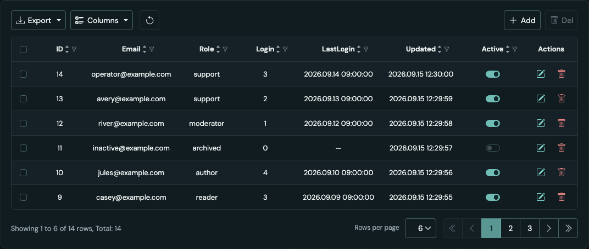

## 目錄

1. [套件結構與資料流程](#1-套件結構與資料流程)
2. [快速開始：完整 API 範例](#2-快速開始完整-api-範例)
3. [DataTable props](#3-datatable-props)
4. [Column、value 與 render](#4-columnvalue-與-render)
5. [Row data：checkbox、switch、toggle、button](#5-row-datacheckboxswitchtogglebutton)
6. [排序與 Columns](#6-排序與-columns)
7. [Filter 型別與日曆](#7-filter-型別與日曆)
8. [Dropdown list filter 與樣式切換](#8-dropdown-list-filter-與樣式切換)
9. [Filter 契約、URL 與後端](#9-filter-契約url-與後端)
10. [分頁、Total 與本頁選取](#10-分頁total-與本頁選取)
11. [Toolbar 與 Actions](#11-toolbar-與-actions)
12. [Details、InlineField／Save 與刪除確認](#12-detailsinlinefieldsave-與刪除確認)
13. [Export](#13-export)
14. [Loading、Empty、Error／Retry](#14-loadingemptyerrorretry)
15. [文案與多語系](#15-文案與多語系)
16. [主題、圖示與 RWD](#16-主題圖示與-rwd)
17. [常見問題](#17-常見問題)
18. [驗證與延伸閱讀](#18-驗證與延伸閱讀)

## 1. 套件結構與資料流程

| 模組                                                             | 責任                                                    |
| ---------------------------------------------------------------- | ------------------------------------------------------- |
| [DataTable.tsx](DataTable.tsx)                                   | 表格、欄位顯示、排序控制、選取、分頁、匯出與狀態        |
| [DataTable.module.css](DataTable.module.css)                     | 置中、ellipsis、自然高度、單一底線、toolbar 與 RWD      |
| [DataTableColumnMenu.tsx](DataTableColumnMenu.tsx)               | 每欄的文字／數值／日期／布林／enum Filter 與底部排序    |
| [DataTableColumnMenu.module.css](DataTableColumnMenu.module.css) | 浮動選單、彩色 chip、Filter 控件與緊湊排序間距          |
| [DataTableChoices.tsx](DataTableChoices.tsx)                     | 靜態／動態選項、搜尋、複選、Select／Deselect 與取消載入 |
| [BooleanCell.tsx](BooleanCell.tsx)                               | 共用唯讀 checkbox／switch，含 null 與狀態說明           |
| [WarningModal.tsx](WarningModal.tsx)                             | 共用警告／確認 modal，可組成刪除確認                    |
| [useDataTableQuery.ts](../hooks/useDataTableQuery.ts)            | React Router URL controller 與 selection scope          |
| [table-query.ts](../lib/table-query.ts)                          | 查詢狀態、URL 讀寫與正規化                              |
| [table-filter.ts](../lib/table-filter.ts)                        | Filter 型別、允許運算子、驗證與上限                     |
| [table-export.ts](../lib/table-export.ts)                        | CSV、TSV、XLSX、列印 HTML 的純資料轉換                  |
| [table-copy.ts](../../i18n/table-copy.ts)                        | 應用程式的三語文案 adapter，由頁面注入                  |

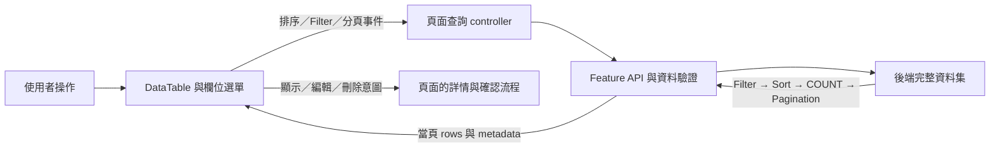

共享 UI 不引用 management、auth 或 i18n feature。`rowActions`、`toolbar` 與 `render` 是組合入口，其他頁面無須複製整張表格。

| 功能                                 | DataTable 提供             | owner 負責                                 |
| ------------------------------------ | -------------------------- | ------------------------------------------ |
| 置中、ellipsis、自然高度、RWD        | ✓                          | 自訂 renderer 的內容                       |
| 三欄排序、分頁與逐欄 Filter          | UI 與事件                  | API 執行完整查詢、COUNT 與排序             |
| Columns 顯示／隱藏                   | 本地呈現狀態               | 用 key 區隔不同表格                        |
| 資料列選取                           | 傳 selection 即啟用        | 狀態與何時清除                             |
| Copy／Excel／CSV／Print              | 傳 export 與匯出文案即啟用 | 可選的完整資料集載入                       |
| Add、Del、Refresh、Edit 與單筆刪除   | toolbar／rowActions 插槽   | 按鈕、權限、回呼與 modal                   |
| Details、InlineField／Save、刪除確認 | 不是 DataTable 內建 CRUD   | ManagementDetails／WarningModal 等頁面組合 |

目前三張管理表的 **Add、Save、Delete 是介面預覽**。Actions 使用 Edit icon 開啟可逐格編輯的詳情；Save 只確認視窗內的草稿，關閉重開恢復查詢資料。確認刪除只關閉 modal，沒有新增、更新或刪除 API 呼叫。

## 2. 快速開始：完整 API 範例

以下範例放在 **page 層**，重用既有 User API、URL controller、selection 與文案 adapter。AppProviders 已提供 Router、QueryClient、i18n 與全站樣式。

`enabled`／`accountId` 由已確認的 SESSION／權限流程提供；`onEdit` 由頁面開啟詳情。`Actions` 由 rowActions 新增，不要再放一個同名 column。

<!-- example: quickstart -->

```tsx
import { useTranslation } from 'react-i18next';
import type { Locale } from '@/i18n/config';
import { dataTableCopy } from '@/i18n/table-copy';
import {
  managementFilterSpecs,
  managementSortFields,
  useManagementList,
  type UserRow,
} from '@/features/management';
import { useDataTableQuery, useDataTableSelection } from '@/shared/hooks/useDataTableQuery';
import { DataTable, type DataTableColumn } from '@/shared/ui/DataTable';
import { Icon } from '@/shared/ui/Icon';
import styles from '@/pages/management/ManagementPage.module.css';

function utc(value: string) {
  return new Date(value).toISOString().slice(0, 19).replace('T', ' ').replaceAll('-', '.');
}

const columns: DataTableColumn<UserRow>[] = [
  {
    id: 'id',
    label: 'ID',
    value: (row) => row.id,
    hideable: false,
    sortable: true,
    filter: managementFilterSpecs.users.id,
  },
  {
    id: 'email',
    label: 'Email',
    value: (row) => row.email,
    sortable: true,
    truncate: false,
    filter: managementFilterSpecs.users.email,
  },
  {
    id: 'role',
    label: 'Role',
    value: (row) => row.role,
    sortable: true,
    filter: managementFilterSpecs.users.role,
  },
  {
    id: 'login_count',
    label: 'Login',
    value: (row) => row.login_count,
    sortable: true,
    filter: managementFilterSpecs.users.login_count,
  },
  {
    id: 'last_login',
    label: 'LastLogin',
    value: (row) => row.last_login,
    sortable: true,
    filter: managementFilterSpecs.users.last_login,
    render: (row) =>
      row.last_login ? <time dateTime={row.last_login}>{utc(row.last_login)}</time> : '—',
  },
  {
    id: 'updatetime',
    label: 'Updated',
    value: (row) => row.updatetime,
    sortable: true,
    filter: managementFilterSpecs.users.updatetime,
    render: (row) => <time dateTime={row.updatetime}>{utc(row.updatetime)}</time>,
  },
  {
    id: 'is_active',
    label: 'Active',
    value: (row) => row.is_active,
    sortable: true,
    filter: managementFilterSpecs.users.is_active,
  },
];

export function UsersTable({
  locale,
  accountId,
  enabled,
  onEdit,
}: {
  locale: Locale;
  accountId: number;
  enabled: boolean;
  onEdit: (row: UserRow) => void;
}) {
  const { t } = useTranslation();
  const controller = useDataTableQuery(managementSortFields.users, managementFilterSpecs.users);
  const { state } = controller;
  const query = useManagementList('users', state, locale, enabled, accountId);
  const selection = useDataTableSelection(`${accountId}/${locale}/${JSON.stringify(state)}`);
  const copy = dataTableCopy(t, t('accountMenu.userManagement'));
  const busy = !enabled || query.isFetching;

  return (
    <DataTable
      key={`users/${accountId}/${locale}`}
      columns={columns}
      rows={query.data?.items ?? []}
      rowKey={(row) => row.id}
      page={query.data ?? { page: state.page, size: state.size, total: 0, pages: 0 }}
      sort={state.sort}
      onSortChange={controller.onSortChange}
      filters={state.filters}
      onFiltersChange={controller.onFiltersChange}
      onPageChange={controller.onPageChange}
      onSizeChange={controller.onSizeChange}
      loading={busy}
      error={query.isError}
      onRetry={() => void query.refetch()}
      selection={{
        ...selection,
        allLabel: t('management.selectAll'),
        rowLabel: (row) => t('management.selectRow', { name: row.email }),
      }}
      copy={copy}
      export={{ filename: `users-${locale}` }}
      toolbar={
        <button
          type="button"
          className="btn btn-outline-secondary btn-sm"
          aria-label={t('management.refresh')}
          title={t('management.refresh')}
          disabled={busy}
          onClick={() => void query.refetch()}
        >
          <Icon name="restart" />
        </button>
      }
      rowActions={(row) => (
        <button
          type="button"
          className={`btn btn-link btn-sm ${styles.tableAction} ${styles.editRow}`}
          value="edit"
          aria-label={t('management.editRow', { name: row.email })}
          title={t('management.editRow', { name: row.email })}
          disabled={busy || query.isError}
          onClick={() => onEdit(row)}
        ></button>
      )}
    />
  );
}
```

其他 API 使用相同的 DataTable 介面，更換 columns、rows 與資料來源即可。沒有 Router 時，可自行管理 `DataTableQueryState` 與 callbacks；排序、Filter、筆數改變時，owner 應將 page 重設為 1。

## 3. DataTable props

### 必填

| Prop         | 型別                              | 使用方式                             |
| ------------ | --------------------------------- | ------------------------------------ |
| columns      | `DataTableColumn<T>[]`            | 順序就是畫面順序                     |
| rows         | `T[]`                             | 已驗證的當頁資料                     |
| rowKey       | `(row: T) => string \| number`    | 穩定且唯一的 ID，不使用列索引        |
| page         | `{ page, size, total, pages }`    | API 的頁碼、每頁筆數、COUNT 與總頁數 |
| sort         | `DataTableSort[]`                 | 沒有指定排序時傳 `[]`                |
| onSortChange | `(sort: DataTableSort[]) => void` | 接收完整排序陣列                     |
| onPageChange | `(page: number) => void`          | 載入指定頁                           |
| onSizeChange | `(size: number) => void`          | 改筆數並回第一頁                     |
| copy         | `DataTableCopy`                   | 文案、動態標籤與無障礙名稱           |

### 選用

| Prop            | 預設／型別                | 使用方式                                         |
| --------------- | ------------------------- | ------------------------------------------------ |
| filters         | `[]`／`DataTableFilter[]` | 每欄一個條件，不同欄 AND 組合                    |
| onFiltersChange | callback                  | 與 column.filter 一起使用才出現 Filter icon      |
| selection       | `DataTableSelection<T>`   | 最左側的本頁選取／全選                           |
| rowActions      | `(row: T) => ReactNode`   | 在最後加 Actions 欄                              |
| toolbar         | `ReactNode`               | Refresh、Add、Del 與 owner 的其他操作            |
| export          | `DataTableExport<T>`      | filename 與可選 loadRows(signal)                 |
| loading         | `false`                   | 首次載入在表頭上方；已有資料時覆蓋表格，保留尺寸 |
| error           | `false`                   | 錯誤呈現，不自行清空已傳入的有效 rows            |
| onRetry         | `() => void`              | 有提供才顯示 Retry                               |
| maxHeight       | 可省略的 CSS 高度         | 如 `480`／`'60dvh'`，超過限制才內部垂直捲動      |

自訂 toolbar、render、rowActions 內的 disabled／權限由 owner 明確傳入，不會自動套到所有 ReactNode。

## 4. Column、value 與 render

| 屬性            | 說明                                                                  |
| --------------- | --------------------------------------------------------------------- |
| id              | 唯一 field ID；Sort／Filter 必須對應後端白名單                        |
| label           | 顯示名稱，優先使用清楚的單字，尊重指定名稱                            |
| value(row)      | `string \| number \| boolean \| null`；預設顯示、匯出與自動選項的資料 |
| render(row)     | 自訂 ReactNode；匯出仍取 value，不取 renderer                         |
| sortable        | 啟用表頭箭頭與選單排序                                                |
| filter          | 查詢型別與能力，與 renderer 分開                                      |
| filterStyle     | `'dropdown-list'`；省略使用標準型別 Filter                            |
| choices         | 自訂 options／load，覆寫自動選項來源                                  |
| menuLabel       | 同名欄位可指定不同的 accessible menu 名稱                             |
| hideable        | false 表示必要欄位，一定顯示                                          |
| initiallyHidden | 初始隱藏；hideable=false 優先                                         |
| truncate        | 字串預設單行省略；false 保留全文／換行                                |
| textWidth       | 預設字串 max-width，預設 180 CSS px                                   |

| value   | 預設畫面                                          |
| ------- | ------------------------------------------------- |
| string  | 一行文字；過長顯示 `…`，hover 原生 title 顯示全文 |
| number  | 數字，包含 0                                      |
| boolean | 唯讀 switch，false 為關閉                         |
| null    | `—`                                               |

`id` 與 `label` 可以不同，例如 `updatetime` 顯示為 Updated；不用改資料庫或 API 名稱。

```tsx
// 接到既有 columns；Item 是你自己的 row 型別。
const introColumn: DataTableColumn<Item> = {
  id: 'introduction',
  label: 'Introduction',
  value: (row) => row.introduction,
  textWidth: 240,
};

const descriptionColumn: DataTableColumn<Item> = {
  id: 'description',
  label: 'Description',
  value: (row) => row.description,
  truncate: false,
};
```

自訂 render 不會自動套用字串 ellipsis／title，請在自己的 wrapper 設定。不要在 `render(row)` 函式直接呼叫 Hook；有狀態的 cell 應封裝為 component，再回傳 `<YourCell row={row} />`。

`truncate` 按欄位設定，不影響其他欄位。上方 User 範例的 Email 使用 `truncate: false`，完整顯示 API 的登入信箱，空間不足時可換行；省略此設定的其他字串欄位仍使用預設單行省略。User 主表、Details 與列操作名稱都以 Email 識別，沒有額外生成的 Account 欄位。

## 5. Row data：checkbox、switch、toggle、button

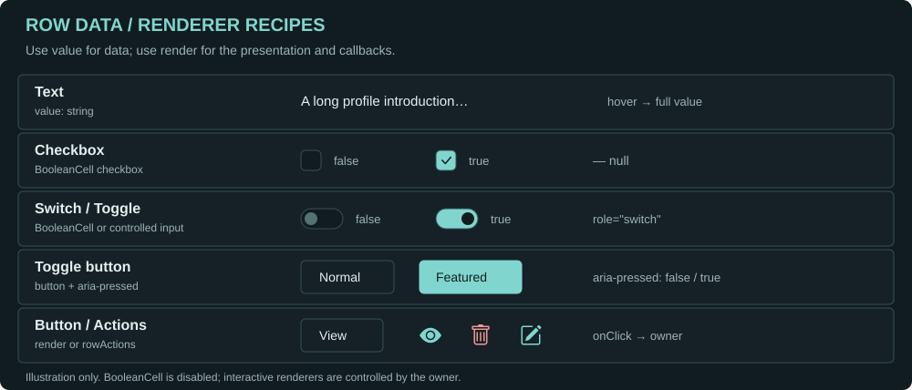

| 樣式            | 配置                                  | 行為                                  |
| --------------- | ------------------------------------- | ------------------------------------- |
| 一般文字／數字  | value                                 | 顯示資料                              |
| 唯讀 switch     | value 回傳 boolean                    | 自動使用 BooleanCell                  |
| 唯讀 checkbox   | render 回傳 BooleanCell，傳 checkbox  | disabled，只表示狀態                  |
| 可操作 checkbox | render：受控 input type=checkbox      | checked 來自 row，onChange 通知 owner |
| Switch／toggle  | form-check form-switch＋受控 checkbox | role=switch、onChange                 |
| Toggle button   | button＋aria-pressed                  | 狀態切換 class，onClick 通知 owner    |
| Button／link    | render 或 rowActions                  | onClick／href 由 owner 提供           |

switch／toggle 指滑動開關；toggle button 是按鈕的按下／未按下狀態，都不會自動更新後端。

### BooleanCell

```tsx
<BooleanCell
  value={row.approved} // boolean | null
  label="Approved"
  rowId={row.id}
  readonly="唯讀狀態" // 說明字串，不是 boolean prop
  checkbox // 省略時使用 switch
  unavailableReason="此資料尚未符合啟用條件" // 選用，由 owner 判斷
/>
```

BooleanCell 固定 disabled；null 顯示 `—`。unavailableReason 提供淡化呈現、title 與讀屏說明，不自行驗證業務條件。要互動時使用 render 注入受控控件。

### 完整自訂 cell 範例

這是其他 management 表的欄位配置範例。owner 提供 callbacks／pending，更新 rows 或執行 API；cell 不另外複製 row 狀態。

<!-- example: cells -->

```tsx
import type { DataTableColumn } from '@/shared/ui/DataTable';
import { BooleanCell } from '@/shared/ui/BooleanCell';

type Item = {
  id: number;
  account: string;
  approved: boolean | null;
  active: boolean;
  featured: boolean;
};

export function itemColumns({
  pending,
  onChange,
  onInspect,
}: {
  pending: ReadonlySet<number>;
  onChange: (id: number, field: 'active' | 'featured', value: boolean) => void;
  onInspect: (row: Item) => void;
}): DataTableColumn<Item>[] {
  return [
    { id: 'id', label: 'ID', value: (row) => row.id, hideable: false },
    {
      id: 'account',
      label: 'Account',
      value: (row) => row.account,
      render: (row) => (
        <button
          type="button"
          className="btn btn-link btn-sm"
          disabled={pending.has(row.id)}
          onClick={() => onInspect(row)}
        >
          {row.account}
        </button>
      ),
    },
    {
      id: 'approved',
      label: 'Approved',
      value: (row) => row.approved,
      filter: { type: 'boolean', nullable: true },
      render: (row) => (
        <BooleanCell
          value={row.approved}
          label="Approved"
          rowId={row.id}
          readonly="唯讀"
          checkbox
        />
      ),
    },
    {
      id: 'active',
      label: 'Active',
      value: (row) => row.active,
      filter: { type: 'boolean' },
      render: (row) => (
        <label
          className="form-check form-switch m-0 d-inline-flex align-items-center justify-content-center p-0"
          style={{ minWidth: 44, minHeight: 44 }}
        >
          <input
            className="form-check-input m-0"
            type="checkbox"
            role="switch"
            aria-label={`Active: ${row.account}`}
            checked={row.active}
            disabled={pending.has(row.id)}
            onChange={(event) => onChange(row.id, 'active', event.currentTarget.checked)}
          />
        </label>
      ),
    },
    {
      id: 'featured',
      label: 'Featured',
      value: (row) => row.featured,
      filter: { type: 'boolean' },
      render: (row) => (
        <button
          type="button"
          aria-pressed={row.featured}
          className={`btn btn-sm ${row.featured ? 'btn-success' : 'btn-outline-secondary'}`}
          disabled={pending.has(row.id)}
          onClick={() => onChange(row.id, 'featured', !row.featured)}
        >
          {row.featured ? 'Featured' : 'Normal'}
        </button>
      ),
    },
  ];
}
```

要將可操作 switch 改成 checkbox，移除 form-switch 與 role=switch 即可。使用 checked，不用 defaultChecked，讓 API 更新 rows 後狀態同步。這些欄位能否查詢，仍取決於後端 field／operator 白名單。

## 6. 排序與 Columns

### 排序

設定 `sortable: true`，表頭有 ↑／↓；該欄也有 Filter 選單時，底部使用同一套排序事件。

1. 點 ↑ 升序、↓ 降序；再點同方向取消該欄。
2. 最多三欄，依加入順序決定優先序，不需 Shift。
3. 改方向保留順位；取消後重加排在最後。
4. 第四欄不會替換前三欄。
5. Clear sorting 清除全部；選單 Clear sort 只清除該欄。

```ts
const sort = [
  { field: 'is_active', direction: 'desc' },
  { field: 'updatetime', direction: 'desc' },
] satisfies DataTableSort[];
```

sort=[] 表示前端未指定，DataTable 不自行排序 rows。現有三支 management GET 此時使用 **updatetime 降序**，同時間以 ID 升序穩定排序；這是後端規則，不是通用元件的預設。URL controller 在排序改變時回第一頁。

篩選條件、輸入框、Clear filter 與底部排序項目統一為桌面 32px／上下 padding 4px，窄螢幕／觸控保留至少 44px 點擊區。排序摘要顯示順位；loading 保留表頭的鍵盤焦點但阻擋排序事件。

### Columns

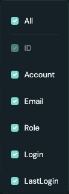

- columns 陣列決定欄位順序，沒有拖曳重排。
- hideable=false 固定顯示，建議用在 ID；initiallyHidden=true 初始隱藏。
- All 勾選顯示全部；取消只保留必要欄位，沒有必要欄位時保留一欄。
- 部分顯示時 All 為 indeterminate；All 固定於長選單頂部。
- 隱藏不發 API，不移除該欄已存在的 Sort／Filter。
- row selection／Actions 不列入 Columns。

選單依最長欄名自然決定寬度，受容器／viewport 限制；欄位標籤與表頭同為預設 13px。

## 7. Filter 型別與日曆

需要 **column.filter 與 onFiltersChange** 才顯示 Filter icon。filters 可省略為空陣列，但操作後仍應由 owner 保存新陣列。

| 型別     | 配置                                             | 選單能力                                                                           |
| -------- | ------------------------------------------------ | ---------------------------------------------------------------------------------- |
| 文字     | `{ type: 'text' }`                               | Contains、Does not contain、Equals、Does not equal、Starts、Ends、Empty、Not empty |
| 數字     | `{ type: 'number', integer: true }`              | Equals、不等於、大小比較與 Between；minimum／maximum 可限制值                      |
| 布林     | `{ type: 'boolean' }`                            | Equals／Does not equal，值為 All／Yes／No                                          |
| 日期     | `{ type: 'date' }`                               | Calendar；Equals、不等於、After、Before、Empty、Not empty                          |
| enum     | `{ type: 'enum', options: [...] }`               | 單選，value 與 label 分開                                                          |
| 彩色複選 | text／enum＋sets=true＋filterStyle=dropdown-list | 搜尋、Select(N)／Deselect(N)、chip、check、排序                                    |

number、boolean、enum 的 nullable=true 加入 Empty／Not empty。文字已有空值運算，日期選單固定提供空值運算。

| 文字                                            | 數字                                              | 布林                                               |
| ----------------------------------------------- | ------------------------------------------------- | -------------------------------------------------- |
| 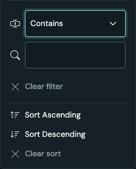 | 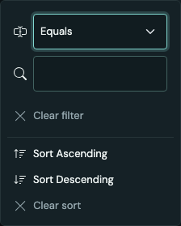 | 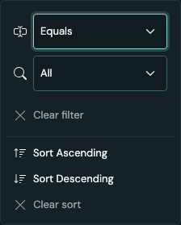 |

文字／數字輸入 debounce 300ms，Enter 立即套用。Between 要有上下界。false 與 0 是有效條件，不代表清除。

<!-- example: filter-specs -->

```ts
import type { DataTableFilterSpec } from '@/shared/lib/table-filter';

export const filterSpecs = {
  id: { type: 'number', integer: true, minimum: 1 },
  account: { type: 'text' },
  amount: { type: 'number', minimum: 0, maximum: 1_000_000 },
  active: { type: 'boolean', nullable: true },
  updatetime: { type: 'date' },
  role: {
    type: 'enum',
    sets: true,
    options: [
      { value: 'admin', label: '管理者' },
      { value: 'editor', label: '編輯者' },
    ],
  },
} satisfies Record<string, DataTableFilterSpec>;
```

宣告 UI 規格不會擴充 API 白名單；複選欄位必須在前後端都宣告 sets。Role／User 管理 API 的 role 均已支援 in／not_in。

### Calendar

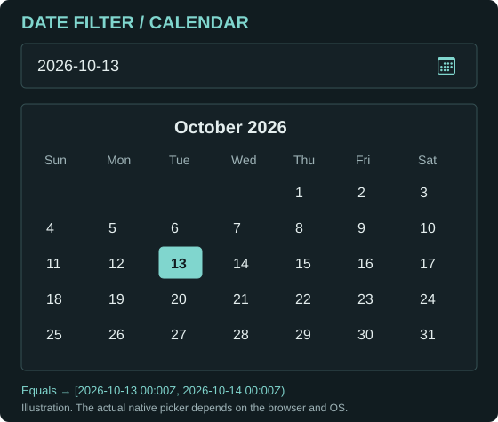

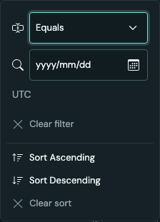

使用原生 input type=date，點擊可開 calendar。實際日曆外觀由瀏覽器／作業系統提供，示意圖不是另一個自訂元件。選定值傳 YYYY-MM-DD，不用輸入時分秒。

| UI             | Operator   | 現有 management API 的 UTC 語意 |
| -------------- | ---------- | ------------------------------- |
| Equals         | equals     | 當日 00:00 ≤ value < 次日 00:00 |
| Does not equal | not_equals | 排除該日與 null                 |
| After          | gt         | value ≥ 次日 00:00              |
| Before         | lt         | value < 當日 00:00              |
| Empty          | empty      | 空值                            |
| Not empty      | not_empty  | 非空值                          |

既有 ISO timestamp 條件仍可讀取。日期 Between 的舊契約仍可驗證／傳送，新的 calendar UI 只呈現上述六項。日曆可選範圍為 0001-01-01 至 9999-12-30，保留有效的次日邊界。畫面時間 YYYY.MM.DD HH:mm:ss 由 owner 的 UTC renderer 格式化，與 Filter 傳值分開。

## 8. Dropdown list filter 與樣式切換

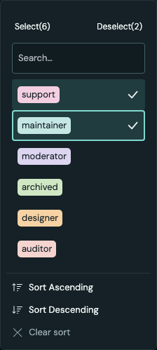

### A. 自動從已載入資料取選項：Role／User 管理的 Role 欄位

<!-- example: dropdown -->

```tsx
import type { RoleRow } from '@/features/management';
import type { DataTableColumn } from '@/shared/ui/DataTable';

export const roleColumn: DataTableColumn<RoleRow> = {
  id: 'role',
  label: 'Role',
  value: (row) => row.role,
  sortable: true,
  filter: { type: 'text', sets: true },
  filterStyle: 'dropdown-list',
};
```

- 從 value(row) 整理 DataTable **已載入**的字串，不另查其他頁。
- 略過 null／空字串；text 不分大小寫去重，enum 依 value 去重並使用 options 的 label。
- 同一個 mount 保留已出現選項，Filter／Sort 後不消失、不換色。
- 新值依序分配七色 pastel，超過七種循環使用，不把色碼寫進 row。
- Select(N) 的 N 是符合搜尋的選項數；Deselect(N) 是其中已選數，沒有搜尋時包含目前 predicate 的全部選取值。
- 搜尋只縮小選項清單，不發列表 API、不改表格結果。
- 未勾選代表不限制；勾選送 in；取消最後一個值清除條件。
- 搜尋中的批次操作保留搜尋外已選值；未搜尋時 Deselect 清除整欄條件，包含網址帶入但未載入的值。
- 批次操作後焦點回搜尋框，Escape 關閉並還原 trigger。
- 不出現 Condition／Values 或額外 Clear filter，底部直接放排序。

用 resource／account／locale 組成新 key，以清除不同資料範圍的舊選項，例如 `key={scope}`，scope 由 resource／account／locale 組成。

### B. 自訂靜態彩色選項

在同欄加入 choices 即覆寫 A 的來源：

```tsx
// 併入 roleColumn：
const coloredRoleColumn: DataTableColumn<RoleRow> = {
  ...roleColumn,
  choices: {
    colored: true,
    options: [
      { value: 'admin', label: 'Administrator', color: 'pink' },
      { value: 'editor', label: 'Editor', color: 'cyan' },
      { value: 'viewer', label: 'Viewer', color: 'violet' },
    ],
  },
};
```

color 可用 pink、cyan、violet、green、orange、red、blue。指定 color 固定每值的顏色；靜態來源未指定時依 value 雜湊選色，可能重複。自動已載入來源則依新值順序分配。choices 的 colored 省略／false 改為一般文字。

### C. 一般複選清單與 Condition／Values

保留 choices 與 text／enum 的 sets 能力，**省略 filterStyle**，即可在 Values／Condition 切換；colored=false 使用一般文字清單。

| 行為           | Dropdown list filter      | 一般 choices                 |
| -------------- | ------------------------- | ---------------------------- |
| 啟用           | filterStyle=dropdown-list | 傳 choices，省略 filterStyle |
| 來源           | 預設已載入 rows，可覆寫   | owner 提供                   |
| 無條件時 check | 全部不勾，資料不受限      | 全部勾選，資料不受限         |
| 取消全部       | 清除 Filter，還原資料     | 完整清單送 in=[]，零筆       |
| 全選           | in 限制為選取值           | 完整清單的 Select 清除條件   |
| 模式切換       | 無                        | Values／Condition            |
| 單欄清除       | Deselect 或工具列清除     | Clear filter                 |

一般 choices 的批次操作限目前搜尋／載入結果；動態來源未讀完時，不能把一頁視為完整選項集。

### D. 動態／分頁來源

<!-- example: choice-source -->

```ts
import type { DataTableChoicePage, DataTableChoicesSource } from '@/shared/ui/DataTableChoices';

export function choiceSource(
  read: (search: string, page: number, signal: AbortSignal) => Promise<DataTableChoicePage>,
): DataTableChoicesSource {
  return {
    colored: true,
    load: (search, page, signal) => read(search, page, signal),
  };
}
```

load 回 `{ items, page, pages, total }`，每個 item 需要 value／label。只在開啟時載入，搜尋 debounce 300ms，More 讀下一頁；關閉、來源／搜尋改變取消舊請求。錯誤提供 Retry。source 物件以 module 常數或 useMemo 保持穩定，避免重複載入。

目前 Role 使用 A，沒有額外讀取全部角色的選項 API。

## 9. Filter 契約、URL 與後端

```ts
const filters = [
  { field: 'email', operator: 'contains', value: 'alex' },
  { field: 'is_active', operator: 'equals', value: false },
  { field: 'login_count', operator: 'between', value: [0, 10] },
] satisfies DataTableFilter[];
```

| 條件                   | value                            |
| ---------------------- | -------------------------------- |
| empty／not_empty       | 不帶 value                       |
| 一般文字／比較／Equals | 單一 string／number／boolean     |
| between                | 兩個有順序的上下界               |
| in／not_in             | string[]，只允許 sets text／enum |

用 [parseTableFilters](../lib/table-filter.ts) 與 owner 的 specs 驗證：每欄一條件、文字最多 200 個 Unicode 字元、複選最多 tableFilterMaxValues=100；拒絕重複值、未知 field、錯誤型別、反向範圍。

現有 management 的文字比較不分大小寫，特殊字元如 % 依 literal 值處理，否定比較排除 null。in=[] 契約是零筆，移除 Filter 才是不受限；Dropdown list filter 在取消最後值時主動移除，不送空 in。

後端先在完整資料集 Filter／Sort，再 COUNT／Pagination。不要先取六列再在前端 filter／sort，會讓總筆數與跨頁結果錯誤。前端規格不會自動擴充後端白名單或授予權限。

`useDataTableQuery(sortable, fields, initialSize=6)` 讀寫 page／size／sort／filters；Back／Forward 還原提交條件。無效 URL 正規化，程式傳入 API 的無效值由 transport 拒絕。文字輸入用 Enter 立即提交，Filter／Sort／size 改變回第一頁。

## 10. 分頁、Total 與本頁選取

### 分頁與總筆數

```ts
const page = { page: 2, size: 6, total: 14, pages: 3 };
```

- 第一頁是 1，空結果可回 pages=0。
- total 是 API COUNT，pages 通常是 Math.ceil(total/size)。
- 筆數選項為 6、10、25、50、100，加上當前 size，數字置中、框寬自適應。
- 大量頁碼使用省略，保留第一頁、上一頁、鄰近頁、下一頁、最後一頁。
- loading／邊界停用對應按鈕，不預抓中間頁。

range(from,to,total,selected) 產生左下角文案：

```text
Showing 1 to 6 of 14 rows, Total: 14, 2 rows selected
```

兩處筆數都取 page.total，是目前查詢條件下的 API 總筆數。若還要未篩選的全資料庫總筆數，owner 另取資料並在 range closure 組合；沒有 globalTotal prop。空頁 from／to 是 0。

### 選取

```tsx
const scope = `${resource}/${accountId}/${locale}/${JSON.stringify(state)}`;
const selected = useDataTableSelection(scope);

// 傳入 DataTable：
<DataTable
  {...tableProps}
  selection={{
    ...selected,
    allLabel: '選取本頁全部資料',
    rowLabel: (row) => `選取 ${row.account}`,
  }}
/>;
```

這是 row selection，不是 row data 中的 approved／active。下列插槽範例的 `tableProps` 代表原本的 DataTable 必填配置，其他未宣告的變數／回呼由 owner 提供。

- 全選只涵蓋本頁 rows，不是全部資料庫結果。
- 部分選取呈現原生 indeterminate；計數只包含本頁存在的 keys。
- 空頁停用表頭；loading／error 停用資料列選取。
- 選取欄不列入 Columns 或 export。
- scope 改變即清空，應含 resource、account、locale 與 query。

批次目標用 `rows.filter(row => selected.keys.includes(row.id))`；不要把六筆全選當十四筆全選。

## 11. Toolbar 與 Actions

內建 Export／Columns 在左側；toolbar 可放 Refresh、Add、Del。用 flex＋margin-left:auto 將 action group 靠右，窄容器允許換行。

```tsx
// owner 的插槽範例；busy、回呼與 selectedRows 由頁面提供。
<DataTable
  {...tableProps}
  toolbar={
    <div className="d-flex flex-wrap align-items-center gap-2 w-100">
      <button
        type="button"
        className="btn btn-outline-secondary btn-sm"
        aria-label="Refresh"
        title="Refresh"
        disabled={busy}
        onClick={onRefresh}
      >
        <Icon name="restart" />
      </button>
      <div className="ms-auto d-flex gap-2">
        <button
          type="button"
          className="btn btn-outline-secondary btn-sm"
          disabled={busy}
          onClick={onAdd}
        >
          <Icon name="plus" /> Add
        </button>
        <button
          type="button"
          className="btn btn-outline-secondary btn-sm"
          aria-label="Delete"
          title="Delete"
          disabled={busy || selectedRows.length === 0}
          onClick={() => openDelete(selectedRows)}
        >
          <span className={styles.trash} aria-hidden="true" /> Del
        </button>
      </div>
    </div>
  }
/>
```

Refresh 只顯示 icon，保留 aria-label／title。現有 Add 保留 UI，Del 開 WarningModal；一般 API 行為由 owner 提供。

```tsx
<DataTable
  {...tableProps}
  rowActions={(row) => (
    <div className="d-inline-flex align-items-center gap-1">
      <button
        type="button"
        className={`btn btn-link btn-sm ${styles.tableAction} ${styles.editRow}`}
        value="edit"
        disabled={busy}
        aria-label={`編輯 ${row.account}`}
        title={`編輯 ${row.account}`}
        onClick={() => onEdit(row)}
      />
      <button
        type="button"
        className="btn btn-link btn-sm"
        disabled={busy}
        aria-label={`刪除 ${row.account}`}
        title={`刪除 ${row.account}`}
        onClick={() => openDelete([row])}
      >
        <span className={styles.trash} aria-hidden="true" />
      </button>
    </div>
  )}
/>
```

trash 用 Bootstrap CSS mask，不傳不存在的 IconName：

```css
/* owner 的 CSS module */
.trash {
  display: inline-block;
  width: 16px;
  height: 16px;
  background: currentColor;
  mask: url('bootstrap-icons/icons/trash.svg?no-inline') center / contain no-repeat;
}
```

自訂按鈕均加 type=button，避免在 form 中誤提交；owner 判斷權限、loading／error 與 disabled。現有 toolbar Del 預設中性，只在 hover／focus 高亮刪除色；單筆 trash 與危險確認按鈕使用刪除語意色。

## 12. Details、InlineField／Save 與刪除確認

| Details                                                   | 刪除確認                                                                |
| --------------------------------------------------------- | ----------------------------------------------------------------------- |
| 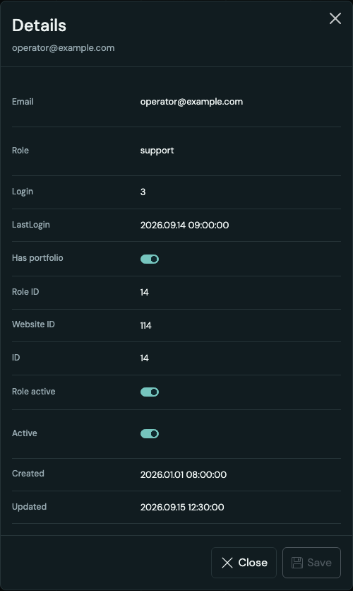 | 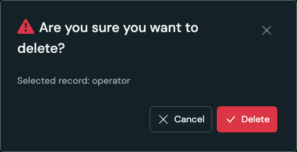 |

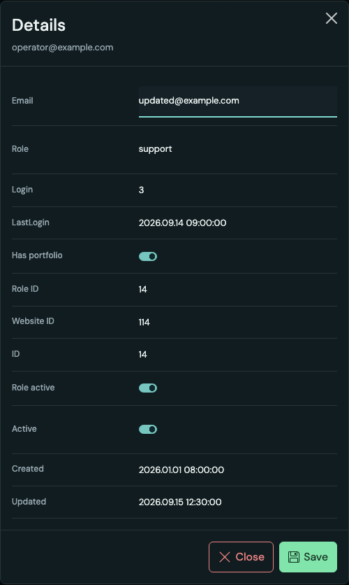

現有 [ManagementDetails](../../pages/management/components/ManagementDetails.tsx) 接收 row、columns、name、copy={title,close,field} 與 onClose；field 使用 InlineFieldCopy 注入逐格編輯文案：

- 欄名／值／checkbox／switch 全部靠左；footer 靠右，Close 有 icon。
- 可用另一組完整 columns，無須把所有資料放進列表。
- 三張管理表的詳情順序集中於 `model/management-view.ts` 的 `fields`：Platform 先基本資料／品牌內容，再聯絡社群、聊天、頁尾與發布設定；Role 先名稱／描述，再預設與權限；User 先 Email／Role。唯讀資訊接在可編輯欄位後，Active／Created／Updated 固定為最後三項；User 的 Role active 緊接在 Active 前。
- Actions 的 Edit icon 開啟詳情；文字值點選後直接編輯，checkbox／switch 直接切換。
- 它屬於 management page，不是 DataTable prop 或資料編輯引擎。
- Save 初始灰色停用；值與草稿基準不同時亮綠、Close 變紅。還原所有值後恢復初始狀態。無效值不能 Save。
- Save 暫時只更新視窗內的草稿基準，不更動 query cache、不送 API；關閉重開使用原查詢資料。
- ID、時間、登入次數、角色帳號數、角色啟用／作品集／翻譯存在狀態、語言 context 與組合的 Profile name 都是唯讀；不存在的網站／語言資料也保持唯讀，不能把 JOIN 的 null 當成可清空的實體欄位。
- `ManagementDetailColumn<T>` 在 DataTableColumn 上加入 `editor(row)`；`model/management-edit.ts` 統一配置型別、既有 schema 驗證與唯讀欄位。共享 `InlineField` 不引用 management。

```tsx
import { useState } from 'react';
import { InlineField, type InlineFieldValue } from '@/shared/ui/InlineField';

function EditableEmail() {
  const [email, setEmail] = useState<InlineFieldValue>('person@example.com');
  return (
    <InlineField
      label="Email"
      value={email}
      onChange={setEmail}
      editor={{ type: 'email', maxLength: 254 }}
      copy={{
        edit: (label) => `Edit ${label}`,
        clear: (label) => `Clear ${label}`,
        invalid: 'Invalid value',
        empty: '—',
      }}
    />
  );
}
```

可用 type：text、email、url、number、multiline、boolean；布林預設 switch，`checkbox: true` 改 checkbox。`nullable: true` 支援 null，nullable 布林提供 Clear；validate 由 owner 注入，不在共享元件猜測業務規則。單行 Enter／多行 Ctrl+Enter 完成該格；Escape 還原該格，Tab／點選別處完成；Save 的 dirty／valid 狀態與持久化由視窗 owner 擁有。

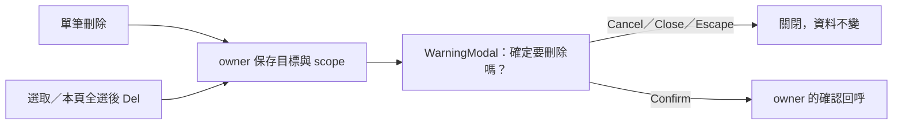

完整確認範例只發出意圖，不把 API 寫死在 modal：

<!-- example: delete-dialog -->

```tsx
import WarningModal from '@/shared/ui/WarningModal';

type Target = { id: number; account: string };

export function DeleteDialog({
  targets,
  onCancel,
  onConfirm,
}: {
  targets: Target[];
  onCancel: () => void;
  onConfirm: (targets: Target[]) => void;
}) {
  if (targets.length === 0) return null;
  return (
    <WarningModal
      title="確定要刪除嗎？"
      message={
        targets.length === 1
          ? `選取的資料：${targets[0]!.account}`
          : `選取的資料：${targets.length} 筆`
      }
      closeLabel="Close"
      onClose={onCancel}
      confirm={{
        label: 'Confirm',
        cancelLabel: 'Cancel',
        variant: 'danger',
        onConfirm: () => onConfirm(targets),
      }}
    />
  );
}
```

確認窗有 warning icon、初始 Cancel 焦點、Tab 邊界與 Escape／關閉後焦點還原。owner 在換 query／帳號／資源時清除舊目標；現有管理頁 Confirm 只關閉 modal。

## 13. Export

```tsx
// dataTableCopy 已提供 copy.export。
<DataTable {...tableProps} export={{ filename: 'users-zh-Hant' }} />
```

| 操作  | 格式                                        |
| ----- | ------------------------------------------- |
| Copy  | 含欄名的 TSV，使用 Clipboard API            |
| Excel | 真正 .xlsx，不是改副檔名的 CSV              |
| CSV   | UTF-8 BOM、引號與換行 escaping              |
| Print | 轉義的獨立 HTML，以暫存 iframe 呼叫原生列印 |

預設匯出 **本頁＋目前可見資料欄**。不含 selection／Actions，取 value 而非 React renderer；長字串保留全文、boolean 保留值、null 為空 cell。文字輸出處理試算表公式起始字元，列印不插入 row 的原始 HTML。

需同時提供 export 與 copy.export 才有 Export。loading／error／匯出中停用；空 rows 且沒有 loadRows 也停用。成功／錯誤狀態使用注入文案。

### 匯出所有符合條件的資料

這是選用能力，不是目前管理頁預設。owner 顯式注入 `loadRows(signal): Promise<T[]>`，並同步改 copy.export.scope，不能載入全結果卻仍寫「本頁」。

<!-- example: export-source -->

```ts
import type { DataTableExport } from '@/shared/ui/DataTable';

export function allRowsExport<T>(
  readPage: (page: number, signal: AbortSignal) => Promise<{ items: T[]; pages: number }>,
): DataTableExport<T> {
  return {
    filename: 'filtered-records',
    loadRows: async (signal) => {
      const rows: T[] = [];
      let pages = 1;
      for (let page = 1; page <= pages; page++) {
        signal.throwIfAborted();
        const result = await readPage(page, signal);
        rows.push(...result.items);
        pages = result.pages;
      }
      return rows;
    },
  };
}
```

readPage 固定本次 Filter／Sort／權限範圍，驗證回應並傳遞 AbortSignal。按下匯出才讀取，卸載取消；大型結果可由 owner 使用後端匯出服務。

## 14. Loading、Empty、Error／Retry

換頁時，owner 應保留上一筆成功查詢的 rows 與分頁 metadata，並傳入 `loading=true`。目前 `useManagementList` 使用 TanStack Query 的 `placeholderData`，只在相同登入身份、resource 與 locale 內保留前頁；資料仍由 query cache 擁有，不另存一份 rows。共享 DataTable 保留排版、在上方覆蓋既有 LoadingIndicator，隱藏且停用舊列，避免空陣列造成先收縮再展開。新資料提交至 DOM 後，以 160ms 淡入顯示；reduced motion 直接顯示。新頁筆數不同時，依完成後的內容調整高度，沒有固定為最大頁高或全表預載。

| 狀態                       | 顯示與操作                                                                               |
| -------------------------- | ---------------------------------------------------------------------------------------- |
| loading=true，無 rows      | LoadingIndicator 在 toolbar／排序摘要下、表頭上方；結束收起，不留空白高度                |
| error=true，不在 loading   | alert 與 copy.error；有 onRetry 才有 Retry                                               |
| rows=[]，無 loading／error | copy.empty，from／to 為 0                                                                |
| 已有 rows 再讀取           | 保留傳入 rows 的排版尺寸，LoadingIndicator 覆蓋表格上方；舊內容暫時隱藏且 tbody 為 inert |

Filter 輸入在列表請求中可繼續編輯，owner 可取消舊請求。排序、分頁、匯出、選取依狀態限制；自訂操作由 owner 控制。

## 15. 文案與多語系

```tsx
const copy = dataTableCopy(t, 'User management');
const customCopy = {
  ...copy,
  actions: 'Actions',
  filter: { ...copy.filter, select: 'Select', deselect: 'Deselect' },
};
```

| DataTableCopy 群組 | 欄位                                                                      |
| ------------------ | ------------------------------------------------------------------------- |
| 名稱／狀態         | caption、loading、empty、error、retry、readonly、actions                  |
| 分頁／Columns      | rowsPerPage、pagination、first、previous、next、last、columns、allColumns |
| 排序               | sorting、clearSort、direction.asc／desc                                   |
| 動態函式           | range(from,to,total,selected)、pageLabel(page)、sortLabel(column,next)    |
| 選用名稱函式       | columnMenuLabel；也可用 column.menuLabel 區分同名欄                       |
| Filter             | 完整 DataTableFilterCopy                                                  |
| 匯出，選用         | export.label、copy、excel、csv、print、scope、busy、error、copied         |

sortLabel 的 next 是 asc／desc／none。Filter copy 包含 condition、value、from、to、all、yes、no、clearAll、clear、invalid、timezone、search、values、select／deselect、兩個 hint、noOptions、more、textMode／valueMode、三種排序文案、typeLabels、operators 與 dateOperators；見 [完整型別](DataTableColumnMenu.tsx)。

UI 不直接使用翻譯 Hook；page 注入 adapter。換 locale 使用新 key 重建本地 visibility／選項範圍。

## 16. 主題、圖示與 RWD

### 主題與字級

使用既有 tokens／Bootstrap。外層提供 data-bs-theme=light／dark；現有 mist 為 light，其餘主題為 dark。

| Token／入口                 | 用途                                                       |
| --------------------------- | ---------------------------------------------------------- |
| --table-font-size           | 表頭、Columns、Filter，預設 13px；Select／Deselect 為 12px |
| --panel／--panel2           | 表格、表頭、選單與輸入背景                                 |
| --text／--muted             | 主／次要文字                                               |
| --border／--control-border  | 外框、列分隔與控件                                         |
| --accent／--on-accent       | checkbox、switch、啟用條件與頁碼                           |
| --control-hover             | hover／選取高亮                                            |
| --field-error               | 錯誤與刪除語意色                                           |
| render／toolbar／rowActions | 個別內容樣式，不複製表格邏輯                               |

全站字級在 [tokens.css](../../styles/tokens.css) 調整。Filter menu portal 到 document.body，自訂 palette token 應放在全站 theme 範圍，不能只放局部 table wrapper。

chip 色彩在 [DataTableColumnMenu.module.css](DataTableColumnMenu.module.css) 的 `.chip[data-color='…']` 修改，維持深色文字對比；要換個別值的顏色，使用 DataTableChoice.color。

### 圖示

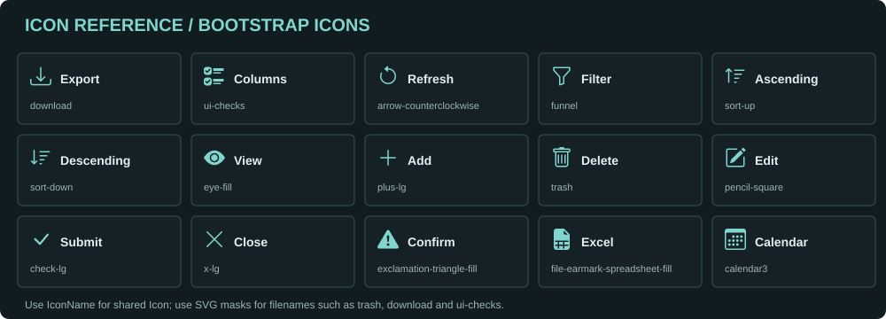

| 操作              | 現有圖示來源                                           |
| ----------------- | ------------------------------------------------------ |
| Export／Columns   | download／ui-checks CSS mask                           |
| Excel             | file-earmark-spreadsheet-fill CSS mask                 |
| 表頭 ↑／↓、Filter | Icon 的 caretUpFill／caretDownFill、funnel／funnelFill |
| 選單排序          | sort-up／sort-down CSS mask                            |
| Refresh／Close    | Icon 的 restart／close                                 |
| Add／警告         | Icon 的 plus／warning                                  |
| Save              | floppy CSS mask                                        |
| Delete／Edit      | trash／pencil-square CSS mask                          |

Bootstrap 檔名不一定是 IconName。目前 Icon 沒有 trash／download／floppy／pencil-square 名稱；使用現有 mask，或在 [Icon.tsx](Icon.tsx) 集中擴充再引用。Icon-only button 必須有 aria-label，裝飾圖示不能取代名稱。

圖例使用既有 Bootstrap Icons 的 SVG 形狀，附上 [MIT 授權文件](data-table-docs/LICENSE.bootstrap-icons.txt)。三張 SVG 圖例可直接修改；介面截圖應在 UI 更新時使用 synthetic fixtures 重新擷取。

### RWD 與長寬

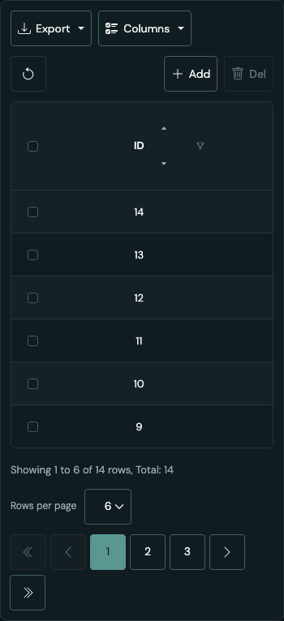

- 表頭／資料水平、垂直置中，標題中心對準值，圖示不推歪標題。
- 高度隨 rows 自然伸縮，不保留固定空白或強制捲軸。
- maxHeight 可選，超出才有內部垂直捲動。
- 最末列不重複畫底線，外框只有一條底邊。
- 寬表格只在自身 viewport 水平捲動，不撐寬整頁。
- 根節點是 data-table inline-size container，640px 以下 toolbar／footer／頁碼換行。
- 窄容器或 coarse pointer 的主要控制保留至少 44px 點擊區。
- Filter menu 依內容自適應，常規寬度 184–208px，viewport 左右至少 8px，短畫面可捲動。
- 外層 flex／grid item 允許 min-width:0，自訂 toolbar 避免固定大 min-width。

```css
/* owner 可重用 named container，無須另做手機表格。 */
.tablePanel {
  min-width: 0;
  max-width: 100%;
}
@container data-table (max-width: 640px) {
  .toolbarActions {
    flex-wrap: wrap;
  }
}
```

背景動畫由 page 組合共用 BackgroundField，DataTable 沒有另一個背景 controller。Settings 沿用主頁配色，導航由 account-menu 的 managementNavigation 統一排序。

## 17. 常見問題

| 現象                           | 調整                                                   |
| ------------------------------ | ------------------------------------------------------ |
| 沒有 Filter icon               | 同時提供 column.filter、onFiltersChange，檢查 ID       |
| 按排序但 row 不變              | owner 用新 sort 重新查完整資料來源                     |
| 日期像文字欄                   | filter 設 date；顯示格式用 render                      |
| checkbox／switch 不能點        | BooleanCell 是唯讀；互動用 render＋受控 callback       |
| 自訂 renderer 沒省略           | 自己加 ellipsis／title，textWidth 只套預設字串         |
| 匯出沒有 Actions／選取欄       | 兩者排除，資料欄 value 決定匯出                        |
| 匯出是原始時間／boolean        | render 不參與匯出，需另一格式時明確調整 value          |
| 新表保留舊欄位／選項           | resource／account／locale 用新 React key               |
| Dropdown Filter 後仍有多個選項 | 保留已出現值便於改選，不代表額外抓 API                 |
| Role 缺其他頁的值              | 目前只取已載入資料，其他來源顯式注入 choices           |
| 隱藏欄位還影響結果             | 隱藏不清條件，用 Clear sort／Clear filters             |
| 全選只有六筆                   | 是本頁，不是整個 API 資料集                            |
| 需要跨頁選取                   | 自訂 selection owner／scope，另設計目標資料與範圍      |
| 頁面多捲軸                     | 檢查父層 min-width／固定高度，不覆寫成 overflow:scroll |
| 筆數怪                         | total／pages 用 API COUNT，不能用 rows.length          |
| Save 沒有更新 API              | Save 只確認視窗內草稿，後端更新由 owner 後續接入       |

## 18. 驗證與延伸閱讀

維護時檢查三欄排序與取消、Filter 型別／UTC 日界、URL Back／Forward、selection scope、abort、匯出 escaping、錯誤／重試、焦點，以及手機／平板／桌面邊界。

```sh
# 在 frontend 執行：
npm run typecheck
npm run lint
npm run check:docs
```

- [共用組件總覽](../README.md#資料表--data-tables)
- [ManagementTable：三張表的 query／toolbar／Actions](../../pages/management/components/ManagementTable.tsx)
- [ManagementDetails：完整欄位與 InlineField／Save](../../pages/management/components/ManagementDetails.tsx)
- [Management feature：API／schema／白名單](../../features/management/index.ts)
- [Default 更新規則](../../../../docs/management-default-update.md)
- [Frontend 完整規格](../../../README.md)

新增功能時，先判斷應放在通用 column／copy／callback，還是 page／feature 的資料與業務流程；避免把帳號、角色名稱、權限或 API URL 寫進 DataTable。
